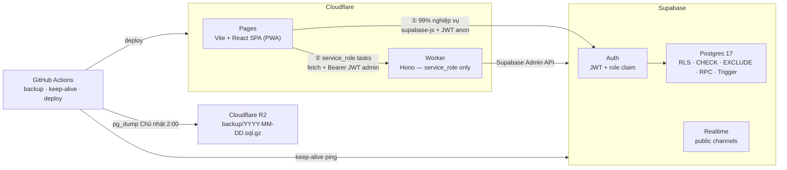
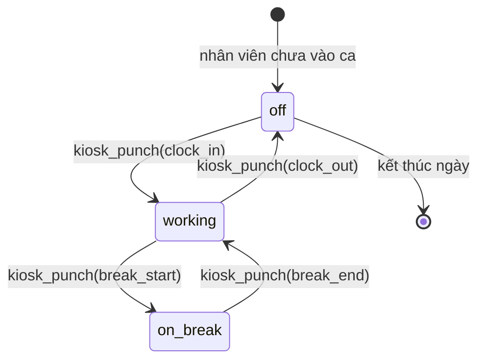

# Kiến trúc hệ thống chấm công

> **Mã nhân viên và đăng nhập:** `employees.employee_code` vẫn là `text`, bắt buộc NOT NULL/UNIQUE và khớp `^[1-9][0-9]{3,5}$` (4–6 chữ số, không bắt đầu bằng 0). Zod dùng cùng quy tắc. Worker tự sinh email Auth `<employeeCode>@staff.chamcong.invalid`; form tạo nhân viên không nhận email. Trang đăng nhập mặc định nhận mã nhân viên và mật khẩu, tự ánh xạ email bằng helper dùng chung; luồng email phụ vẫn hỗ trợ Admin tạo thủ công và Kiosk. Kiosk tra cứu bằng mã số, PIN độc lập với mã nhân viên.
>
> Khi mở modal tạo nhân viên, Admin gọi `GET /api/employees/next-code`; RPC `suggest_next_employee_code()` chỉ cho Admin đang hoạt động, trả `max(mã số)+1`, tối thiểu `1001`, tối đa `999999`. Gợi ý không giữ chỗ; UNIQUE và email Auth là chốt chặn khi tạo đồng thời, Worker trả `409 EMPLOYEE_CODE_CONFLICT` để giao diện lấy lại gợi ý, không tự tạo lại. Role tạo mới vẫn chỉ `employee/manager`.

> **Quản lý vai trò nhân sự:** Tài khoản Admin chỉ được tạo và thay đổi vai trò thủ công trong Supabase (tạo Auth user rồi tạo hồ sơ `employees` cùng ID). Form tạo nhân viên, Worker và RPC tạo hồ sơ chỉ nhận `employee` hoặc `manager`. Trigger `trg_employees_protect_admin_role` chặn tạo/xóa hồ sơ Admin và chuyển vai trò vào/ra Admin qua API `authenticated`; vẫn cho phép sửa chi nhánh chính/lương khi giữ nguyên vai trò Admin. Thao tác **Sửa nhân viên** dành cho Admin cho phép sửa chi nhánh chính và đổi `employee ↔ manager`; vai trò Admin hiển thị chỉ đọc. Vai trò nhân sự đọc từ `employees`, quyền quản lý chi nhánh vẫn phân công riêng qua `manager_branches`.

> **Cập nhật chi nhánh chính và xếp ca:** `employees.home_branch_id` là UUID nullable, tham chiếu `branches(id)` với `ON DELETE SET NULL` và có index. Admin chọn/sửa chi nhánh chính trong quản lý nhân viên và lọc nhân sự theo trường này. Schema/index nằm trong `0001_tables.sql` và `0002_constraints.sql`.
>
> Khi nhân viên đăng ký ca, giao diện chỉ hiển thị chi nhánh chính để đọc; database dùng trigger `trg_shifts_enforce_home_branch` gán chi nhánh chính cho ca tự đăng ký và báo `HOME_BRANCH_REQUIRED` nếu chưa phân công. Ca mẫu chỉ điền giờ. Chi nhánh của ca cũ không đổi khi hồ sơ nhân viên thay đổi. Khi duyệt, RPC `approve_shifts_at_branch(p_shift_ids, p_branch_id)` cho phép giữ nguyên hoặc chuyển chi nhánh trong cùng giao dịch; Manager phải quản lý cả nguồn và đích và không tự duyệt, Admin được duyệt mọi chi nhánh. Quyền Manager vẫn dựa trên `manager_branches`. Các hàm/trigger nằm trong `0004_functions.sql`;

> [!NOTE]
> Tài liệu này mô tả toàn bộ kiến trúc kỹ thuật của hệ thống chấm công. Một developer mới có thể đọc file này để hiểu hệ thống từ đầu đến cuối mà không cần tài liệu bổ sung.

---

## Mục lục

1. [Phạm vi và nguyên tắc nền](#1-phạm-vi-và-nguyên-tắc-nền)
2. [Sơ đồ hệ thống](#2-sơ-đồ-hệ-thống)
3. [Stack công nghệ](#3-stack-công-nghệ)
4. [Bảo mật](#4-bảo-mật)
5. [Thiết kế dữ liệu](#5-thiết-kế-dữ-liệu)
6. [Phân quyền](#6-phân-quyền)
7. [Luồng nghiệp vụ chính](#7-luồng-nghiệp-vụ-chính)
8. [Deployment & CI/CD](#8-deployment--cicd)
9. [Quy tắc tính lương](#9-quy-tắc-tính-lương)
10. [Cấu trúc thư mục](#10-cấu-trúc-thư-mục)
11. [Error Handling & Retry Strategy](#11-error-handling--retry-strategy)

---

## 1. Phạm vi và nguyên tắc nền

### 1.1 Phạm vi hệ thống

| Vai trò | Chức năng |
|---|---|
| **Nhân viên** | Đăng ký ca, xem lịch làm, chấm công tại iPad kiosk, xin nghỉ, xem bảng công & lương của mình, tự đổi mật khẩu / PIN |
| **Manager** | Trong chi nhánh mình phụ trách: xem lịch, duyệt ca, xem & sửa lượt chấm, xem ai đang trong ca, xem audit log |
| **Admin** | Toàn quyền: nhân sự, chi nhánh, iPad, đơn giá, ngày lễ, phụ cấp, duyệt bảng công, lương, xuất báo cáo |
| **iPad kiosk** | Đặt tại chi nhánh — nhận mã nhân viên + PIN → vào ca / bắt đầu nghỉ / kết thúc nghỉ / ra ca |
| **Hệ thống** | Tính giờ công + lương khi admin duyệt bảng công; backup hàng tuần |

### 1.2 Quy ước nghiệp vụ

- **Mã nhân viên** là duy nhất toàn hệ thống, không mang mã chi nhánh — nhân viên chuyển chi nhánh không cần đổi mã.
- **Chi nhánh** có mã dạng `CN001`, `CN002`, … Mỗi chi nhánh có 0, 1 hoặc nhiều manager. Không có manager thì admin quản lý trực tiếp.
- Mỗi chi nhánh có ≥ 1 iPad kiosk. Chỉ admin được thêm / thu hồi iPad.
- Nhân viên được chấm công ở **bất kỳ chi nhánh nào**; lượt chấm ghi nhận chi nhánh của iPad được dùng.
- Chấm công bắt buộc **online**. Không tính đi muộn / về sớm.
- Lương chỉ được tính sau khi admin **duyệt bảng công** của tháng: theo block 15 phút, tăng ca khi vượt 48 giờ/tuần, không có hệ số cuối tuần.

### 1.3 Nguyên tắc kiến trúc

| # | Nguyên tắc | Hệ quả thiết kế |
|---|---|---|
| 1 | **Logic nghiệp vụ nằm ở Postgres, không ở browser** | RLS + CHECK + RPC là tầng bảo vệ thật sự. Tính lương cũng là RPC |
| 2 | **CRUD thông thường gọi thẳng Supabase từ client** | Không viết REST API thừa, giảm egress tối đa |
| 3 | **Worker chỉ làm việc cần `service_role`** | 5 endpoint quản lý tài khoản & iPad, không cron |
| 4 | **Không đặt tác vụ nặng lên Worker** | Worker Free giới hạn 10 ms CPU. Excel sinh ra ở trình duyệt; backup chạy trên GitHub Actions |
| 5 | **Thời gian kiosk do server quyết định** | `kiosk_punch` dùng đồng hồ DB; chỉ RPC sửa lỗi của Manager được truyền `p_at` lịch sử, bắt buộc lý do và audit |
| 6 | **iPad là thiết bị được tin cậy; nhân viên chỉ xác minh** | iPad có phiên đăng nhập riêng (1 `auth.user` gắn với `devices`). Nhân viên nhập mã + PIN |

---

## 2. Sơ đồ hệ thống

### 2.1 Tổng quan hệ thống



### 2.2 State machine kiosk



### 2.3 Luồng tính lương


---

## 3. Stack công nghệ

### 3.1 Frontend — `apps/web` (Cloudflare Pages)

| Thành phần | Lựa chọn | Ghi chú |
|---|---|---|
| Build | Vite 6 | |
| UI | React 19 + TypeScript | |
| Routing | TanStack Router | Lazy-load từng khu vực |
| Data fetching | TanStack Query + `supabase-js` | |
| Lịch | FullCalendar 6 | Chỉ plugin MIT: `timeGrid`, `dayGrid`, `interaction` |
| UI kit | shadcn/ui + Tailwind CSS | |
| Form | React Hook Form + Zod | Dùng chung schema với Worker |
| Bảng | TanStack Table | |
| Excel | ExcelJS (lazy-load) | Nạp riêng khi xuất báo cáo; loại khỏi Workbox precache |
| PWA | `vite-plugin-pwa` | |

### 3.2 Backend — `apps/worker` (Cloudflare Worker)

| Thành phần | Lựa chọn | Ghi chú |
|---|---|---|
| Runtime | Cloudflare Worker (V8 isolate) | Giới hạn 10 ms CPU / request (Free tier) |
| Framework | Hono | Nhẹ, type-safe |
| Validate | Zod (qua `@hono/zod-validator`) | Dùng chung schema với FE |
| Vai trò | Chỉ gọi Supabase Admin API | Không xử lý logic nghiệp vụ |

**5 endpoint của Worker (đã có skeleton/implementation trong `apps/worker/src/index.ts`; cần integration test và deploy secrets):**

```
POST /api/employees              → tạo tài khoản nhân viên mới
POST /api/employees/:id/reset-password → cấp lại mật khẩu
POST /api/devices                → thêm iPad mới
POST /api/devices/pair           → ghép nối iPad với chi nhánh
POST /api/devices/:id/revoke     → thu hồi iPad
```

### 3.3 Database — `supabase/`

| Thành phần | Lựa chọn | Ghi chú |
|---|---|---|
| DB | Supabase Postgres 17 | |
| Auth | Supabase Auth (Email + mật khẩu) | |
| Bảo mật | RLS trên mọi bảng | Không có ngoại lệ |
| Hash PIN | `pgcrypto` `crypt()` + bcrypt | |

---

## 4. Bảo mật

### 4.1 JWT xác thực & Role Lookup

Supabase Auth phát JWT để xác thực danh tính; RLS không dùng `app_metadata.role` làm nguồn phân quyền chính. Hàm `private.my_role()` truy vấn trực tiếp `public.employees` theo `auth.uid()` và chỉ trả role của nhân viên đang hoạt động:

```sql
-- private schema, không lộ ra PostgREST API
CREATE OR REPLACE FUNCTION private.my_role()
RETURNS text
LANGUAGE sql
STABLE
SECURITY DEFINER
SET search_path = public, private, pg_temp
AS $$
  SELECT role
  FROM public.employees
  WHERE id = auth.uid()
    AND is_active = true;
$$;
```

> [!IMPORTANT]
> Tra cứu DB giúp đổi role hoặc vô hiệu hoá nhân viên (`is_active = false`) có hiệu lực ngay trong truy vấn kế tiếp, không chờ JWT hết hạn. Tài khoản iPad kiosk không có dòng trong `employees`, nên `private.my_role()` trả `NULL`.

Đây là lựa chọn về tính đúng đắn và thu hồi quyền, không phải cam kết nhanh hơn JWT. Hàm được đánh dấu `STABLE` và tra theo khóa chính `employees.id`, nên chi phí tra cứu là một index lookup nhỏ trong mỗi statement; cần đo trên workload thực tế nếu RLS được áp dụng cho truy vấn nhiều dòng.

### 4.2 Row Level Security (RLS)

- **Bật RLS trên tất cả các bảng** — kể cả các bảng mà client không bao giờ truy cập trực tiếp (ví dụ: `employee_pins`).
- Các bảng không cần client đọc (như `employee_pins`) được bật RLS **nhưng không có policy nào** → chỉ RPC `SECURITY DEFINER` mới đọc được.
- Mọi policy đều dùng hàm trong schema `private` để tránh lộ logic ra ngoài API.

### 4.3 PIN Lockout

Cơ chế chống brute-force PIN được cài đặt trong bảng `employee_pins`:

```sql
-- Cột liên quan trong employee_pins
pin_hash      text        NOT NULL,   -- bcrypt hash
pin_failed    int         NOT NULL DEFAULT 0,
pin_lock_until timestamptz,           -- NULL = không khoá
```

Logic trong RPC `kiosk_punch`:
1. Nếu `pin_lock_until > now()` → trả lỗi `PIN_LOCKED`.
2. Nếu PIN sai → `pin_failed = pin_failed + 1`.
3. Nếu `pin_failed >= 5` → `pin_lock_until = now() + interval '15 minutes'`.
4. Nếu PIN đúng → `pin_failed = 0`, `pin_lock_until = NULL`.

`kiosk_punch()` lấy khoá `FOR UPDATE` trên cả dòng `employees` và `employee_pins` trước khi đọc trạng thái/PIN. Vì vậy các request song song của cùng nhân viên được xử lý tuần tự; không request nào có thể cùng thấy một giá trị `pin_failed` cũ. Sau khi chờ khoá, hàm dùng `clock_timestamp()` và đặt lại bộ đếm từ 1 khi thời gian khoá trước đó đã hết.

### 4.4 CORS

Worker cấu hình CORS chỉ cho phép origin từ Cloudflare Pages:

```typescript
// apps/worker/src/index.ts
app.use('*', cors({
  origin: [
    'https://<project>.pages.dev',
    'https://<custom-domain>.com',
  ],
  allowMethods: ['GET', 'POST', 'PATCH', 'DELETE'],
  allowHeaders: ['Authorization', 'Content-Type'],
}));
```

### 4.5 Service Role Isolation

- `SUPABASE_SERVICE_ROLE_KEY` chỉ tồn tại trong Worker (Cloudflare Secrets) và GitHub Actions.
- Frontend **không bao giờ** nhận hoặc lưu `service_role` key.
- Worker validate `Authorization: Bearer <admin_jwt>` trước khi gọi Supabase Admin API — đảm bảo chỉ admin đã xác thực mới được gọi Worker.

```typescript
// apps/worker/src/lib/requireAdmin.ts
export async function requireAdmin(c: Context): Promise<void> {
  const jwt = c.req.header('Authorization')?.replace('Bearer ', '');
  const { data: { user }, error } = await supabase.auth.getUser(jwt);
  let employee: { role: string; is_active: boolean } | null = null;
  if (!error && user) {
    const result = await supabase
      .from('employees')
      .select('role, is_active')
      .eq('id', user.id)
      .maybeSingle();
    employee = result.data;
  }
  if (error || !user || employee?.role !== 'admin' || employee.is_active !== true) {
    throw new HTTPException(403, { message: 'Forbidden' });
  }
}
```

Worker cũng phải đọc role từ `employees`; nếu chỉ đọc `app_metadata.role`, Worker sẽ có thời gian hiệu lực khác với RLS khi admin bị hạ quyền hoặc vô hiệu hoá.

### 4.6 Device Pairing Security

Mã ghép nối iPad (`device_pairings`) chỉ lưu **hash** (SHA-256), dùng 1 lần, hết hạn sau 10 phút:

```sql
CREATE TABLE device_pairings (
  id          uuid PRIMARY KEY DEFAULT gen_random_uuid(),
  code_hash   text        NOT NULL UNIQUE,  -- SHA-256(plain_code)
  device_id   uuid        REFERENCES devices(id),
  expires_at  timestamptz NOT NULL DEFAULT now() + interval '10 minutes',
  used_at     timestamptz
);
```

---

## 5. Thiết kế dữ liệu

### 5.1 Quan hệ tổng thể

```
auth.users ──┬── employees ──┬── employee_pins
             │               ├── shifts          (branch_id, during tstzrange)
             │               ├── punches         (branch_id, device_id)
             │               ├── leave_requests
             │               ├── monthly_allowances (period_id)
             │               └── payroll         (period_id)
             │
             └── devices ──── branches ──── manager_branches ──── employees

payroll_periods  ← kỳ lương theo tháng (open → approved)
device_pairings  ← mã ghép nối iPad (dùng 1 lần, hết hạn 10 phút)
audit_log        ← ai làm gì, lúc nào, ở chi nhánh nào
holidays         ← ngày lễ, tết (hệ số 200%)
shift_templates  ← ca sáng / chiều / đêm mẫu
```

### 5.2 Bảng chính

| Bảng | Vai trò | Ghi chú quan trọng |
|---|---|---|
| `branches` | Chi nhánh | `code` UNIQUE (`CN001`, `CN002`, …) |
| `employees` | Profile + lương | 1-1 với `auth.users`. `employee_code` UNIQUE toàn hệ thống. `fixed_allowance` = phụ cấp cố định VND/tháng, mặc định 0 |
| `employee_pins` | Hash PIN + đếm sai | `pin_hash`, `pin_failed`, `pin_lock_until`. RLS bật, không có policy → chỉ RPC `SECURITY DEFINER` đọc được |
| `manager_branches` | Manager ↔ Chi nhánh | N-N. Chi nhánh có thể không có manager |
| `devices` | iPad kiosk | 1-1 với một `auth.user` riêng (không có dòng trong `employees`). `branch_id` đổi được; `revoked_at` để thu hồi tức thì |
| `device_pairings` | Mã ghép nối iPad | Chỉ lưu hash, dùng 1 lần, hết hạn 10 phút |
| `shifts` | Ca đăng ký (kế hoạch) | `branch_id` + `during tstzrange` + EXCLUDE. `start_at`, `end_at` là cột sinh từ `during` để lọc theo giờ. Không dùng để tính lương |
| `punches` | Lượt chấm thực tế | `type`: `clock_in`, `break_start`, `break_end`, `clock_out`. Kiosk lấy `at` từ đồng hồ DB sau khi chờ khoá. `source`: `kiosk` hoặc `manual`. Không xoá, không update — sửa = void (`voided_at`) + thêm lượt mới |
| `payroll_periods` | Kỳ lương theo tháng | `open` → `approved`. Đã duyệt thì trigger khoá `punches` và `monthly_allowances` của tháng đó |
| `monthly_allowances` | SELECT của mình khi kỳ đã duyệt (`approved`) | ✗ | SELECT tất cả (`open` & `approved`); INSERT / UPDATE / DELETE khi kỳ còn `open` |
| `payroll` | Kết quả tính lương | Snapshot `hourly_rate`, `fixed_allowance` lúc duyệt + số phút theo 6 loại + tổng tiền. Client không ghi được; chỉ `approve_timesheet()` ghi |
| `audit_log` | Vết kiểm toán | Ghi bằng trigger chung `private.audit_row()` trên các bảng cấu hình; các RPC punch (`correct_punch`, `add_manual_punch`, `void_punch`) tự ghi cũ → mới, `branch_id`. Không ai sửa / xoá được |

### 5.3 Constraint cốt lõi

```sql
-- Mã nhân viên duy nhất trên toàn hệ thống, không phân biệt chi nhánh
ALTER TABLE employees
  ADD CONSTRAINT employee_code_unique UNIQUE (employee_code);

-- Một người không thể có 2 ca chồng giờ nhau, kể cả ở 2 chi nhánh khác nhau
ALTER TABLE shifts
  ADD CONSTRAINT no_overlap EXCLUDE USING gist (
    employee_id WITH =,
    during      WITH &&
  ) WHERE (status <> 'rejected');

-- Ca không quá 12 tiếng
ALTER TABLE shifts
  ADD CONSTRAINT max_12h
  CHECK (upper(during) - lower(during) <= interval '12 hours');

-- Lượt chấm thủ công bắt buộc có người sửa và lý do
ALTER TABLE punches
  ADD CONSTRAINT manual_needs_reason
  CHECK (source = 'kiosk' OR (created_by IS NOT NULL AND reason IS NOT NULL));

-- Phụ cấp cố định mặc định 0, không âm
ALTER TABLE employees
  ADD CONSTRAINT fixed_allowance_non_negative
  CHECK (fixed_allowance >= 0);

-- Phụ cấp tháng phải dương và có lý do
ALTER TABLE monthly_allowances
  ADD CONSTRAINT allowance_positive CHECK (amount > 0),
  ADD CONSTRAINT allowance_needs_reason CHECK (reason IS NOT NULL AND reason <> '');
```

### 5.4 RPC Functions

#### `kiosk_lookup(p_employee_code text)`

Trả về tên nhân viên và trạng thái hiện tại — dùng để iPad hiển thị thông tin trước khi nhân viên nhập PIN.

```sql
CREATE OR REPLACE FUNCTION public.kiosk_lookup(p_employee_code text)
  RETURNS json
  LANGUAGE plpgsql
  SECURITY DEFINER
  SET search_path = public, private, pg_temp
AS
$$
DECLARE
  v_emp  employees%ROWTYPE;
  v_state text;
BEGIN
  IF NOT EXISTS (SELECT 1 FROM devices
                 WHERE auth_user_id = auth.uid() AND revoked_at IS NULL) THEN
    RETURN json_build_object('error', 'DEVICE_REVOKED');
  END IF;
  SELECT * INTO v_emp FROM employees WHERE employee_code = p_employee_code;
  IF NOT FOUND THEN
    RETURN json_build_object('error', 'EMPLOYEE_NOT_FOUND');
  END IF;

  -- Trạng thái theo lượt chưa void mới nhất trên toàn hệ thống
  SELECT CASE
    WHEN type = 'clock_in'    THEN 'working'
    WHEN type = 'break_start' THEN 'on_break'
    WHEN type = 'break_end'   THEN 'working'
    WHEN type = 'clock_out'   THEN 'off'
    ELSE 'off'
  END INTO v_state
  FROM punches
  WHERE employee_id = v_emp.id AND voided_at IS NULL
  ORDER BY at DESC, id DESC LIMIT 1;

  RETURN json_build_object(
    'employee_id',   v_emp.id,
    'full_name',     v_emp.full_name,
    'current_state', COALESCE(v_state, 'off')
  );
END;
$$;
```

Nếu lượt chưa-void mới nhất là `clock_in`/`break_end` và đã quá 16 giờ, hoặc là
`break_start` đã quá 16 giờ, RPC trả thêm `warning` lần lượt là
`MISSING_CLOCK_OUT`/`MISSING_BREAK_END` và coi trạng thái kiosk là `off` để cho
phép vào ca mới. Đây không phải là tự động đóng ca: lượt cũ vẫn là dữ liệu lỗi
và phải được Manager xử lý trước khi duyệt lương.

#### `kiosk_punch(p_employee_code text, p_pin text, p_action text)`

Xác minh thiết bị, PIN và state machine trước khi ghi lượt chấm. Trả về JSON `{ok: true}` hoặc `{error: string}`. Khoá thiết bị được giữ đến cuối transaction, vì vậy thu hồi hoặc đổi chi nhánh chờ lượt đang xử lý. Mọi thao tác tạo hoặc void punch của cùng nhân viên phải khoá dòng `employees` trước khi đọc hoặc thay đổi punches; client không được ghi trực tiếp. PIN sai trả JSON để bộ đếm được commit, không dùng `RAISE` sau cập nhật.

Thứ tự lượt chấm được xác định bằng `at DESC, id DESC`. Nếu mốc mới không lớn hơn mốc cuối (ví dụ một lượt sửa có thời gian trong tương lai), trả `PUNCH_TIME_CONFLICT` để quản lý xử lý. Cần kiểm tra chuỗi dữ liệu lịch sử trước khi áp dụng quy tắc này.

```sql
CREATE OR REPLACE FUNCTION public.kiosk_punch(
  p_employee_code text,
  p_pin           text,
  p_action        text   -- 'clock_in' | 'break_start' | 'break_end' | 'clock_out'
)
  RETURNS json
  LANGUAGE plpgsql
  SECURITY DEFINER
  SET search_path = public, private, extensions, pg_temp
AS
$$
DECLARE
  v_emp    employees%ROWTYPE;
  v_pin    employee_pins%ROWTYPE;
  v_dev    devices%ROWTYPE;
  v_last_type text;
  v_last_at timestamptz;
  v_state text;
  v_at timestamptz;
  v_failed int;
BEGIN
  -- Xác thực và khoá thiết bị trước khi kiểm tra PIN.
  SELECT * INTO v_dev FROM devices
  WHERE auth_user_id = auth.uid() AND revoked_at IS NULL FOR SHARE;
  IF NOT FOUND THEN RETURN json_build_object('error', 'DEVICE_REVOKED'); END IF;

  -- Tuần tự hoá mọi thao tác punch của nhân viên trên các chi nhánh.
  SELECT * INTO v_emp FROM employees WHERE employee_code = p_employee_code FOR UPDATE;
  IF NOT FOUND THEN RETURN json_build_object('error', 'EMPLOYEE_NOT_FOUND'); END IF;

  -- 2. Lấy PIN record
  SELECT * INTO v_pin FROM employee_pins WHERE employee_id = v_emp.id FOR UPDATE;
  IF NOT FOUND THEN RETURN json_build_object('error', 'WRONG_PIN'); END IF;
  v_at := clock_timestamp();

  -- 3. Kiểm tra lockout
  IF v_pin.pin_lock_until IS NOT NULL AND v_pin.pin_lock_until > v_at THEN
    RETURN json_build_object('error', 'PIN_LOCKED',
      'unlock_at', v_pin.pin_lock_until);
  END IF;

  -- 4. Xác minh PIN
  IF p_pin IS NULL OR v_pin.pin_hash IS NULL OR extensions.crypt(p_pin, v_pin.pin_hash) <> v_pin.pin_hash THEN
    v_failed := CASE WHEN v_pin.pin_lock_until IS NOT NULL AND v_pin.pin_lock_until <= v_at
                     THEN 1 ELSE v_pin.pin_failed + 1 END;
    UPDATE employee_pins
    SET pin_failed    = v_failed,
        pin_lock_until = CASE WHEN v_failed >= 5
                              THEN v_at + interval '15 minutes' ELSE NULL END
    WHERE employee_id = v_emp.id;
    IF v_failed >= 5 THEN
      RETURN json_build_object('error', 'PIN_LOCKED', 'unlock_at', v_at + interval '15 minutes');
    END IF;
    RETURN json_build_object('error', 'WRONG_PIN', 'remaining_attempts', 5 - v_failed);
  END IF;

  -- 5. Reset failed counter
  UPDATE employee_pins
  SET pin_failed = 0, pin_lock_until = NULL
  WHERE employee_id = v_emp.id;

  -- Trạng thái được đọc sau khi khoá nhân viên; không lọc theo chi nhánh.
  SELECT type, at INTO v_last_type, v_last_at FROM punches
  WHERE employee_id = v_emp.id AND voided_at IS NULL
  ORDER BY at DESC, id DESC LIMIT 1;
  v_state := CASE v_last_type
    WHEN 'clock_in' THEN 'working' WHEN 'break_end' THEN 'working'
    WHEN 'break_start' THEN 'on_break' ELSE 'off' END;
  IF ((v_state = 'off' AND p_action = 'clock_in') OR
      (v_state = 'working' AND p_action IN ('break_start', 'clock_out')) OR
      (v_state = 'on_break' AND p_action = 'break_end')) IS NOT TRUE THEN
    RETURN json_build_object('error', 'INVALID_ACTION', 'current_state', v_state);
  END IF;

  -- Lấy thời gian sau khi chờ khoá và xác minh PIN.
  v_at := clock_timestamp();
  IF v_last_at IS NOT NULL AND v_at <= v_last_at THEN
    RETURN json_build_object('error', 'PUNCH_TIME_CONFLICT');
  END IF;
  INSERT INTO punches (employee_id, device_id, branch_id, type, at, source)
  VALUES (v_emp.id, v_dev.id, v_dev.branch_id, p_action, v_at, 'kiosk');

  RETURN json_build_object('ok', true, 'at', v_at);
END;
$$;
```

#### Sửa lỗi punch thủ công

`correct_punch()` chỉ sửa thời điểm của một lượt đã tồn tại. Hai RPC bổ sung xử
lý các lỗi vận hành không có `p_punch_id` hoặc cần huỷ lượt bấm nhầm:

- `add_manual_punch(p_employee_id, p_branch_id, p_type, p_at, p_reason)` thêm
  lượt `source = 'manual'`, bắt buộc lý do và ghi audit; Manager chỉ thao tác
  được trong chi nhánh mình phụ trách và không được sửa chính mình.
- `void_punch(p_punch_id, p_reason)` đánh dấu `voided_at`/`voided_by`, không xoá
  dữ liệu, bắt buộc lý do và ghi audit. Cả hai RPC khoá dòng nhân viên để
  không chạy đua với kiosk.

#### `approve_shifts(p_shift_ids uuid[])`

Manager / admin duyệt một hoặc nhiều ca cùng lúc.

```sql
CREATE OR REPLACE FUNCTION public.approve_shifts(p_shift_ids uuid[])
  RETURNS void
  LANGUAGE plpgsql
  SECURITY DEFINER
  SET search_path = public, private, pg_temp
AS
$$
BEGIN
  -- Kiểm tra quyền: phải là manager của chi nhánh hoặc admin
  IF private.my_role() NOT IN ('manager', 'admin') THEN
    RAISE EXCEPTION 'FORBIDDEN';
  END IF;

  UPDATE shifts
  SET status = 'approved', approved_by = auth.uid(), approved_at = now()
  WHERE id = ANY(p_shift_ids)
    AND (
      private.my_role() = 'admin'
      OR (
        branch_id = ANY(private.my_branches())
        AND employee_id <> auth.uid()
      )
    )
    AND status = 'pending';
END;
$$;
```

#### `correct_punch(p_punch_id uuid, p_new_at timestamptz, p_reason text)`

Sửa lượt chấm: void lượt cũ, tạo lượt mới, ghi audit log.

```sql
CREATE OR REPLACE FUNCTION public.correct_punch(
  p_punch_id uuid,
  p_new_at   timestamptz,
  p_reason   text
)
  RETURNS uuid
  LANGUAGE plpgsql
  SECURITY DEFINER
  SET search_path = public, private, pg_temp
AS
$$
DECLARE
  v_old  punches%ROWTYPE;
  v_new_id uuid;
BEGIN
  SELECT * INTO v_old FROM punches WHERE id = p_punch_id AND voided_at IS NULL;
  IF NOT FOUND THEN RAISE EXCEPTION 'PUNCH_NOT_FOUND'; END IF;

  -- Kiểm tra quyền
  IF private.my_role() NOT IN ('manager', 'admin') THEN
    RAISE EXCEPTION 'FORBIDDEN';
  END IF;
  IF private.my_role() = 'manager' AND v_old.employee_id = auth.uid() THEN
    RAISE EXCEPTION 'CANNOT_CORRECT_OWN_PUNCH';
  END IF;
  IF private.my_role() = 'manager'
     AND v_old.branch_id <> ALL(private.my_branches()) THEN
    RAISE EXCEPTION 'FORBIDDEN';
  END IF;

  -- Dùng cùng khoá với kiosk, rồi đọc lại vì một sửa đổi khác có thể đã hoàn tất.
  PERFORM 1 FROM employees WHERE id = v_old.employee_id FOR UPDATE;
  SELECT * INTO v_old FROM punches WHERE id = p_punch_id AND voided_at IS NULL;
  IF NOT FOUND THEN RAISE EXCEPTION 'PUNCH_NOT_FOUND'; END IF;
  -- Chỉ đổi thời gian trong khoảng giữa hai lượt lân cận, giữ thứ tự state machine.
  IF p_new_at IS NULL OR EXISTS (
    SELECT 1 FROM punches WHERE employee_id = v_old.employee_id
      AND voided_at IS NULL AND id <> p_punch_id AND (
        at = p_new_at OR at = v_old.at OR
        (at < v_old.at AND at >= p_new_at) OR
        (at > v_old.at AND at <= p_new_at)
      )
  ) THEN RAISE EXCEPTION 'OUT_OF_ORDER_CORRECTION'; END IF;

  -- Void lượt cũ
  UPDATE punches SET voided_at = now(), voided_by = auth.uid()
  WHERE id = p_punch_id;

  -- Tạo lượt mới
  INSERT INTO punches
    (employee_id, device_id, branch_id, type, at, source, created_by, reason, corrects_punch_id)
  VALUES
    (v_old.employee_id, v_old.device_id, v_old.branch_id,
     v_old.type, p_new_at, 'manual', auth.uid(), p_reason, p_punch_id)
  RETURNING id INTO v_new_id;

  -- Ghi audit log
  INSERT INTO audit_log (table_name, row_id, action, old_data, new_data, actor_id, branch_id)
  VALUES ('punches', p_punch_id, 'correct_punch',
          row_to_json(v_old), json_build_object('new_id', v_new_id, 'new_at', p_new_at, 'reason', p_reason),
          auth.uid(), v_old.branch_id);

  RETURN v_new_id;
END;
$$;
```

#### `preview_timesheet(p_period_id uuid, p_employee_id uuid DEFAULT NULL)`

Xem trước kết quả tính lương — không commit, không lock kỳ.
Admin có thể xem toàn bộ nhân viên trong kỳ hoặc một nhân viên cụ thể; nhân viên chỉ được gọi cho chính mình (`p_employee_id = auth.uid()`). Khi Admin gọi tổng quan (`p_employee_id IS NULL`), RPC trả về mảng JSON tóm tắt từng nhân viên (bao gồm `hourly_pay_subtotal`, phụ cấp, `total_salary`, 6 nhóm phút công) và **lược bỏ `block_details`** để giữ payload nhẹ. Khi truyền `p_employee_id` cụ thể, RPC trả thêm mảng `block_details` chi tiết từng block 15 phút (phục vụ cơ chế lazy-load trên giao diện `/admin/payroll/preview`).

Cả `preview_timesheet()` và `approve_timesheet()` đều uỷ quyền tính toán cho cùng một hàm nguồn chân lý `public.fn_calculate_payroll_base(p_period_id, p_employee_id)`. Các hàm hỗ trợ nội bộ (`public.fn_calculate_payroll_base`, `private.fn_find_orphaned_punches`) bị thu hồi quyền `EXECUTE` khỏi `PUBLIC`, `anon`, `authenticated`.

```sql
CREATE OR REPLACE FUNCTION public.preview_timesheet(
  p_period_id   uuid,
  p_employee_id uuid DEFAULT NULL
)
  RETURNS json
  LANGUAGE plpgsql
  STABLE
  SECURITY DEFINER
  SET search_path = public, private, pg_temp
AS
$$
DECLARE
  v_result json;
BEGIN
  IF NOT private.is_admin()
     AND p_employee_id IS DISTINCT FROM auth.uid() THEN
    RAISE EXCEPTION 'FORBIDDEN' USING ERRCODE = '42501';
  END IF;

  SELECT COALESCE(
    jsonb_agg(
      CASE
        WHEN p_employee_id IS NULL THEN to_jsonb(t) - 'block_details'
        ELSE to_jsonb(t)
      END
    )::json,
    '[]'::json
  )
  INTO v_result
  FROM public.fn_calculate_payroll_base(p_period_id, p_employee_id) t;

  RETURN v_result;
END;
$$;
```

#### `approve_timesheet(p_period_id uuid)`

Tính lương chính thức, lưu snapshot và khoá sổ kỳ lương trong cùng một DB transaction. Chỉ Admin được gọi.

```sql
CREATE OR REPLACE FUNCTION public.approve_timesheet(p_period_id uuid)
  RETURNS void
  LANGUAGE plpgsql
  SECURITY DEFINER
  SET search_path = public, private, pg_temp
AS
$$
DECLARE
  v_status  text;
  v_orphans json;
BEGIN
  IF NOT private.is_admin() THEN
    RAISE EXCEPTION 'FORBIDDEN' USING ERRCODE = '42501';
  END IF;

  -- Khoá dòng kỳ lương FOR UPDATE để tuần tự hoá với mọi thao tác ghi punches / monthly_allowances
  SELECT status INTO v_status
  FROM public.payroll_periods
  WHERE id = p_period_id
  FOR UPDATE;

  IF NOT FOUND THEN
    RAISE EXCEPTION 'PERIOD_NOT_FOUND' USING ERRCODE = 'P0002';
  END IF;
  IF v_status = 'approved' THEN
    RAISE EXCEPTION 'PERIOD_ALREADY_APPROVED' USING ERRCODE = 'P0001';
  END IF;

  v_orphans := private.fn_find_orphaned_punches(p_period_id, NULL);
  IF v_orphans IS NOT NULL THEN
    RAISE EXCEPTION 'ORPHANED_PUNCHES'
      USING ERRCODE = 'P0001', DETAIL = v_orphans::text;
  END IF;

  -- Ghi snapshot vào public.payroll từ fn_calculate_payroll_base(p_period_id, NULL)
  -- và chuyển payroll_periods.status = 'approved', approved_by = auth.uid(), approved_at = now()
END;
$$;
```

Trước khi tính hoặc chốt lương, `private.fn_find_orphaned_punches()` kiểm tra nghiêm ngặt toàn bộ chuỗi sự kiện chấm công (state machine) trong kỳ lương và phần tuần vắt từ tháng trước sang đầu tháng (`[v_lookback_start, v_end)`): mỗi phiên bắt buộc tuân theo trình tự `clock_in` → 0 hoặc nhiều cặp (`break_start` → `break_end`) → `clock_out`, thời gian các sự kiện phải tăng nghiêm ngặt (`next_at > at`), thời lượng phiên không vượt quá 24 giờ, và tổng số block nghỉ (mỗi lần nghỉ làm tròn lên bội số 15 phút) không được vượt quá tổng số block ca làm việc đã làm tròn (chống overdraw). Nếu phát hiện bất kỳ punch mồ côi, thiếu `clock_out`/`break_end`, sai trình tự hoặc vi phạm thời lượng nào, RPC dừng ngay với lỗi `ORPHANED_PUNCHES` (`ERRCODE = 'P0001'`) kèm mảng JSON chi tiết (`employee_id`, `employee_code`, `full_name`, `last_type`, `last_punch_at`) trong `DETAIL` để Manager/Admin xử lý bằng các RPC điều chỉnh trước khi duyệt. Vì vậy cơ chế cảnh báo 16 giờ ở kiosk chỉ giúp không kẹt ca ngày mới, tuyệt đối không làm lọt dữ liệu lỗi khi chốt lương.

---
---

## 6. Phân quyền

### 6.1 Role

- Role lưu ở cột `employees.role`.
- Chi nhánh của manager lưu ở bảng `manager_branches`.
- RLS đọc qua các hàm `private.my_role()`, `private.is_admin()`, `private.my_branches()` — schema `private` không lộ ra API.
- Đổi role, vô hiệu hoá nhân viên hoặc phân công có **hiệu lực ngay** ở RLS, không chờ JWT hết hạn; JWT chỉ xác định danh tính qua `auth.uid()`.
- iPad không có dòng trong `employees` → `my_role()` trả `NULL` → không qua được policy nào ngoài RPC kiosk.

| Role | Quyền |
|---|---|
| `employee` | Đọc / tạo dữ liệu của mình. Không đổi `status`. Không xem lương người khác |
| `manager` | Trong chi nhánh mình phụ trách: xem lịch, duyệt ca, xem & sửa lượt chấm, xem audit log. Không xem lương. Không tự duyệt / sửa dữ liệu của chính mình |
| `admin` | Toàn quyền |
| `kiosk` | Chỉ gọi được `kiosk_lookup`, `kiosk_punch` — không đọc được bảng nào |
| `service_role` | Chỉ Worker dùng để gọi Supabase Admin API |

> [!NOTE]
> Manager và admin cũng là nhân viên → có đủ quyền `employee` với dữ liệu của chính mình.

### 6.2 Ma trận RLS

| Bảng | `employee` | `manager` (chi nhánh mình) | `admin` |
|---|---|---|---|
| `shifts` | SELECT / INSERT của mình (pending, ca chưa bắt đầu); DELETE ca pending của mình | SELECT; duyệt qua `approve_shifts()` | Tất cả |
| `punches` | SELECT của mình | Sửa qua `correct_punch()`, `add_manual_punch()`, `void_punch()` | Tất cả |
| `payroll` | SELECT của mình khi kỳ đã duyệt | ✗ | SELECT; ghi qua `approve_timesheet()` |
| `monthly_allowances` | SELECT của mình khi kỳ đã duyệt (`approved`) | ✗ | SELECT tất cả (`open` & `approved`); INSERT / UPDATE / DELETE khi kỳ còn `open` |
| `employees` | SELECT của mình | Mã + tên qua `employee_directory()`, không thấy `hourly_rate`, `fixed_allowance` | Tất cả |
| `employee_pins` | ✗ | ✗ | ✗ — chỉ RPC |
| `devices` | ✗ | ✗ | SELECT; thêm / thu hồi qua Worker |
| `audit_log` | ✗ | SELECT | SELECT; chỉ trigger ghi |

---

## 7. Luồng nghiệp vụ chính

### 7.1 Đăng ký ca — Nhân viên (`/app`)

1. Nhân viên mở `/app/shifts` → FullCalendar hiển thị lịch làm của mình.
2. Nhấn vào ô ngày trống → form đăng ký ca: chọn `shift_template` (sáng / chiều / đêm) hoặc tùy chỉnh giờ.
3. Frontend validate: ca không quá 12 tiếng, không trùng ca đang `pending` / `approved`.
4. `supabase.from('shifts').insert(...)` → RLS cho phép nhân viên INSERT ca của mình.
5. Postgres kiểm tra `EXCLUDE no_overlap` — nếu trùng thì trả lỗi `23P01`.
6. Ca mới ở trạng thái `pending` → hiển thị màu khác trên lịch.
7. Nhân viên có thể DELETE ca `pending` chưa bắt đầu.

```
Nhân viên → INSERT shifts (pending)
         ← EXCLUDE kiểm tra trùng ca
         ← RLS kiểm tra employee_id = auth.uid()
Manager nhận Realtime push → hiển thị ca pending mới
```

### 7.2 Duyệt ca — Manager / Admin (`/admin/shifts`)

1. Manager mở `/admin/shifts` → xem tất cả ca `pending` trong chi nhánh mình.
2. Tích chọn một hoặc nhiều ca → nhấn **Duyệt** hoặc **Từ chối**.
3. Frontend gọi `supabase.rpc('approve_shifts', { p_shift_ids: [...] })`.
4. RPC kiểm tra role và chi nhánh → UPDATE `status = 'approved'` hoặc `'rejected'`.
5. Realtime đẩy cập nhật về FE của nhân viên.

> [!WARNING]
> Manager không được tự duyệt ca của chính mình. RPC kiểm tra `employee_id <> auth.uid()` khi role là `manager`.

### 7.3 Chấm công tại iPad kiosk

**Điều kiện tiên quyết:** iPad đã được ghép nối (`device_pairings`) và có phiên đăng nhập hợp lệ.

**Trạng thái nhân viên** tính theo toàn hệ thống (không phân biệt chi nhánh):
- Không thể vào ca ở 2 chi nhánh cùng lúc.
- Vào ca ở `CN001`, ra ca ở `CN002` vẫn hợp lệ.

**Quy trình:**

```
1. Nhân viên nhập mã NV trên iPad
2. iPad gọi kiosk_lookup(employee_code)
   → Hiển thị: tên, ảnh đại diện, trạng thái hiện tại (off / working / on_break)
   → Hiển thị 1 trong 4 nút: [Vào ca] [Bắt đầu nghỉ] [Kết thúc nghỉ] [Ra ca]
     (nút nào hợp lệ với trạng thái hiện tại thì bật sáng)

3. Nhân viên nhập PIN (4–6 số)
4. iPad gọi kiosk_punch(employee_code, pin, action)
   → Xác minh thiết bị, kiểm tra lockout và PIN (bcrypt)
   → Khoá theo nhân viên, kiểm tra state machine
   → Ghi punch với thời gian thực của DB
   → Trả về {ok: true, at: timestamp} hoặc {error: string}

5. iPad hiển thị kết quả 3 giây → về màn hình chờ
```

**Các lỗi có thể xảy ra:**

| Lỗi | Hiển thị |
|---|---|
| `EMPLOYEE_NOT_FOUND` | "Không tìm thấy mã nhân viên" |
| `WRONG_PIN` | "PIN không đúng (còn N lần)" |
| `PIN_LOCKED` | "PIN bị khoá đến HH:MM" |
| `INVALID_ACTION` | "Hành động không hợp lệ với trạng thái hiện tại" |
| `DEVICE_REVOKED` | "Thiết bị không hợp lệ hoặc đã bị thu hồi, liên hệ admin" |
| `PUNCH_TIME_CONFLICT` | "Không xác định được thứ tự lượt chấm, liên hệ quản lý" |

### 7.4 Xem & Sửa lượt chấm — Manager / Admin (`/admin/punches`)

1. Mở `/admin/punches` → bảng danh sách lượt chấm theo ngày / nhân viên / chi nhánh.
2. Lọc theo ngày, chi nhánh, nhân viên.
3. Nhấn **Sửa** bên cạnh lượt chấm → modal nhập:
   - Thời gian mới (`new_at`)
   - Lý do (`reason`)
4. Frontend gọi `supabase.rpc('correct_punch', { p_punch_id, p_new_at, p_reason })`.
5. RPC void lượt cũ (`voided_at = now()`) → tạo lượt mới với `source = 'manual'` → ghi `audit_log`.
6. Lượt bị void vẫn hiển thị với trạng thái "đã huỷ" (không xoá khỏi DB).

> [!CAUTION]
> Manager không được sửa lượt chấm của chính mình. Phải nhờ admin.

### 7.5 Duyệt bảng công & Tính lương — Admin (`/admin/payroll/*`)

1. Admin mở `/admin/payroll/settings` để cấu hình danh mục ngày nghỉ lễ (`holidays`, hệ số cố định 200% ngày / 230% đêm) và ca làm việc mẫu (`shift_templates`).
2. Admin mở `/admin/payroll/allowances` → tạo kỳ lương mới (`payroll_periods` ở trạng thái `open`) và nhập/xóa các khoản phụ cấp biến đổi theo tháng (`monthly_allowances`, bắt buộc số tiền nguyên dương và lý do).
3. Admin mở `/admin/payroll/preview` → chọn kỳ lương đang `open`:
   - Giao diện gọi `preview_timesheet(period_id)` (`p_employee_id = NULL`) để hiển thị bảng tổng hợp toàn công ty theo 6 nhóm phút công, `hourly_pay_subtotal`, phụ cấp cố định, phụ cấp tháng và `total_salary` (không tải sẵn `block_details`).
   - Khi nhấn **Xem chi tiết block** trên từng dòng nhân viên, giao diện gọi lazy-load `preview_timesheet(period_id, employee_id)` để hiển thị chi tiết từng phiên làm việc và từng block 15 phút.
   - Nếu còn chuỗi chấm công lỗi/treo, hệ thống hiển thị bảng cảnh báo chi tiết từ `ORPHANED_PUNCHES` kèm liên kết sang `/admin/punches` để xử lý.
4. Sau khi rà soát, Admin nhấn **Duyệt bảng công** → xác nhận trên modal cảnh báo không thể hoàn tác → gọi `approve_timesheet(period_id)`:
   - Khoá dòng `payroll_periods` (`FOR UPDATE`), kiểm tra lại điều kiện `ORPHANED_PUNCHES`.
   - Tính lương qua `fn_calculate_payroll_base(period_id, NULL)` và `INSERT ... ON CONFLICT DO UPDATE` vào bảng `payroll` (snapshot `hourly_rate_snapshot`, `fixed_allowance_snapshot`, 6 nhóm phút công, `total_allowance`, `total_salary`).
   - Cập nhật `payroll_periods.status = 'approved'`, `approved_by = auth.uid()`, `approved_at = now()` trong cùng transaction.
   - Các trigger `trg_punches_check_period` và `trg_monthly_allowances_check_period` luôn khoá `FOR UPDATE` dòng `payroll_periods` liên quan trước khi kiểm tra trạng thái, giúp tuần tự hoá hoàn toàn với `approve_timesheet()` và chặn mọi thao tác thêm/sửa/xoá `punches` hoặc `monthly_allowances` thuộc kỳ đã duyệt.
5. Admin tra cứu bảng lương chính thức và phiếu lương chi tiết (Payslip) tại `/admin/payroll/view`; nhân viên xem phiếu lương của mình tại `/app/payroll`.

> [!IMPORTANT]
> Quyền `UPDATE` trực tiếp trên bảng `payroll_periods` đã bị `REVOKE` khỏi `authenticated` (và không có RLS policy `UPDATE`), kết hợp cùng trigger `trg_payroll_periods_immutable`. Mọi sự chuyển trạng thái từ `open` sang `approved` bắt buộc phải đi qua RPC `approve_timesheet()`, và kỳ đã `approved` là bất biến tuyệt đối (không thể sửa hay xoá).
### 7.6 Xuất Excel — Admin (trình duyệt)

1. Admin mở `/admin/reports` (`apps/web/src/routes/admin/reports.tsx` — kiểm tra chặt `role === 'admin'`) → chọn chế độ báo cáo:
   - **Báo cáo Bảng lương tháng (`payroll`)**: truy vấn `payroll_periods` (`status = 'approved'`), `payroll`, `monthly_allowances`, `employees`, `branches`, và `punches` trong kỳ (để xác định các nhân viên có phát sinh chấm công tại chi nhánh được lọc). Cột *Lương theo giờ* chỉ được dẫn xuất phục vụ hiển thị từ `hourly_rate_snapshot` và 6 nhóm số phút đã duyệt; cột `total_salary` luôn giữ nguyên giá trị snapshot chính thức trong DB.
   - **Báo cáo Bảng chấm công chi tiết (`timesheet`)**: truy vấn `punches` (mở rộng lookback về Thứ Hai đầu tuần chứa ngày mùng 1 đầu tháng theo giờ VN và +24h cuối tháng; không lọc `branch_id` trước khi ghép phiên để không làm đứt các ca chấm liên chi nhánh) cùng bảng `holidays`. Hệ thống ghép phiên theo state machine (`clock_in` → `break_start`/`break_end` → `clock_out`), tích lũy ngưỡng 48 giờ/tuần (bao gồm các ca đầu tuần thuộc tháng trước nhưng chỉ kết xuất các phiên có `clock_in` trong tháng mục tiêu), tính tổng giờ thực tế ròng (`work_hours`) và giờ vượt ngưỡng 48h/tuần (`overtime_hours`), đồng thời gắn nhãn cảnh báo cho các phiên thiếu lượt đóng hoặc sai trình tự.
     - Bộ lọc chi nhánh được áp dụng sau khi ghép phiên hoàn chỉnh dựa trên chi nhánh của punch clock_in, không loại một nửa phiên khi nhân viên chấm khác chi nhánh.
2. Giao diện hiển thị bảng xem trước báo cáo (report preview table) kèm dòng tổng cộng khớp 100% với dữ liệu sẽ xuất.
3. Khi nhấn **Xuất Excel**, helper `apps/web/src/lib/reports/export-workbook.ts` thực hiện `await import('exceljs')` để **lazy-load** thư viện ExcelJS, làm sạch chuỗi chống Formula Injection (`=`, `+`, `-`, `@`), điền công thức `SUM` kèm `result`, tạo Blob `.xlsx` (`Bang_Luong_Thang_YYYY-MM.xlsx` hoặc `Bang_Cong_Chi_Nhanh_<MaCN>_YYYY-MM.xlsx`) và kích hoạt tải xuống trực tiếp trên trình duyệt.

> [!TIP]
> ExcelJS được tách riêng thành lazy chunk, nạp bằng dynamic import và loại khỏi Workbox precache (`globIgnores: ["**/exceljs*.js"]`), nên không được tải khi khởi động hoặc cài PWA; chunk chỉ tải khi người dùng xuất Excel. Không có API endpoint nào trên Cloudflare Worker xử lý Excel — toàn bộ quá trình tạo file chạy ở trình duyệt.

## 8. Deployment & CI/CD

### 8.1 Cloudflare Pages

**`wrangler.toml` (tại `apps/web`):**
```toml
name = "timekeeping-web"
pages_build_output_dir = "dist"
compatibility_date = "2024-01-01"

[env.production]
vars = { VITE_SUPABASE_URL = "https://<ref>.supabase.co" }
```

**Build command:**
```bash
pnpm --filter web build
```

**Environment variables (Cloudflare Dashboard → Pages → Settings):**
```
VITE_SUPABASE_URL        = https://<ref>.supabase.co
VITE_SUPABASE_ANON_KEY   = eyJ...
VITE_WORKER_URL          = https://timekeeping-worker.<account>.workers.dev
```

### 8.2 Cloudflare Worker

**`wrangler.toml` (tại `apps/worker`):**
```toml
name = "timekeeping-worker"
main = "src/index.ts"
compatibility_date = "2024-01-01"

[vars]
SUPABASE_URL = "https://<ref>.supabase.co"

# Secret (không commit):
# SUPABASE_SERVICE_ROLE_KEY — đặt qua `wrangler secret put`
```

**Deploy:**
```bash
pnpm --filter worker deploy
```

### 8.3 GitHub Actions Workflows

#### Workflow 1: Backup hàng tuần

**`.github/workflows/backup.yml`:**
```yaml
name: Weekly Database Backup

on:
  schedule:
    - cron: '0 19 * * 0'   # Chủ nhật 02:00 giờ VN (UTC+7 = 19:00 UTC thứ 7)
  workflow_dispatch:

jobs:
  backup:
    runs-on: ubuntu-latest
    steps:
      - name: Dump database
        env:
          DATABASE_URL: ${{ secrets.SUPABASE_DB_URL }}
        run: |
          pg_dump "$DATABASE_URL" \
            --no-owner --no-acl --format=custom \
            | gzip > backup.sql.gz

      - name: Upload to R2
        env:
          AWS_ACCESS_KEY_ID:     ${{ secrets.R2_ACCESS_KEY_ID }}
          AWS_SECRET_ACCESS_KEY: ${{ secrets.R2_SECRET_ACCESS_KEY }}
          R2_ENDPOINT:           ${{ secrets.R2_ENDPOINT }}
        run: |
          DATE=$(date +%Y-%m-%d)
          aws s3 cp backup.sql.gz \
            "s3://timekeeping-backup/backup/${DATE}.sql.gz" \
            --endpoint-url "$R2_ENDPOINT"

      - name: Prune old backups (keep 12 weeks)
        env:
          AWS_ACCESS_KEY_ID:     ${{ secrets.R2_ACCESS_KEY_ID }}
          AWS_SECRET_ACCESS_KEY: ${{ secrets.R2_SECRET_ACCESS_KEY }}
          R2_ENDPOINT:           ${{ secrets.R2_ENDPOINT }}
        run: |
          # Xoá backup cũ hơn 84 ngày
          aws s3 ls s3://timekeeping-backup/backup/ \
            --endpoint-url "$R2_ENDPOINT" \
          | awk '{print $4}' \
          | sort \
          | head -n -12 \
          | xargs -I{} aws s3 rm "s3://timekeeping-backup/backup/{}" \
              --endpoint-url "$R2_ENDPOINT" || true
```

#### Workflow 2: Keep-alive (chống Supabase pause)

**`.github/workflows/keep-alive.yml`:**
```yaml
name: Supabase Keep-Alive

on:
  schedule:
    - cron: '0 0 * * *'   # Mỗi ngày 00:00 UTC
  workflow_dispatch:

jobs:
  ping:
    runs-on: ubuntu-latest
    steps:
      - name: Ping Supabase
        env:
          SUPABASE_URL:      ${{ secrets.SUPABASE_URL }}
          SUPABASE_ANON_KEY: ${{ secrets.SUPABASE_ANON_KEY }}
        run: |
          curl -sf \
            -H "apikey: $SUPABASE_ANON_KEY" \
            -H "Authorization: Bearer $SUPABASE_ANON_KEY" \
            "$SUPABASE_URL/rest/v1/branches?select=id&limit=1" \
          && echo "Ping OK" || echo "Ping failed (non-fatal)"
```

#### Workflow 3: Deploy CI

**`.github/workflows/deploy.yml`:**
```yaml
name: Deploy

on:
  push:
    branches: [main]

jobs:
  deploy-worker:
    runs-on: ubuntu-latest
    steps:
      - uses: actions/checkout@v4
      - uses: pnpm/action-setup@v4
      - run: pnpm install --frozen-lockfile
      - run: pnpm --filter worker deploy
        env:
          CLOUDFLARE_API_TOKEN: ${{ secrets.CLOUDFLARE_API_TOKEN }}
          CLOUDFLARE_ACCOUNT_ID: ${{ secrets.CLOUDFLARE_ACCOUNT_ID }}

  deploy-pages:
    runs-on: ubuntu-latest
    needs: deploy-worker
    steps:
      - uses: actions/checkout@v4
      - uses: pnpm/action-setup@v4
      - run: pnpm install --frozen-lockfile
      - run: pnpm --filter web build
        env:
          VITE_SUPABASE_URL:      ${{ secrets.VITE_SUPABASE_URL }}
          VITE_SUPABASE_ANON_KEY: ${{ secrets.VITE_SUPABASE_ANON_KEY }}
          VITE_WORKER_URL:        ${{ secrets.VITE_WORKER_URL }}
      - uses: cloudflare/pages-action@v1
        with:
          apiToken:    ${{ secrets.CLOUDFLARE_API_TOKEN }}
          accountId:   ${{ secrets.CLOUDFLARE_ACCOUNT_ID }}
          projectName: timekeeping-web
          directory:   apps/web/dist
```

---

## 9. Quy tắc tính lương

### 9.1 Chuỗi chấm công hợp lệ, Block 15 phút & Khấu trừ giờ nghỉ

- **Kiểm tra chuỗi sự kiện nghiêm ngặt (`private.fn_find_orphaned_punches`):**
  - Mỗi phiên làm việc hợp lệ phải tuân theo state machine: `clock_in` → 0 hoặc nhiều cặp (`break_start` → `break_end`) → `clock_out`.
  - Mốc thời gian các sự kiện trong phiên phải tăng nghiêm ngặt (`next_at > at`), tổng thời lượng từ `clock_in` đến `clock_out` (hoặc sự kiện cuối) không vượt quá 24 giờ.
  - Mọi sự kiện mồ côi đứng trước `clock_in`, thiếu `clock_out`, lặp/thiếu cặp `break_start`/`break_end`, lùi thời gian, vượt 24 giờ, hoặc có tổng số block nghỉ vượt quá tổng số block làm việc đã làm tròn của ca (overdraw) đều bị từ chối với lỗi `ORPHANED_PUNCHES`.
- **Chia lưới 15 phút:**
  - Thời gian chia theo **lưới 15 phút** của đồng hồ: `:00`, `:15`, `:30`, `:45`.
  - Các mốc `22:00`, `06:00`, `00:00` đều nằm trên lưới → mỗi block 15 phút thuộc đúng 1 loại.
  - **Vào ca (`rounded_in_at`)**: làm tròn **lên** theo lưới 15 phút, có **grace period 2 phút** ở đầu mỗi block (từ `:00:00` đến trước `:02:00` giữ nguyên ở đầu block `:00`).
  - **Ra ca (`rounded_out_at`)**: làm tròn **xuống** theo lưới 15 phút.
- **Làm tròn và khấu trừ tất định từng block nghỉ (`break_removal_step`):**
  - Mỗi cặp nghỉ (`break_start` → `break_end`) được tính thời lượng thực tế và làm tròn **lên** theo bội số 15 phút: $\text{break\_blocks} = \lceil (\text{break\_end} - \text{break\_start}) / 15\text{ phút} \rceil$.
  - Mỗi lần nghỉ thứ $b$ được trải phẳng thành các đơn vị nghỉ 15 phút ($k = 1 \dots \text{break\_blocks}$) với mốc mục tiêu $\text{target\_block\_start} = \text{date\_bin}(15', \text{break\_start}) + (k - 1) \times 15'$.
  - Thuật toán đệ quy duyệt tuần tự từng đơn vị nghỉ và loại bỏ duy nhất 1 block làm việc chưa bị trừ trong ca có khoảng cách tuyệt đối $|\text{block\_start} - \text{target\_block\_start}|$ nhỏ nhất; nếu cách đều thì ưu tiên block có tâm ($\text{block\_start} + 7.5'$) gần tâm thực tế của lần nghỉ ($\text{break\_midpoint}$) hơn, sau đó theo $\text{block\_start}$ tăng dần.
  - Cách khấu trừ tất định này đảm bảo số block nghỉ bị trừ đúng tại vùng thời gian thực tế diễn ra kỳ nghỉ mà không làm lệch phân loại ngày/đêm ở các khung giờ xa của ca.

$\text{số\_block\_được\_trả} = \frac{\text{ra\_ca}_{\downarrow 15'} - \text{vào\_ca}_{\uparrow 15'\text{ (grace 2')}}}{15'} - \sum \left\lceil \frac{\text{break\_end} - \text{break\_start}}{15'} \right\rceil$
### 9.2 Hệ số

$$\text{hệ số của block} = \text{hệ số loại} + 30\%\ \text{nếu là block đêm (22:00–06:00)}$$

| Loại | Ngày | Đêm |
|---|---|---|
| Thường | 100% | 130% |
| Tăng ca (vượt 48 giờ/tuần) | 150% | 180% |
| Lễ, tết (theo bảng `holidays`) | 200% | 230% |

### 9.3 Gán kỳ lương theo `clock_in` & Tăng ca theo tuần

- **Múi giờ chuẩn:** Toàn bộ phép tính ngày, tuần, tháng và giờ đêm (`22:00–06:00`) đều quy chiếu theo múi giờ Việt Nam (`Asia/Ho_Chi_Minh`).
- **Quy tắc gán kỳ lương theo `clock_in` (`in_target_period`):**
  - Một phiên làm việc có `clock_in` rơi vào tháng nào thì **toàn bộ các block giờ công được trả của phiên đó thuộc trọn vẹn về kỳ lương tháng chứa `clock_in`** và chỉ được trả lương **đúng một lần** tại kỳ đó, kể cả khi `clock_out` vắt sang đầu tháng kế tiếp (`is_cross_month = true`).
- **Quy tắc gán tuần làm việc theo `clock_in` (`week_start_vn`):**
  - **Tuần** = Thứ Hai 00:00 → Chủ Nhật 24:00 (`date_trunc('week', raw_in_at AT TIME ZONE 'Asia/Ho_Chi_Minh')`).
  - Toàn bộ tập block của phiên làm việc thuộc về tuần làm việc chứa thời điểm `clock_in` (ví dụ: ca đêm Chủ Nhật 22:00 → Thứ Hai 06:00 thuộc trọn về tuần của ngày Chủ Nhật đó).
- **Đếm ngưỡng tăng ca 48 giờ/tuần (192 block) & Tuần vắt qua 2 tháng:**
  - Trong mỗi tuần (`week_start_vn`), các block **không phải ngày lễ** (`NOT is_holiday`) sau khi đã trừ block nghỉ được đánh số thứ tự thời gian (`weekly_regular_seq` theo `block_start, session_no`):
    - Các block có $\text{weekly\_regular\_seq} \le 192$ (48 giờ đầu) = giờ thường (`regular_day` / `regular_night`).
    - Các block có $\text{weekly\_regular\_seq} > 192$ (từ block thứ 193 trở đi) = giờ tăng ca (`ot_day` / `ot_night`).
    - Các block rơi vào ngày trong bảng `holidays` luôn nhận hệ số lễ (`holiday_day` / `holiday_night`) và không tiêu tốn bộ đếm 192 block thường của tuần.
  - **Xử lý tuần vắt tháng (`v_lookback_start`):** Khi tính lương cho tháng mục tiêu, hệ thống quét lùi về Thứ Hai 00:00 của tuần chứa ngày mùng 1 đầu tháng. Các phiên làm việc có `clock_in` nằm ở phần cuối tháng trước của tuần vắt đó (`in_target_period = false`) **chỉ tham gia vào bộ đếm `weekly_regular_seq`** để xác định chính xác ngưỡng 192 block của tuần đầu tháng, nhưng **tuyệt đối không được cộng số phút hay tính trả lương lại** trong kỳ lương tháng mới (và không xuất vào `block_details` của tháng mới).
### 9.4 Phụ cấp

| Loại phụ cấp | Lưu ở đâu | Ghi chú |
|---|---|---|
| Phụ cấp cố định | `employees.fixed_allowance` | VND/tháng, mặc định 0, snapshot lúc duyệt |
| Phụ cấp theo tháng | `monthly_allowances` | Nhiều dòng / nhân viên / tháng, cần lý do |

### 9.5 Công thức

$\text{Phút}[\text{loại}] = \text{số\_block}[\text{loại}] \times 15 \quad (\text{số nguyên, 6 loại thuộc các phiên có } \text{in\_target\_period} = \text{true})$

$\text{raw\_hourly\_pay} = \left( \frac{\text{reg\_day}}{60} \times 1.0 + \frac{\text{reg\_night}}{60} \times 1.3 + \frac{\text{ot\_day}}{60} \times 1.5 + \frac{\text{ot\_night}}{60} \times 1.8 + \frac{\text{hol\_day}}{60} \times 2.0 + \frac{\text{hol\_night}}{60} \times 2.3 \right) \times \text{hourly\_rate}$

$\text{hourly\_pay\_subtotal} = \text{ROUND}(\text{raw\_hourly\_pay},\ 0)$

$\text{total\_salary} = \text{ROUND}\!\left(\text{raw\_hourly\_pay} + \text{fixed\_allowance} + \sum \text{monthly\_allowances.amount},\ 0\right)$

> [!NOTE]
> - `hourly_pay_subtotal` được làm tròn riêng ở server (`ROUND(raw_hourly_pay, 0)`) để hiển thị minh bạch cột "Tiền giờ tạm tính" trên màn hình preview.
> - `total_salary` thực hiện **đúng một lần làm tròn** (`ROUND(..., 0)`) trên tổng của `raw_hourly_pay` (chưa làm tròn) cộng `fixed_allowance_snapshot` và `total_allowance`.
> - Toàn bộ công thức nằm tại hàm `public.fn_calculate_payroll_base()` trong `supabase/migrations/0004_functions.sql` và được dùng chung cho cả `preview_timesheet()` lẫn `approve_timesheet()`, đảm bảo số tiền preview và số tiền chốt sổ khớp nhau tuyệt đối (sai số 0 VND).
---

## 10. Cấu trúc thư mục

```
timekeeping/
├── apps/
│   ├── web/                        # Cloudflare Pages
│   │   ├── src/
│   │   │   ├── routes/
│   │   │   │   ├── kiosk/          # iPad: ghép nối, nhập mã + PIN, 4 nút hành động
│   │   │   │   ├── app/            # Nhân viên: lịch làm + đăng ký ca, tài khoản (PIN, mật khẩu), bảng công, lương
│   │   │   │   └── admin/          # Quản trị: nhân sự, chi nhánh, iPad, lương, báo cáo
│   │   │   ├── features/
│   │   │   │   ├── auth/           # Đăng nhập, đổi mật khẩu, đổi PIN, trạng thái phiên
│   │   │   │   ├── employees/      # Tạo nhân viên, cấp lại mật khẩu / PIN
│   │   │   │   ├── branches/       # Quản lý chi nhánh
│   │   │   │   ├── devices/        # Quản lý iPad kiosk
│   │   │   │   ├── shifts/         # Đăng ký ca, lịch (FullCalendar), duyệt ca
│   │   │   │   ├── punches/        # Ai đang trong ca, xem & sửa lượt chấm
│   │   │   │   ├── timesheet/      # Bảng công, duyệt kỳ lương
│   │   │   │   ├── payroll/        # Bảng lương
│   │   │   │   └── reports/        # Xuất Excel
│   │   │   ├── lib/
│   │   │   │   ├── supabase.ts     # Client với anon key
│   │   │   │   ├── api.ts          # Gọi Worker
│   │   │   │   ├── errors.ts       # Error mapping
│   │   │   │   ├── time.ts         # Tiện ích thời gian (VN timezone)
│   │   │   │   └── realtime.ts     # Supabase Realtime subscriptions
│   │   │   ├── router.tsx          # TanStack Router, lazy-load từng khu vực
│   │   │   └── main.tsx
│   │   └── vite.config.ts
│   │
│   └── worker/                     # Cloudflare Worker
│       ├── src/
│       │   ├── index.ts            # Hono app + CORS
│       │   ├── routes/
│       │   │   ├── employees.ts    # Tạo tài khoản, reset mật khẩu
│       │   │   └── devices.ts      # Thêm, ghép nối, thu hồi iPad
│       │   └── lib/
│       │       ├── supabase.ts     # Client với service_role key
│       │       ├── requireAdmin.ts # Middleware kiểm tra JWT admin
│       │       └── crypto.ts       # SHA-256 cho pairing code
│       └── wrangler.toml
│
├── packages/
│   └── shared/
│       └── src/
│           ├── auth.ts             # Hằng số role, type
│           ├── schemas.ts          # Zod schemas dùng chung FE + Worker
│           └── database.types.ts   # Type gen từ Supabase
│
├── supabase/
│   ├── migrations/
│   │   ├── 0001_tables.sql        # Tạo tất cả bảng
│   │   ├── 0002_constraints.sql   # CHECK + EXCLUDE + indexes
│   │   ├── 0003_rls.sql           # GRANT, policies, private helpers, employee_directory giới hạn theo chi nhánh
│   │   ├── 0004_functions.sql     # kiosk/PIN/payroll RPC + RPC Phase 6 quản lý Manager và từ chối ca
│   │   └── 0005_phase6_realtime.sql # Đưa shifts/punches vào publication supabase_realtime
│   └── seed.sql                   # Dữ liệu mẫu cho dev
│
├── .github/
│   └── workflows/
│       ├── backup.yml             # pg_dump → R2 (Chủ nhật 02:00 VN)
│       ├── keep-alive.yml         # Ping Supabase hàng ngày
│       └── deploy.yml             # Deploy Worker + Pages khi push main
│
└── docs/
    └── architecture.md            # File này
```

### 10.1 Chi tiết Migrations

| File | Nội dung |
|---|---|
| `0001_tables.sql` | Tạo tất cả bảng: `branches`, `employees`, `employee_pins`, `manager_branches`, `devices`, `device_pairings`, `shifts`, `punches`, `payroll_periods`, `monthly_allowances`, `payroll`, `audit_log`, `holidays`, `shift_templates` |
| `0002_constraints.sql` | `CHECK` + `EXCLUDE USING GIST` + indexes (GiST index cho `during`, B-tree index cho `employee_code`, `branch_id`, `at`) |
| `0003_rls.sql` | `GRANT` quyền anon/authenticated; schema `private`, RLS policies, helpers `private.my_role()`, `private.is_admin()`, `private.my_branches()`, `private.audit_row()` và RPC `employee_directory()` đã giới hạn theo chi nhánh Manager |
| `0004_functions.sql` | RPC kiosk/PIN/chấm công/lương; `admin_create_employee_with_pin` cho `service_role`; Phase 6 `set_branch_managers` và `reject_shifts` |
| `0005_phase6_realtime.sql` | Thêm `shifts` và `punches` vào publication `supabase_realtime` theo cách idempotent |
| `seed.sql` | Branch `CN001`, admin account, shift templates, holidays mẫu cho môi trường dev |

---

## 11. Error Handling & Retry Strategy

### 11.1 Lỗi kiosk

Kiosk phải xử lý **gracefully** vì nhân viên không phải kỹ thuật viên:

| Tình huống | Xử lý |
|---|---|
| `EMPLOYEE_NOT_FOUND` | Thông báo rõ ràng, xoá input, cho nhập lại |
| `WRONG_PIN` | Hiển thị số lần còn lại; sau lần cuối hiển thị thời gian unlock |
| `PIN_LOCKED` | Hiển thị đồng hồ đếm ngược đến `unlock_at` |
| `INVALID_ACTION` | "Bạn đã ở trạng thái X, không thể thực hiện Y" |
| `DEVICE_REVOKED` | "iPad đã bị thu hồi. Vui lòng liên hệ quản lý." Không retry |
| `PUNCH_TIME_CONFLICT` | Liên hệ quản lý để kiểm tra mốc thời gian lượt chấm |
| `MISSING_CLOCK_OUT` / `MISSING_BREAK_END` | Cảnh báo ca trước chưa đóng; cho phép vào ca mới nhưng phải báo Manager |
| `ORPHANED_PUNCHES` | Không thể duyệt kỳ; sửa/void các lượt được liệt kê trong chi tiết lỗi |
| Lỗi mạng | Thông báo "Mất kết nối" + nút Thử lại |

> [!CAUTION]
> Kiosk **không cache** lượt chấm để gửi sau khi có mạng. Chấm công bắt buộc online — `at` lấy từ đồng hồ DB server, không phải client.

### 11.2 Retry Logic (supabase-js client)

`kiosk_punch` chưa có idempotency key. Không tự retry RPC này khi kết quả bị mất do lỗi mạng: trạng thái hiện tại không chứng minh request cụ thể đã thành công, vì các thao tác hoặc sửa đổi khác có thể xen vào. Hiển thị kết quả chưa xác định; xác minh lượt chấm với quản lý trước khi nhân viên thực hiện lại. State machine không thay thế idempotency.

Nếu cần retry tự động, thiết kế request ID duy nhất, lưu kết quả cùng transaction và trả lại kết quả đã lưu khi nhận lại cùng request; quy định cách xử lý request ID trùng nhưng payload khác trước khi triển khai.

### 11.3 Xử lý lỗi Postgres

Lỗi Postgres được map về message thân thiện ở `apps/web/src/lib/errors.ts`:

```typescript
export function mapSupabaseError(error: PostgrestError): string {
  switch (error.code) {
    case '23P01': return 'Ca bị trùng giờ với ca đã đăng ký.';
    case '23514': // check_violation
      if (error.message.includes('max_12h')) return 'Ca không được vượt quá 12 tiếng.';
      if (error.message.includes('manual_needs_reason')) return 'Lượt chấm thủ công cần có lý do.';
      return 'Dữ liệu không hợp lệ.';
    case '42501': // insufficient_privilege từ RPC
      if (error.message === 'CANNOT_CORRECT_OWN_PUNCH') {
        return 'Manager không được tự sửa lượt chấm của mình. Vui lòng nhờ admin.';
      }
      if (error.message === 'FORBIDDEN_BRANCH') {
        return 'Bạn không có quyền trên chi nhánh của lượt chấm này.';
      }
      if (error.message === 'FORBIDDEN') return 'Bạn không có quyền thực hiện hành động này.';
      return 'Bạn không có quyền thực hiện hành động này.';
    case 'P0001': // raise_exception từ RPC
      if (error.message === 'FORBIDDEN') return 'Bạn không có quyền thực hiện hành động này.';
      if (error.message === 'PERIOD_NOT_OPEN') return 'Kỳ lương đã được duyệt hoặc không tồn tại.';
      if (error.message === 'ORPHANED_PUNCHES') return 'Kỳ còn lượt chấm chưa đóng; xem danh sách chi tiết để Manager sửa trước khi duyệt.';
      return error.message;
    default:
      return 'Đã xảy ra lỗi. Vui lòng thử lại.';
  }
}
```

### 11.4 Offline Detection & Kiosk Screen Wake Lock

- **Giám sát kết nối & phục hồi dữ liệu (`apps/web/src/routes/kiosk.tsx`):**
  - Màn hình Kiosk lắng nghe trực tiếp sự kiện `offline` / `online` trong `apps/web/src/routes/kiosk.tsx`; `lib/realtime.ts` hiện chỉ quản lý Supabase Realtime subscriptions.
  - Riêng màn hình Kiosk (`/kiosk`, `apps/web/src/routes/kiosk.tsx`) hiển thị thanh trạng thái trực tuyến/ngoại tuyến toàn chiều ngang, khóa toàn bộ thao tác tra cứu và chấm công ngay khi `online === false` (tuyệt đối không lưu hàng đợi ngoại tuyến). Khi kết nối mạng khôi phục (`online === true`), nếu đang hiển thị thông tin một nhân viên, Kiosk tự động gọi lại `lookupEmployee(employee_code)` để đồng bộ trạng thái mới nhất từ máy chủ mà không xóa trắng màn hình nếu lượt làm mới gặp lỗi tạm thời.
- **Giữ sáng màn hình Kiosk (`apps/web/src/lib/use-screen-wake-lock.ts`):**
  - Hook `useScreenWakeLock(true)` trên `/kiosk` sử dụng Screen Wake Lock API (`navigator.wakeLock.request('screen')`) để giữ màn hình iPad luôn sáng khi tab đang hiển thị (`document.visibilityState === 'visible'`), tự động giải phóng sentinel khi ẩn trang hoặc unmount và xin cấp lại khi trang hiển thị trở lại, kèm thông báo hướng dẫn bật *Tự động khóa: Không* nếu trình duyệt từ chối hoặc không hỗ trợ.

---
