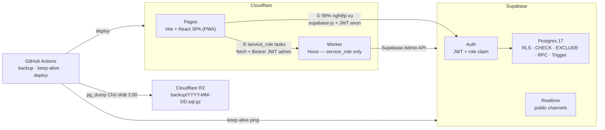
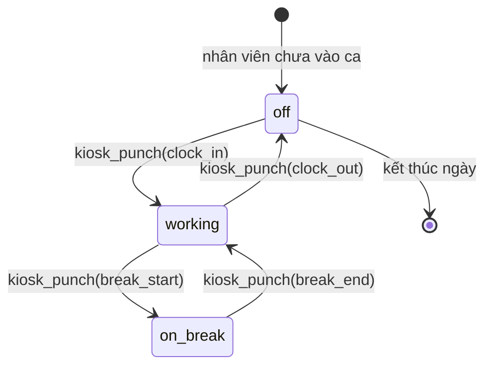
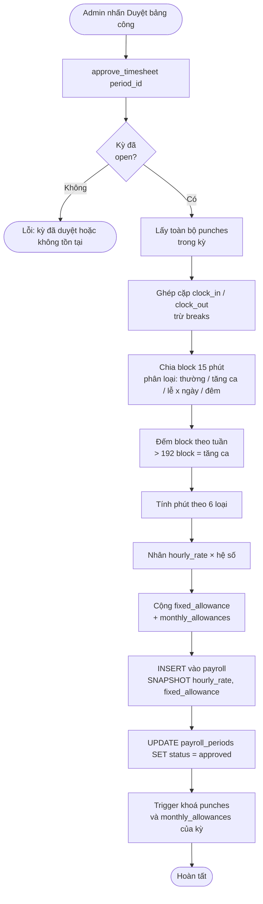

# Kiến trúc hệ thống chấm công

> [!NOTE]
> Tài liệu này mô tả toàn bộ kiến trúc kỹ thuật của hệ thống chấm công. Một developer mới có thể đọc file này để hiểu hệ thống từ đầu đến cuối mà không cần tài liệu bổ sung.

---

## Mục lục

1. [Phạm vi và nguyên tắc nền](#1-phạm-vi-và-nguyên-tắc-nền)
2. [Sơ đồ hệ thống](#2-sơ-đồ-hệ-thống)
3. [Stack công nghệ](#3-stack-công-nghệ)
4. [Bảo mật](#4-bảo-mật)
5. [Thiết kế dữ liệu](#5-thiết-kế-dữ-liệu)
6. [Phân quyền](#6-phân-quyền)
7. [Luồng nghiệp vụ chính](#7-luồng-nghiệp-vụ-chính)
8. [Deployment & CI/CD](#8-deployment--cicd)
9. [Quy tắc tính lương](#9-quy-tắc-tính-lương)
10. [Cấu trúc thư mục](#10-cấu-trúc-thư-mục)
11. [Error Handling & Retry Strategy](#11-error-handling--retry-strategy)

---

## 1. Phạm vi và nguyên tắc nền

### 1.1 Phạm vi hệ thống

| Vai trò | Chức năng |
|---|---|
| **Nhân viên** | Đăng ký ca, xem lịch làm, chấm công tại iPad kiosk, xin nghỉ, xem bảng công & lương của mình, tự đổi mật khẩu / PIN |
| **Manager** | Trong chi nhánh mình phụ trách: xem lịch, duyệt ca, xem & sửa lượt chấm, xem ai đang trong ca, xem audit log |
| **Admin** | Toàn quyền: nhân sự, chi nhánh, iPad, đơn giá, ngày lễ, phụ cấp, duyệt bảng công, lương, xuất báo cáo |
| **iPad kiosk** | Đặt tại chi nhánh — nhận mã nhân viên + PIN → vào ca / bắt đầu nghỉ / kết thúc nghỉ / ra ca |
| **Hệ thống** | Tính giờ công + lương khi admin duyệt bảng công; backup hàng tuần |

### 1.2 Quy ước nghiệp vụ

- **Mã nhân viên** là duy nhất toàn hệ thống, không mang mã chi nhánh — nhân viên chuyển chi nhánh không cần đổi mã.
- **Chi nhánh** có mã dạng `CN001`, `CN002`, … Mỗi chi nhánh có 0, 1 hoặc nhiều manager. Không có manager thì admin quản lý trực tiếp.
- Mỗi chi nhánh có ≥ 1 iPad kiosk. Chỉ admin được thêm / thu hồi iPad.
- Nhân viên được chấm công ở **bất kỳ chi nhánh nào**; lượt chấm ghi nhận chi nhánh của iPad được dùng.
- Chấm công bắt buộc **online**. Không tính đi muộn / về sớm.
- Lương chỉ được tính sau khi admin **duyệt bảng công** của tháng: theo block 15 phút, tăng ca khi vượt 48 giờ/tuần, không có hệ số cuối tuần.

### 1.3 Nguyên tắc kiến trúc

| # | Nguyên tắc | Hệ quả thiết kế |
|---|---|---|
| 1 | **Logic nghiệp vụ nằm ở Postgres, không ở browser** | RLS + CHECK + RPC là tầng bảo vệ thật sự. Tính lương cũng là RPC |
| 2 | **CRUD thông thường gọi thẳng Supabase từ client** | Không viết REST API thừa, giảm egress tối đa |
| 3 | **Worker chỉ làm việc cần `service_role`** | 5 endpoint quản lý tài khoản & iPad, không cron |
| 4 | **Không đặt tác vụ nặng lên Worker** | Worker Free giới hạn 10 ms CPU. Excel sinh ra ở trình duyệt; backup chạy trên GitHub Actions |
| 5 | **Thời gian do server quyết định, không phải client** | Dùng `now()` trong RPC, client không được truyền timestamp vào lượt chấm |
| 6 | **iPad là thiết bị được tin cậy; nhân viên chỉ xác minh** | iPad có phiên đăng nhập riêng (1 `auth.user` gắn với `devices`). Nhân viên nhập mã + PIN |

---

## 2. Sơ đồ hệ thống

### 2.1 Tổng quan hệ thống



### 2.2 State machine kiosk



### 2.3 Luồng tính lương



---

## 3. Stack công nghệ

### 3.1 Frontend — `apps/web` (Cloudflare Pages)

| Thành phần | Lựa chọn | Ghi chú |
|---|---|---|
| Build | Vite 6 | |
| UI | React 19 + TypeScript | |
| Routing | TanStack Router | Lazy-load từng khu vực |
| Data fetching | TanStack Query + `supabase-js` | |
| Lịch | FullCalendar 6 | Chỉ plugin MIT: `timeGrid`, `dayGrid`, `interaction` |
| UI kit | shadcn/ui + Tailwind CSS | |
| Form | React Hook Form + Zod | Dùng chung schema với Worker |
| Bảng | TanStack Table | |
| Excel | ExcelJS (lazy-load) | Chỉ tải ở `/admin` |
| PWA | `vite-plugin-pwa` | |

### 3.2 Backend — `apps/worker` (Cloudflare Worker)

| Thành phần | Lựa chọn | Ghi chú |
|---|---|---|
| Runtime | Cloudflare Worker (V8 isolate) | Giới hạn 10 ms CPU / request (Free tier) |
| Framework | Hono | Nhẹ, type-safe |
| Validate | Zod (qua `@hono/zod-validator`) | Dùng chung schema với FE |
| Vai trò | Chỉ gọi Supabase Admin API | Không xử lý logic nghiệp vụ |

**5 endpoint hiện có:**

```
POST /api/employees              → tạo tài khoản nhân viên mới
POST /api/employees/:id/reset-password → cấp lại mật khẩu
POST /api/devices                → thêm iPad mới
POST /api/devices/pair           → ghép nối iPad với chi nhánh
POST /api/devices/:id/revoke     → thu hồi iPad
```

### 3.3 Database — `supabase/`

| Thành phần | Lựa chọn | Ghi chú |
|---|---|---|
| DB | Supabase Postgres 17 | |
| Auth | Supabase Auth (Email + mật khẩu) | |
| Bảo mật | RLS trên mọi bảng | Không có ngoại lệ |
| Hash PIN | `pgcrypto` `crypt()` + bcrypt | |

---

## 4. Bảo mật

### 4.1 JWT & Role Claim

Supabase Auth phát JWT chứa `app_metadata.role` (`employee` / `manager` / `admin` / `kiosk`). RLS dùng hàm `private.my_role()` để đọc claim này mà không cần query bảng:

```sql
-- private schema, không lộ ra PostgREST API
CREATE OR REPLACE FUNCTION private.my_role()
  RETURNS text
  LANGUAGE sql STABLE SECURITY DEFINER AS
$$
  SELECT COALESCE(
    current_setting('request.jwt.claims', true)::jsonb -> 'app_metadata' ->> 'role',
    'anonymous'
  );
$$;
```

> [!IMPORTANT]
> `app_metadata` chỉ được ghi bởi `service_role`. Client không thể tự leo thang quyền.

### 4.2 Row Level Security (RLS)

- **Bật RLS trên tất cả các bảng** — kể cả các bảng mà client không bao giờ truy cập trực tiếp (ví dụ: `employee_pins`).
- Các bảng không cần client đọc (như `employee_pins`) được bật RLS **nhưng không có policy nào** → chỉ RPC `SECURITY DEFINER` mới đọc được.
- Mọi policy đều dùng hàm trong schema `private` để tránh lộ logic ra ngoài API.

### 4.3 PIN Lockout

Cơ chế chống brute-force PIN được cài đặt trong bảng `employee_pins`:

```sql
-- Cột liên quan trong employee_pins
pin_hash      text        NOT NULL,   -- bcrypt hash
pin_failed    int         NOT NULL DEFAULT 0,
pin_lock_until timestamptz,           -- NULL = không khoá
```

Logic trong RPC `kiosk_punch`:
1. Nếu `pin_lock_until > now()` → trả lỗi `PIN_LOCKED`.
2. Nếu PIN sai → `pin_failed = pin_failed + 1`.
3. Nếu `pin_failed >= 5` → `pin_lock_until = now() + interval '15 minutes'`.
4. Nếu PIN đúng → `pin_failed = 0`, `pin_lock_until = NULL`.

### 4.4 CORS

Worker cấu hình CORS chỉ cho phép origin từ Cloudflare Pages:

```typescript
// apps/worker/src/index.ts
app.use('*', cors({
  origin: [
    'https://<project>.pages.dev',
    'https://<custom-domain>.com',
  ],
  allowMethods: ['GET', 'POST', 'PATCH', 'DELETE'],
  allowHeaders: ['Authorization', 'Content-Type'],
}));
```

### 4.5 Service Role Isolation

- `SUPABASE_SERVICE_ROLE_KEY` chỉ tồn tại trong Worker (Cloudflare Secrets) và GitHub Actions.
- Frontend **không bao giờ** nhận hoặc lưu `service_role` key.
- Worker validate `Authorization: Bearer <admin_jwt>` trước khi gọi Supabase Admin API — đảm bảo chỉ admin đã xác thực mới được gọi Worker.

```typescript
// apps/worker/src/lib/requireAdmin.ts
export async function requireAdmin(c: Context): Promise<void> {
  const jwt = c.req.header('Authorization')?.replace('Bearer ', '');
  const { data: { user }, error } = await supabase.auth.getUser(jwt);
  if (error || user?.app_metadata?.role !== 'admin') {
    throw new HTTPException(403, { message: 'Forbidden' });
  }
}
```

### 4.6 Device Pairing Security

Mã ghép nối iPad (`device_pairings`) chỉ lưu **hash** (SHA-256), dùng 1 lần, hết hạn sau 10 phút:

```sql
CREATE TABLE device_pairings (
  id          uuid PRIMARY KEY DEFAULT gen_random_uuid(),
  code_hash   text        NOT NULL UNIQUE,  -- SHA-256(plain_code)
  device_id   uuid        REFERENCES devices(id),
  expires_at  timestamptz NOT NULL DEFAULT now() + interval '10 minutes',
  used_at     timestamptz
);
```

---

## 5. Thiết kế dữ liệu

### 5.1 Quan hệ tổng thể

```
auth.users ──┬── employees ──┬── employee_pins
             │               ├── shifts          (branch_id, during tstzrange)
             │               ├── punches         (branch_id, device_id)
             │               ├── leave_requests
             │               ├── monthly_allowances (period_id)
             │               └── payroll         (period_id)
             │
             └── devices ──── branches ──── manager_branches ──── employees

payroll_periods  ← kỳ lương theo tháng (open → approved)
device_pairings  ← mã ghép nối iPad (dùng 1 lần, hết hạn 10 phút)
audit_log        ← ai làm gì, lúc nào, ở chi nhánh nào
holidays         ← ngày lễ, tết (hệ số 200%)
shift_templates  ← ca sáng / chiều / đêm mẫu
```

### 5.2 Bảng chính

| Bảng | Vai trò | Ghi chú quan trọng |
|---|---|---|
| `branches` | Chi nhánh | `code` UNIQUE (`CN001`, `CN002`, …) |
| `employees` | Profile + lương | 1-1 với `auth.users`. `employee_code` UNIQUE toàn hệ thống. `fixed_allowance` = phụ cấp cố định VND/tháng, mặc định 0 |
| `employee_pins` | Hash PIN + đếm sai | `pin_hash`, `pin_failed`, `pin_lock_until`. RLS bật, không có policy → chỉ RPC `SECURITY DEFINER` đọc được |
| `manager_branches` | Manager ↔ Chi nhánh | N-N. Chi nhánh có thể không có manager |
| `devices` | iPad kiosk | 1-1 với một `auth.user` riêng (không có dòng trong `employees`). `branch_id` đổi được; `revoked_at` để thu hồi tức thì |
| `device_pairings` | Mã ghép nối iPad | Chỉ lưu hash, dùng 1 lần, hết hạn 10 phút |
| `shifts` | Ca đăng ký (kế hoạch) | `branch_id` + `during tstzrange` + EXCLUDE. `start_at`, `end_at` là cột sinh từ `during` để lọc theo giờ. Không dùng để tính lương |
| `punches` | Lượt chấm thực tế | `type`: `clock_in`, `break_start`, `break_end`, `clock_out`. `at = now()` của DB. `source`: `kiosk` hoặc `manual`. Không xoá, không update — sửa = void (`voided_at`) + thêm lượt mới |
| `payroll_periods` | Kỳ lương theo tháng | `open` → `approved`. Đã duyệt thì trigger khoá `punches` và `monthly_allowances` của tháng đó |
| `monthly_allowances` | Phụ cấp theo tháng | Admin thêm khi kỳ còn `open`: `period_id`, `employee_id`, `amount`, `reason`. Nhiều dòng / nhân viên / tháng |
| `payroll` | Kết quả tính lương | Snapshot `hourly_rate`, `fixed_allowance` lúc duyệt + số phút theo 6 loại + tổng tiền. Client không ghi được; chỉ `approve_timesheet()` ghi |
| `audit_log` | Vết kiểm toán | Ghi bằng trigger chung `private.audit_row()` (cũ → mới, `branch_id`) trên `shifts` và các bảng cấu hình; `correct_punch` tự ghi. Không ai sửa / xoá được |

### 5.3 Constraint cốt lõi

```sql
-- Mã nhân viên duy nhất trên toàn hệ thống, không phân biệt chi nhánh
ALTER TABLE employees
  ADD CONSTRAINT employee_code_unique UNIQUE (employee_code);

-- Một người không thể có 2 ca chồng giờ nhau, kể cả ở 2 chi nhánh khác nhau
ALTER TABLE shifts
  ADD CONSTRAINT no_overlap EXCLUDE USING gist (
    employee_id WITH =,
    during      WITH &&
  ) WHERE (status <> 'rejected');

-- Ca không quá 12 tiếng
ALTER TABLE shifts
  ADD CONSTRAINT max_12h
  CHECK (upper(during) - lower(during) <= interval '12 hours');

-- Lượt chấm thủ công bắt buộc có người sửa và lý do
ALTER TABLE punches
  ADD CONSTRAINT manual_needs_reason
  CHECK (source = 'kiosk' OR (created_by IS NOT NULL AND reason IS NOT NULL));

-- Phụ cấp cố định mặc định 0, không âm
ALTER TABLE employees
  ADD CONSTRAINT fixed_allowance_non_negative
  CHECK (fixed_allowance >= 0);

-- Phụ cấp tháng phải dương và có lý do
ALTER TABLE monthly_allowances
  ADD CONSTRAINT allowance_positive CHECK (amount > 0),
  ADD CONSTRAINT allowance_needs_reason CHECK (reason IS NOT NULL AND reason <> '');
```

### 5.4 RPC Functions

#### `kiosk_lookup(p_employee_code text)`

Trả về tên nhân viên và trạng thái hiện tại — dùng để iPad hiển thị thông tin trước khi nhân viên nhập PIN.

```sql
CREATE OR REPLACE FUNCTION public.kiosk_lookup(p_employee_code text)
  RETURNS json
  LANGUAGE plpgsql SECURITY DEFINER AS
$$
DECLARE
  v_emp  employees%ROWTYPE;
  v_state text;
BEGIN
  SELECT * INTO v_emp FROM employees WHERE employee_code = p_employee_code;
  IF NOT FOUND THEN
    RETURN json_build_object('error', 'EMPLOYEE_NOT_FOUND');
  END IF;

  -- Tính trạng thái: lượt clock_in gần nhất chưa có clock_out tương ứng
  SELECT CASE
    WHEN type = 'clock_in'    THEN 'working'
    WHEN type = 'break_start' THEN 'on_break'
    WHEN type = 'break_end'   THEN 'working'
    WHEN type = 'clock_out'   THEN 'off'
    ELSE 'off'
  END INTO v_state
  FROM punches
  WHERE employee_id = v_emp.id AND voided_at IS NULL
  ORDER BY at DESC LIMIT 1;

  RETURN json_build_object(
    'employee_id',   v_emp.id,
    'full_name',     v_emp.full_name,
    'current_state', COALESCE(v_state, 'off')
  );
END;
$$;
```

#### `kiosk_punch(p_employee_code text, p_pin text, p_action text)`

Xác minh PIN và ghi lượt chấm. Trả về JSON `{ok: true}` hoặc `{error: string}`.

```sql
CREATE OR REPLACE FUNCTION public.kiosk_punch(
  p_employee_code text,
  p_pin           text,
  p_action        text   -- 'clock_in' | 'break_start' | 'break_end' | 'clock_out'
)
  RETURNS json
  LANGUAGE plpgsql SECURITY DEFINER AS
$$
DECLARE
  v_emp    employees%ROWTYPE;
  v_pin    employee_pins%ROWTYPE;
  v_dev_id uuid;
BEGIN
  -- 1. Lấy nhân viên
  SELECT * INTO v_emp FROM employees WHERE employee_code = p_employee_code;
  IF NOT FOUND THEN RETURN json_build_object('error', 'EMPLOYEE_NOT_FOUND'); END IF;

  -- 2. Lấy PIN record
  SELECT * INTO v_pin FROM employee_pins WHERE employee_id = v_emp.id;

  -- 3. Kiểm tra lockout
  IF v_pin.pin_lock_until IS NOT NULL AND v_pin.pin_lock_until > now() THEN
    RETURN json_build_object('error', 'PIN_LOCKED',
      'unlock_at', v_pin.pin_lock_until);
  END IF;

  -- 4. Xác minh PIN
  IF v_pin.pin_hash IS NULL OR crypt(p_pin, v_pin.pin_hash) <> v_pin.pin_hash THEN
    UPDATE employee_pins
    SET pin_failed    = pin_failed + 1,
        pin_lock_until = CASE WHEN pin_failed + 1 >= 5
                              THEN now() + interval '15 minutes'
                              ELSE pin_lock_until END
    WHERE employee_id = v_emp.id;
    RETURN json_build_object('error', 'WRONG_PIN');
  END IF;

  -- 5. Reset failed counter
  UPDATE employee_pins
  SET pin_failed = 0, pin_lock_until = NULL
  WHERE employee_id = v_emp.id;

  -- 6. Lấy device_id từ JWT
  SELECT id INTO v_dev_id FROM devices
  WHERE auth_user_id = auth.uid() AND revoked_at IS NULL;

  -- 7. Ghi punch
  INSERT INTO punches (employee_id, device_id, branch_id, type, at, source)
  SELECT v_emp.id, v_dev_id, d.branch_id, p_action, now(), 'kiosk'
  FROM devices d WHERE d.id = v_dev_id;

  RETURN json_build_object('ok', true, 'at', now());
END;
$$;
```

#### `approve_shifts(p_shift_ids uuid[])`

Manager / admin duyệt một hoặc nhiều ca cùng lúc.

```sql
CREATE OR REPLACE FUNCTION public.approve_shifts(p_shift_ids uuid[])
  RETURNS void
  LANGUAGE plpgsql SECURITY DEFINER AS
$$
BEGIN
  -- Kiểm tra quyền: phải là manager của chi nhánh hoặc admin
  IF private.my_role() NOT IN ('manager', 'admin') THEN
    RAISE EXCEPTION 'FORBIDDEN';
  END IF;

  UPDATE shifts
  SET status = 'approved', approved_by = auth.uid(), approved_at = now()
  WHERE id = ANY(p_shift_ids)
    AND (
      private.my_role() = 'admin'
      OR branch_id = ANY(private.my_branches())
    )
    AND status = 'pending';
END;
$$;
```

#### `correct_punch(p_punch_id uuid, p_new_at timestamptz, p_reason text)`

Sửa lượt chấm: void lượt cũ, tạo lượt mới, ghi audit log.

```sql
CREATE OR REPLACE FUNCTION public.correct_punch(
  p_punch_id uuid,
  p_new_at   timestamptz,
  p_reason   text
)
  RETURNS uuid
  LANGUAGE plpgsql SECURITY DEFINER AS
$$
DECLARE
  v_old  punches%ROWTYPE;
  v_new_id uuid;
BEGIN
  SELECT * INTO v_old FROM punches WHERE id = p_punch_id AND voided_at IS NULL;
  IF NOT FOUND THEN RAISE EXCEPTION 'PUNCH_NOT_FOUND'; END IF;

  -- Kiểm tra quyền
  IF private.my_role() NOT IN ('manager', 'admin') THEN
    RAISE EXCEPTION 'FORBIDDEN';
  END IF;
  IF private.my_role() = 'manager'
     AND v_old.branch_id <> ALL(private.my_branches()) THEN
    RAISE EXCEPTION 'FORBIDDEN';
  END IF;

  -- Void lượt cũ
  UPDATE punches SET voided_at = now(), voided_by = auth.uid()
  WHERE id = p_punch_id;

  -- Tạo lượt mới
  INSERT INTO punches
    (employee_id, device_id, branch_id, type, at, source, created_by, reason, corrects_punch_id)
  VALUES
    (v_old.employee_id, v_old.device_id, v_old.branch_id,
     v_old.type, p_new_at, 'manual', auth.uid(), p_reason, p_punch_id)
  RETURNING id INTO v_new_id;

  -- Ghi audit log
  INSERT INTO audit_log (table_name, row_id, action, old_data, new_data, actor_id, branch_id)
  VALUES ('punches', p_punch_id, 'correct_punch',
          row_to_json(v_old), json_build_object('new_id', v_new_id, 'new_at', p_new_at, 'reason', p_reason),
          auth.uid(), v_old.branch_id);

  RETURN v_new_id;
END;
$$;
```

#### `preview_timesheet(p_period_id uuid, p_employee_id uuid)`

Xem trước kết quả tính lương — không commit, không lock kỳ.

```sql
CREATE OR REPLACE FUNCTION public.preview_timesheet(
  p_period_id   uuid,
  p_employee_id uuid
)
  RETURNS json
  LANGUAGE plpgsql STABLE SECURITY DEFINER AS
$$
-- Logic tính giống approve_timesheet nhưng chỉ RETURN, không INSERT
$$;
```

#### `approve_timesheet(p_period_id uuid)`

Tính lương và lock kỳ. Chỉ admin được gọi.

```sql
CREATE OR REPLACE FUNCTION public.approve_timesheet(p_period_id uuid)
  RETURNS void
  LANGUAGE plpgsql SECURITY DEFINER AS
$$
BEGIN
  IF private.my_role() <> 'admin' THEN RAISE EXCEPTION 'FORBIDDEN'; END IF;

  -- Tính lương cho toàn bộ nhân viên có punches trong kỳ
  -- INSERT INTO payroll ... (xem mục 9 để biết công thức)

  -- Lock kỳ
  UPDATE payroll_periods SET status = 'approved', approved_by = auth.uid(), approved_at = now()
  WHERE id = p_period_id AND status = 'open';

  IF NOT FOUND THEN RAISE EXCEPTION 'PERIOD_NOT_OPEN'; END IF;
END;
$$;
```

---

## 6. Phân quyền

### 6.1 Role

- Role lưu ở cột `employees.role`.
- Chi nhánh của manager lưu ở bảng `manager_branches`.
- RLS đọc qua các hàm `private.my_role()`, `private.is_admin()`, `private.my_branches()` — schema `private` không lộ ra API.
- Đổi role hoặc phân công có **hiệu lực ngay**, không chờ JWT hết hạn (vì hàm đọc DB tại thời điểm query).
- iPad không có dòng trong `employees` → `my_role()` trả `NULL` → không qua được policy nào ngoài RPC kiosk.

| Role | Quyền |
|---|---|
| `employee` | Đọc / tạo dữ liệu của mình. Không đổi `status`. Không xem lương người khác |
| `manager` | Trong chi nhánh mình phụ trách: xem lịch, duyệt ca, xem & sửa lượt chấm, xem audit log. Không xem lương. Không tự duyệt / sửa dữ liệu của chính mình |
| `admin` | Toàn quyền |
| `kiosk` | Chỉ gọi được `kiosk_lookup`, `kiosk_punch` — không đọc được bảng nào |
| `service_role` | Chỉ Worker dùng để gọi Supabase Admin API |

> [!NOTE]
> Manager và admin cũng là nhân viên → có đủ quyền `employee` với dữ liệu của chính mình.

### 6.2 Ma trận RLS

| Bảng | `employee` | `manager` (chi nhánh mình) | `admin` |
|---|---|---|---|
| `shifts` | SELECT / INSERT của mình (pending, ca chưa bắt đầu); DELETE ca pending của mình | SELECT; duyệt qua `approve_shifts()` | Tất cả |
| `punches` | SELECT của mình | SELECT; sửa qua `correct_punch()` | Tất cả |
| `payroll` | SELECT của mình khi kỳ đã duyệt | ✗ | SELECT; ghi qua `approve_timesheet()` |
| `monthly_allowances` | SELECT của mình khi kỳ đã duyệt | ✗ | Tất cả khi kỳ còn `open` |
| `employees` | SELECT của mình | Mã + tên qua `employee_directory()`, không thấy `hourly_rate`, `fixed_allowance` | Tất cả |
| `employee_pins` | ✗ | ✗ | ✗ — chỉ RPC |
| `devices` | ✗ | ✗ | SELECT; thêm / thu hồi qua Worker |
| `audit_log` | ✗ | SELECT | SELECT; chỉ trigger ghi |

---

## 7. Luồng nghiệp vụ chính

### 7.1 Đăng ký ca — Nhân viên (`/app`)

1. Nhân viên mở `/app/shifts` → FullCalendar hiển thị lịch làm của mình.
2. Nhấn vào ô ngày trống → form đăng ký ca: chọn `shift_template` (sáng / chiều / đêm) hoặc tùy chỉnh giờ.
3. Frontend validate: ca không quá 12 tiếng, không trùng ca đang `pending` / `approved`.
4. `supabase.from('shifts').insert(...)` → RLS cho phép nhân viên INSERT ca của mình.
5. Postgres kiểm tra `EXCLUDE no_overlap` — nếu trùng thì trả lỗi `23P01`.
6. Ca mới ở trạng thái `pending` → hiển thị màu khác trên lịch.
7. Nhân viên có thể DELETE ca `pending` chưa bắt đầu.

```
Nhân viên → INSERT shifts (pending)
         ← EXCLUDE kiểm tra trùng ca
         ← RLS kiểm tra employee_id = auth.uid()
Manager nhận Realtime push → hiển thị ca pending mới
```

### 7.2 Duyệt ca — Manager / Admin (`/admin/shifts`)

1. Manager mở `/admin/shifts` → xem tất cả ca `pending` trong chi nhánh mình.
2. Tích chọn một hoặc nhiều ca → nhấn **Duyệt** hoặc **Từ chối**.
3. Frontend gọi `supabase.rpc('approve_shifts', { p_shift_ids: [...] })`.
4. RPC kiểm tra role và chi nhánh → UPDATE `status = 'approved'` hoặc `'rejected'`.
5. Realtime đẩy cập nhật về FE của nhân viên.

> [!WARNING]
> Manager không được tự duyệt ca của chính mình. RPC kiểm tra `employee_id <> auth.uid()` khi role là `manager`.

### 7.3 Chấm công tại iPad kiosk

**Điều kiện tiên quyết:** iPad đã được ghép nối (`device_pairings`) và có phiên đăng nhập hợp lệ.

**Trạng thái nhân viên** tính theo toàn hệ thống (không phân biệt chi nhánh):
- Không thể vào ca ở 2 chi nhánh cùng lúc.
- Vào ca ở `CN001`, ra ca ở `CN002` vẫn hợp lệ.

**Quy trình:**

```
1. Nhân viên nhập mã NV trên iPad
2. iPad gọi kiosk_lookup(employee_code)
   → Hiển thị: tên, ảnh đại diện, trạng thái hiện tại (off / working / on_break)
   → Hiển thị 1 trong 4 nút: [Vào ca] [Bắt đầu nghỉ] [Kết thúc nghỉ] [Ra ca]
     (nút nào hợp lệ với trạng thái hiện tại thì bật sáng)

3. Nhân viên nhập PIN (4–6 số)
4. iPad gọi kiosk_punch(employee_code, pin, action)
   → Kiểm tra lockout
   → Xác minh PIN (bcrypt)
   → Ghi punch với at = now() của DB
   → Trả về {ok: true, at: timestamp} hoặc {error: string}

5. iPad hiển thị kết quả 3 giây → về màn hình chờ
```

**Các lỗi có thể xảy ra:**

| Lỗi | Hiển thị |
|---|---|
| `EMPLOYEE_NOT_FOUND` | "Không tìm thấy mã nhân viên" |
| `WRONG_PIN` | "PIN không đúng (còn N lần)" |
| `PIN_LOCKED` | "PIN bị khoá đến HH:MM" |
| `INVALID_ACTION` | "Hành động không hợp lệ với trạng thái hiện tại" |
| `DEVICE_REVOKED` | "iPad đã bị thu hồi, liên hệ admin" |

### 7.4 Xem & Sửa lượt chấm — Manager / Admin (`/admin/punches`)

1. Mở `/admin/punches` → bảng danh sách lượt chấm theo ngày / nhân viên / chi nhánh.
2. Lọc theo ngày, chi nhánh, nhân viên.
3. Nhấn **Sửa** bên cạnh lượt chấm → modal nhập:
   - Thời gian mới (`new_at`)
   - Lý do (`reason`)
4. Frontend gọi `supabase.rpc('correct_punch', { p_punch_id, p_new_at, p_reason })`.
5. RPC void lượt cũ (`voided_at = now()`) → tạo lượt mới với `source = 'manual'` → ghi `audit_log`.
6. Lượt bị void vẫn hiển thị với trạng thái "đã huỷ" (không xoá khỏi DB).

> [!CAUTION]
> Manager không được sửa lượt chấm của chính mình. Phải nhờ admin.

### 7.5 Duyệt bảng công & Tính lương — Admin

1. Admin mở `/admin/timesheet` → chọn tháng.
2. Nhấn **Xem trước** → gọi `preview_timesheet(period_id, null)` để xem tổng lương toàn chi nhánh (không commit).
3. Kiểm tra từng nhân viên → nhấn **Duyệt bảng công**.
4. Gọi `approve_timesheet(period_id)`:
   - Tính lương cho tất cả nhân viên (xem mục 9).
   - INSERT vào `payroll` (snapshot `hourly_rate`, `fixed_allowance` tại thời điểm duyệt).
   - UPDATE `payroll_periods.status = 'approved'`.
   - Trigger khoá `punches` và `monthly_allowances` của kỳ (không ai sửa được nữa).
5. Nhân viên thấy bảng lương trong `/app/payroll`.

> [!IMPORTANT]
> Sau khi duyệt, `payroll_periods` chuyển sang `approved` — không thể hoàn tác. Cần `service_role` để can thiệp thủ công.

### 7.6 Xuất Excel — Admin (trình duyệt)

1. Admin mở `/admin/reports` → chọn tháng, chi nhánh, nhân viên (tuỳ chọn).
2. Nhấn **Xuất Excel** → ExcelJS được **lazy-load** (chỉ tải khi cần).
3. Frontend query `payroll` + `payroll_periods` + `employees` từ Supabase.
4. ExcelJS tạo file `.xlsx` trực tiếp trong trình duyệt → trigger download.

> [!TIP]
> ExcelJS được lazy-load qua dynamic import để không ảnh hưởng đến bundle size của toàn ứng dụng. Không có API endpoint nào xử lý Excel — tất cả chạy ở client.

### 7.7 Quản lý tài khoản, mật khẩu & PIN

**Tạo nhân viên mới (Admin):**
```
Admin → POST /api/employees (Worker)
      → requireAdmin() kiểm tra JWT
      → supabase.auth.admin.createUser({ email, password, app_metadata: { role } })
      → INSERT employees (employee_code, full_name, hourly_rate, ...)
      → INSERT employee_pins (pin_hash = crypt(pin, gen_salt('bf')))
```

**Đổi mật khẩu (Nhân viên tự đổi):**
```
Nhân viên → supabase.auth.updateUser({ password: newPassword })
```

**Cấp lại mật khẩu (Admin):**
```
Admin → POST /api/employees/:id/reset-password (Worker)
      → requireAdmin()
      → supabase.auth.admin.updateUserById(id, { password: newPassword })
```

**Đổi PIN (Nhân viên tự đổi):**
```
Nhân viên → supabase.rpc('change_pin', { old_pin, new_pin })
           → RPC xác minh old_pin, cập nhật pin_hash
```

**Reset PIN (Admin):**
```
Admin → supabase.rpc('reset_pin', { employee_id, new_pin })
      → RPC kiểm tra private.is_admin(), cập nhật pin_hash, reset pin_failed
```

---

## 8. Deployment & CI/CD

### 8.1 Cloudflare Pages

**`wrangler.toml` (tại `apps/web`):**
```toml
name = "timekeeping-web"
pages_build_output_dir = "dist"
compatibility_date = "2024-01-01"

[env.production]
vars = { VITE_SUPABASE_URL = "https://<ref>.supabase.co" }
```

**Build command:**
```bash
pnpm --filter web build
```

**Environment variables (Cloudflare Dashboard → Pages → Settings):**
```
VITE_SUPABASE_URL        = https://<ref>.supabase.co
VITE_SUPABASE_ANON_KEY   = eyJ...
VITE_WORKER_URL          = https://timekeeping-worker.<account>.workers.dev
```

### 8.2 Cloudflare Worker

**`wrangler.toml` (tại `apps/worker`):**
```toml
name = "timekeeping-worker"
main = "src/index.ts"
compatibility_date = "2024-01-01"

[vars]
SUPABASE_URL = "https://<ref>.supabase.co"

# Secret (không commit):
# SUPABASE_SERVICE_ROLE_KEY — đặt qua `wrangler secret put`
```

**Deploy:**
```bash
pnpm --filter worker deploy
```

### 8.3 GitHub Actions Workflows

#### Workflow 1: Backup hàng tuần

**`.github/workflows/backup.yml`:**
```yaml
name: Weekly Database Backup

on:
  schedule:
    - cron: '0 19 * * 0'   # Chủ nhật 02:00 giờ VN (UTC+7 = 19:00 UTC thứ 7)
  workflow_dispatch:

jobs:
  backup:
    runs-on: ubuntu-latest
    steps:
      - name: Dump database
        env:
          DATABASE_URL: ${{ secrets.SUPABASE_DB_URL }}
        run: |
          pg_dump "$DATABASE_URL" \
            --no-owner --no-acl --format=custom \
            | gzip > backup.sql.gz

      - name: Upload to R2
        env:
          AWS_ACCESS_KEY_ID:     ${{ secrets.R2_ACCESS_KEY_ID }}
          AWS_SECRET_ACCESS_KEY: ${{ secrets.R2_SECRET_ACCESS_KEY }}
          R2_ENDPOINT:           ${{ secrets.R2_ENDPOINT }}
        run: |
          DATE=$(date +%Y-%m-%d)
          aws s3 cp backup.sql.gz \
            "s3://timekeeping-backup/backup/${DATE}.sql.gz" \
            --endpoint-url "$R2_ENDPOINT"

      - name: Prune old backups (keep 12 weeks)
        env:
          AWS_ACCESS_KEY_ID:     ${{ secrets.R2_ACCESS_KEY_ID }}
          AWS_SECRET_ACCESS_KEY: ${{ secrets.R2_SECRET_ACCESS_KEY }}
          R2_ENDPOINT:           ${{ secrets.R2_ENDPOINT }}
        run: |
          # Xoá backup cũ hơn 84 ngày
          aws s3 ls s3://timekeeping-backup/backup/ \
            --endpoint-url "$R2_ENDPOINT" \
          | awk '{print $4}' \
          | sort \
          | head -n -12 \
          | xargs -I{} aws s3 rm "s3://timekeeping-backup/backup/{}" \
              --endpoint-url "$R2_ENDPOINT" || true
```

#### Workflow 2: Keep-alive (chống Supabase pause)

**`.github/workflows/keep-alive.yml`:**
```yaml
name: Supabase Keep-Alive

on:
  schedule:
    - cron: '0 0 * * *'   # Mỗi ngày 00:00 UTC
  workflow_dispatch:

jobs:
  ping:
    runs-on: ubuntu-latest
    steps:
      - name: Ping Supabase
        env:
          SUPABASE_URL:      ${{ secrets.SUPABASE_URL }}
          SUPABASE_ANON_KEY: ${{ secrets.SUPABASE_ANON_KEY }}
        run: |
          curl -sf \
            -H "apikey: $SUPABASE_ANON_KEY" \
            -H "Authorization: Bearer $SUPABASE_ANON_KEY" \
            "$SUPABASE_URL/rest/v1/branches?select=id&limit=1" \
          && echo "Ping OK" || echo "Ping failed (non-fatal)"
```

#### Workflow 3: Deploy CI

**`.github/workflows/deploy.yml`:**
```yaml
name: Deploy

on:
  push:
    branches: [main]

jobs:
  deploy-worker:
    runs-on: ubuntu-latest
    steps:
      - uses: actions/checkout@v4
      - uses: pnpm/action-setup@v4
      - run: pnpm install --frozen-lockfile
      - run: pnpm --filter worker deploy
        env:
          CLOUDFLARE_API_TOKEN: ${{ secrets.CLOUDFLARE_API_TOKEN }}
          CLOUDFLARE_ACCOUNT_ID: ${{ secrets.CLOUDFLARE_ACCOUNT_ID }}

  deploy-pages:
    runs-on: ubuntu-latest
    needs: deploy-worker
    steps:
      - uses: actions/checkout@v4
      - uses: pnpm/action-setup@v4
      - run: pnpm install --frozen-lockfile
      - run: pnpm --filter web build
        env:
          VITE_SUPABASE_URL:      ${{ secrets.VITE_SUPABASE_URL }}
          VITE_SUPABASE_ANON_KEY: ${{ secrets.VITE_SUPABASE_ANON_KEY }}
          VITE_WORKER_URL:        ${{ secrets.VITE_WORKER_URL }}
      - uses: cloudflare/pages-action@v1
        with:
          apiToken:    ${{ secrets.CLOUDFLARE_API_TOKEN }}
          accountId:   ${{ secrets.CLOUDFLARE_ACCOUNT_ID }}
          projectName: timekeeping-web
          directory:   apps/web/dist
```

---

## 9. Quy tắc tính lương

### 9.1 Block 15 phút

- Thời gian chia theo **lưới 15 phút** của đồng hồ: `:00`, `:15`, `:30`, `:45`.
- Các mốc quan trọng `22:00`, `06:00`, `00:00` đều nằm trên lưới → mỗi block thuộc đúng 1 loại.
- **Vào ca**: làm tròn **lên** theo lưới.
- **Ra ca**: làm tròn **xuống** theo lưới.
- Mỗi lần nghỉ tính theo thời lượng thực tế (kết thúc nghỉ − bắt đầu nghỉ), làm tròn **lên** bội số 15 phút rồi trừ ra.
  - Ví dụ: nghỉ 45 phút → trừ 45 phút; nghỉ 47 phút → trừ 60 phút; nghỉ 10 phút → trừ 15 phút.

$$\text{giờ\_làm} = \big(\text{ra\_ca}_{\downarrow 15'} - \text{vào\_ca}_{\uparrow 15'}\big) - \sum \text{thời\_lượng\_nghỉ}_{\uparrow 15'}$$

### 9.2 Hệ số

$$\text{hệ số của block} = \text{hệ số loại} + 30\%\ \text{nếu là block đêm (22:00–06:00)}$$

| Loại | Ngày | Đêm |
|---|---|---|
| Thường | 100% | 130% |
| Tăng ca (vượt 48 giờ/tuần) | 150% | 180% |
| Lễ, tết (theo bảng `holidays`) | 200% | 230% |

### 9.3 Tăng ca theo tuần

- **Tuần** = Thứ Hai 00:00 → Chủ Nhật 24:00 (giờ Việt Nam, `Asia/Ho_Chi_Minh`).
- Toàn bộ phiên làm (từ `clock_in` đến `clock_out`) **thuộc tuần** chứa giờ `clock_in`.
  - Ca đêm Chủ Nhật 22:00 → Thứ Hai 06:00 thuộc trọn tuần cũ.
- Trong tuần, đếm các block **không phải ngày lễ** theo thứ tự thời gian:
  - 192 block đầu (48 giờ) = giờ thường.
  - Từ block thứ 193 trở đi = tăng ca.
- **Tuần vắt qua 2 tháng:** khi tính tháng sau, các block của tuần đó nằm ở tháng trước vẫn được đếm vào 48 giờ (đã trả ở tháng trước) → số giờ tăng ca không phụ thuộc vào cách chia tháng.

### 9.4 Phụ cấp

| Loại phụ cấp | Lưu ở đâu | Ghi chú |
|---|---|---|
| Phụ cấp cố định | `employees.fixed_allowance` | VND/tháng, mặc định 0, snapshot lúc duyệt |
| Phụ cấp theo tháng | `monthly_allowances` | Nhiều dòng / nhân viên / tháng, cần lý do |

### 9.5 Công thức

$$\text{Phút}[\text{loại}] = \text{số\_block} \times 15 \quad \text{(số nguyên, 6 loại)}$$

$$\text{lương\_giờ} = \sum_{\text{loại}} \frac{\text{Phút}[\text{loại}]}{60} \times \text{hourly\_rate} \times \text{hệ\_số}[\text{loại}]$$

$$\text{tổng} = \text{round}(\text{lương\_giờ}) + \text{fixed\_allowance} + \sum \text{monthly\_allowances.amount}$$

> [!NOTE]
> Công thức đặt trong `supabase/migrations/0004_functions.sql`, dùng chung cho `preview_timesheet()` và `approve_timesheet()` để đảm bảo kết quả preview luôn khớp với kết quả thực tế.

---

## 10. Cấu trúc thư mục

```
timekeeping/
├── apps/
│   ├── web/                        # Cloudflare Pages
│   │   ├── src/
│   │   │   ├── routes/
│   │   │   │   ├── kiosk/          # iPad: ghép nối, nhập mã + PIN, 4 nút hành động
│   │   │   │   ├── app/            # Nhân viên: lịch làm + đăng ký ca, tài khoản (PIN, mật khẩu), bảng công, lương
│   │   │   │   └── admin/          # Quản trị: nhân sự, chi nhánh, iPad, lương, báo cáo
│   │   │   ├── features/
│   │   │   │   ├── auth/           # Đăng nhập, đổi mật khẩu, đổi PIN, trạng thái phiên
│   │   │   │   ├── employees/      # Tạo nhân viên, cấp lại mật khẩu / PIN
│   │   │   │   ├── branches/       # Quản lý chi nhánh
│   │   │   │   ├── devices/        # Quản lý iPad kiosk
│   │   │   │   ├── shifts/         # Đăng ký ca, lịch (FullCalendar), duyệt ca
│   │   │   │   ├── punches/        # Ai đang trong ca, xem & sửa lượt chấm
│   │   │   │   ├── timesheet/      # Bảng công, duyệt kỳ lương
│   │   │   │   ├── payroll/        # Bảng lương
│   │   │   │   └── reports/        # Xuất Excel
│   │   │   ├── lib/
│   │   │   │   ├── supabase.ts     # Client với anon key
│   │   │   │   ├── api.ts          # Gọi Worker
│   │   │   │   ├── errors.ts       # Error mapping
│   │   │   │   ├── time.ts         # Tiện ích thời gian (VN timezone)
│   │   │   │   └── realtime.ts     # Supabase Realtime subscriptions
│   │   │   ├── router.tsx          # TanStack Router, lazy-load từng khu vực
│   │   │   └── main.tsx
│   │   └── vite.config.ts
│   │
│   └── worker/                     # Cloudflare Worker
│       ├── src/
│       │   ├── index.ts            # Hono app + CORS
│       │   ├── routes/
│       │   │   ├── employees.ts    # Tạo tài khoản, reset mật khẩu
│       │   │   └── devices.ts      # Thêm, ghép nối, thu hồi iPad
│       │   └── lib/
│       │       ├── supabase.ts     # Client với service_role key
│       │       ├── requireAdmin.ts # Middleware kiểm tra JWT admin
│       │       └── crypto.ts       # SHA-256 cho pairing code
│       └── wrangler.toml
│
├── packages/
│   └── shared/
│       └── src/
│           ├── auth.ts             # Hằng số role, type
│           ├── schemas.ts          # Zod schemas dùng chung FE + Worker
│           └── database.types.ts   # Type gen từ Supabase
│
├── supabase/
│   ├── migrations/
│   │   ├── 0001_tables.sql        # Tạo tất cả bảng
│   │   ├── 0002_constraints.sql   # CHECK + EXCLUDE + indexes
│   │   ├── 0003_rls.sql           # GRANT + policies + private schema functions
│   │   ├── 0004_functions.sql     # kiosk RPC, PIN functions, payroll functions
│   │   └── 0005_kiosk.sql         # (tuỳ chọn) cấu hình bổ sung cho kiosk
│   └── seed.sql                   # Dữ liệu mẫu cho dev
│
├── .github/
│   └── workflows/
│       ├── backup.yml             # pg_dump → R2 (Chủ nhật 02:00 VN)
│       ├── keep-alive.yml         # Ping Supabase hàng ngày
│       └── deploy.yml             # Deploy Worker + Pages khi push main
│
└── docs/
    └── architecture.md            # File này
```

### 10.1 Chi tiết Migrations

| File | Nội dung |
|---|---|
| `0001_tables.sql` | Tạo tất cả bảng: `branches`, `employees`, `employee_pins`, `manager_branches`, `devices`, `device_pairings`, `shifts`, `punches`, `payroll_periods`, `monthly_allowances`, `payroll`, `audit_log`, `holidays`, `shift_templates` |
| `0002_constraints.sql` | `CHECK` + `EXCLUDE USING GIST` + indexes (GiST index cho `during`, B-tree index cho `employee_code`, `branch_id`, `at`) |
| `0003_rls.sql` | `GRANT` quyền cho anon / authenticated; tạo schema `private`; RLS policies trên mọi bảng; hàm `private.my_role()`, `private.is_admin()`, `private.my_branches()`, `private.audit_row()` |
| `0004_functions.sql` | RPC công khai: `kiosk_lookup`, `kiosk_punch`, `approve_shifts`, `correct_punch`, `preview_timesheet`, `approve_timesheet`; hàm PIN: `change_pin`, `reset_pin`; hàm ghép nối: `new_pairing_code`, `consume_pairing_code` |
| `0005_kiosk.sql` | (tuỳ chọn) Thêm index hoặc view cho kiosk nếu cần tách riêng |
| `seed.sql` | Branch `CN001`, admin account, shift templates, holidays mẫu cho môi trường dev |

---

## 11. Error Handling & Retry Strategy

### 11.1 Lỗi kiosk

Kiosk phải xử lý **gracefully** vì nhân viên không phải kỹ thuật viên:

| Tình huống | Xử lý |
|---|---|
| `EMPLOYEE_NOT_FOUND` | Thông báo rõ ràng, xoá input, cho nhập lại |
| `WRONG_PIN` | Hiển thị số lần còn lại; sau lần cuối hiển thị thời gian unlock |
| `PIN_LOCKED` | Hiển thị đồng hồ đếm ngược đến `unlock_at` |
| `INVALID_ACTION` | "Bạn đã ở trạng thái X, không thể thực hiện Y" |
| `DEVICE_REVOKED` | "iPad đã bị thu hồi. Vui lòng liên hệ quản lý." Không retry |
| Lỗi mạng | Thông báo "Mất kết nối" + nút Thử lại |

> [!CAUTION]
> Kiosk **không cache** lượt chấm để gửi sau khi có mạng. Chấm công bắt buộc online — lượt chấm chứa `at = now()` của DB server, không phải client.

### 11.2 Retry Logic (supabase-js client)

`supabase-js` tự retry với exponential backoff cho lỗi mạng. Tuy nhiên, với các RPC **không idempotent** (đặc biệt `kiosk_punch`), client phải kiểm tra trạng thái trước khi retry:

```typescript
// Kiểm tra state trước khi retry kiosk_punch
async function safePunch(employeeCode: string, pin: string, action: PunchAction) {
  const { data: lookup } = await supabase.rpc('kiosk_lookup', { p_employee_code: employeeCode });

  // Nếu state đã là kết quả mong muốn (do retry trước thành công)
  const expectedState = ACTION_TO_STATE[action]; // e.g. clock_in → working
  if (lookup.current_state === expectedState) {
    return { ok: true, already_done: true };
  }

  return supabase.rpc('kiosk_punch', {
    p_employee_code: employeeCode,
    p_pin: pin,
    p_action: action,
  });
}
```

### 11.3 Xử lý lỗi Postgres

Lỗi Postgres được map về message thân thiện ở `apps/web/src/lib/errors.ts`:

```typescript
export function mapSupabaseError(error: PostgrestError): string {
  switch (error.code) {
    case '23P01': return 'Ca bị trùng giờ với ca đã đăng ký.';
    case '23514': // check_violation
      if (error.message.includes('max_12h')) return 'Ca không được vượt quá 12 tiếng.';
      if (error.message.includes('manual_needs_reason')) return 'Lượt chấm thủ công cần có lý do.';
      return 'Dữ liệu không hợp lệ.';
    case 'P0001': // raise_exception từ RPC
      if (error.message === 'FORBIDDEN') return 'Bạn không có quyền thực hiện hành động này.';
      if (error.message === 'PERIOD_NOT_OPEN') return 'Kỳ lương đã được duyệt hoặc không tồn tại.';
      return error.message;
    default:
      return 'Đã xảy ra lỗi. Vui lòng thử lại.';
  }
}
```

### 11.4 Offline Detection

Ứng dụng PWA hiển thị banner khi mất kết nối:

```typescript
// Trong lib/realtime.ts
window.addEventListener('offline', () => {
  toast.warning('Mất kết nối internet. Một số tính năng không khả dụng.');
});
window.addEventListener('online', () => {
  toast.success('Đã kết nối lại.');
  queryClient.invalidateQueries(); // Làm mới tất cả data
});
```

---

*Cập nhật lần cuối: tháng 11 năm 2026.*
