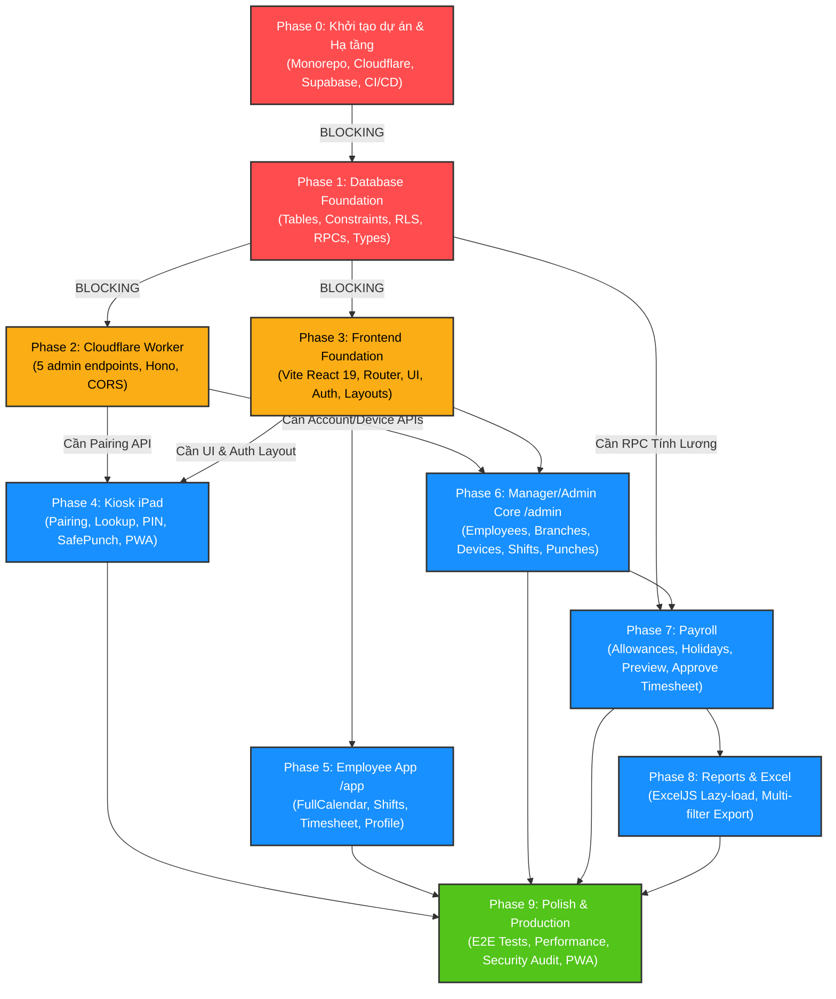

# Kế hoạch triển khai hệ thống chấm công

> **Bổ sung cho Phase 1/5/6:** Chi nhánh chính của nhân viên dùng `employees.home_branch_id` (schema/index trong `0001/0002`; nhân viên hiện có trên local đã gán CN003). Nhân viên đăng ký ca tại chi nhánh chính, không chọn chi nhánh; thiếu phân công thì chặn đăng ký. Manager/Admin chọn giữ nguyên hoặc đổi chi nhánh khi duyệt bằng RPC `approve_shifts_at_branch` (hàm/trigger trong `0004`), Manager cần quyền ở cả chi nhánh nguồn và đích và không được tự duyệt. Chi tiết quy tắc được cập nhật ở đầu `architecture.md`. Áp dụng bằng `pnpm exec supabase migration up --local` trên local; không cần reset dữ liệu.

> [!IMPORTANT]
> **Thứ tự triển khai BLOCKING bắt buộc:**
> 1. **Phase 0 (Khởi tạo dự án & Hạ tầng)** là tiền đề bắt buộc cho toàn bộ dự án.
> 2. **Phase 1 (Database Foundation)** phải hoàn thành 100% trước khi triển khai bất kỳ module backend hay frontend nào. Toàn bộ logic nghiệp vụ cốt lõi, RLS, constraint và RPC nằm tại Postgres.
> 3. Sau Phase 1, **Phase 2 (Cloudflare Worker)** và **Phase 3 (Frontend Foundation)** có thể triển khai song song.
> 4. **Phase 4 (Kiosk iPad)** phụ thuộc trực tiếp vào cả Phase 2 (Pairing/Revoke APIs) và Phase 3 (Frontend Foundation).

---

## Lộ trình tổng quan & Sơ đồ phụ thuộc (Dependency Graph)



---

## Bảng quy ước độ phức tạp (T-shirt Sizing)

| Kích thước | Ước lượng thời gian | Đặc điểm công việc |
|:---:|:---:|---|
| **S** (Small) | 1 – 2 giờ | Config chuẩn, CRUD cơ bản, UI form đơn giản, logic đã có mẫu rõ ràng. |
| **M** (Medium) | 3 – 5 giờ | Tích hợp nhiều thành phần, viết middleware, form có validation phức tạp, UI bảng có filter/sorting. |
| **L** (Large) | 1 – 2 ngày | Thuật toán nghiệp vụ chuyên sâu, RPC Postgres phức tạp, Realtime synchronization, state machine kiosk. |
| **XL** (Extra Large) | 3 – 5 ngày | Xử lý concurrency cao, thuật toán tính lương đa chiều, constraint GiST thời gian, transaction phức tạp với rollback/audit. |

---

## Chi tiết các giai đoạn triển khai

---

### Phase 0 – Khởi tạo dự án & Hạ tầng (Blocking toàn bộ)

#### 1. Mục tiêu
Thiết lập monorepo pnpm workspace tiêu chuẩn, khởi tạo tài nguyên hạ tầng đám mây trên Supabase, Cloudflare (Pages, Worker, R2) và cấu hình toàn bộ pipeline CI/CD tự động hóa trên GitHub Actions.

#### 2. Danh sách công việc (Task List)
- [ ] **Khởi tạo pnpm monorepo structure** (`package.json`, `pnpm-workspace.yaml`, `.npmrc`, `.gitignore`) bao gồm `apps/web`, `apps/worker`, `packages/shared`, `supabase`. *(Độ phức tạp: S)*
- [ ] **Cấu hình TypeScript base & tooling** (`tsconfig.base.json`, Biome/ESLint, Prettier, EditorConfig) dùng chung toàn workspace. *(Độ phức tạp: S)*
- [ ] **Provisioning Supabase Project** (Postgres 17): lấy thông tin Connection String, Project Ref, Anon Key, Service Role Key; bật các extension cốt lõi (`pgcrypto`, `btree_gist`, `uuid-ossp`). *(Độ phức tạp: S)*
- [ ] **Cấu hình Cloudflare Services**:
  - Tạo Cloudflare Pages project `timekeeping-web`. *(Độ phức tạp: S)*
  - Tạo Cloudflare Worker `timekeeping-worker`. *(Độ phức tạp: S)*
  - Tạo Cloudflare R2 bucket `timekeeping-backup` và API token S3-compatible credentials. *(Độ phức tạp: S)*
- [ ] **Cấu hình GitHub Repository Secrets**: nạp đầy đủ 11 secrets cho CI/CD (`SUPABASE_URL`, `SUPABASE_ANON_KEY`, `SUPABASE_SERVICE_ROLE_KEY`, `SUPABASE_DB_URL`, `CLOUDFLARE_API_TOKEN`, `CLOUDFLARE_ACCOUNT_ID`, `R2_ACCESS_KEY_ID`, `R2_SECRET_ACCESS_KEY`, `R2_ENDPOINT`, `VITE_SUPABASE_URL`, `VITE_SUPABASE_ANON_KEY`, `VITE_WORKER_URL`). *(Độ phức tạp: S)*
- [ ] **Xây dựng GitHub Actions CI/CD workflows**:
  - `.github/workflows/deploy.yml`: Pipeline tự động deploy Worker và Pages khi push vào nhánh `main`. *(Độ phức tạp: M)*
  - `.github/workflows/backup.yml`: Cron job `0 19 * * 0` (02:00 Chủ nhật giờ VN) chạy `pg_dump` custom format, nén `gzip`, đẩy vào R2 và dọn dẹp backup cũ hơn 12 tuần (84 ngày). *(Độ phức tạp: M)*
  - `.github/workflows/keep-alive.yml`: Cron job ping endpoint Supabase REST hàng ngày lúc 00:00 UTC để chống auto-pause trên Free tier. *(Độ phức tạp: S)*

#### 3. Dependencies
- Không có (Đây là Phase gốc).

#### 4. Có thể song song với
- Không có (Blocking toàn bộ các phase tiếp theo).

#### 5. Rủi ro & Lưu ý kỹ thuật
> [!WARNING]
> - Extension `btree_gist` trên Supabase Postgres 17 bắt buộc phải được kích hoạt trước khi chạy migration constraint GiST ở Phase 1.
> - `SUPABASE_SERVICE_ROLE_KEY` tuyệt đối **không** được inject vào client build environment (`apps/web`), chỉ cấu hình trong Cloudflare Worker secrets và GitHub Actions secrets.
> - Cấu hình múi giờ container GitHub Actions trong workflow backup cần chú ý chênh lệch UTC+7 (19:00 UTC Thứ Bảy tương ứng 02:00 Chủ Nhật giờ Hà Nội).

#### 6. Definition of Done (DoD)
1. Lệnh `pnpm install` và `pnpm build` chạy thành công không có lỗi tại root.
2. Các dashboard Supabase, Cloudflare Pages, Worker, R2 đã hoạt động và kết nối thành công.
3. Chạy thử nghiệm thủ công (`workflow_dispatch`) cả 3 workflow GitHub Actions (`deploy.yml`, `backup.yml`, `keep-alive.yml`) thành công. File backup xuất hiện trên bucket R2.

#### 7. Hướng dẫn triển khai thực tế
1. **Khởi tạo Supabase & Lưu trữ Secret an toàn**:
   - Đăng ký tài khoản và tạo project Supabase mới (Postgres 17, khu vực Singapore `ap-southeast-1`). Bật sẵn các extension: `pgcrypto`, `btree_gist`, `uuid-ossp`.
   - Sao chép `SUPABASE_URL`, `SUPABASE_ANON_KEY`, `SUPABASE_SERVICE_ROLE_KEY` và `SUPABASE_DB_URL` (Session/Direct connection string) lưu ngay vào trình quản lý mật khẩu (1Password/Bitwarden). **Tuyệt đối không commit bất kỳ khóa nào vào Git.**
2. **Khởi tạo tài nguyên Cloudflare**:
   - Tạo tài khoản Cloudflare, ghi nhận `CLOUDFLARE_ACCOUNT_ID` và tạo `CLOUDFLARE_API_TOKEN` (quyền chỉnh sửa Pages, Workers, R2).
   - Tạo Cloudflare Pages project `timekeeping-web`, Worker `timekeeping-worker` (nạp biến môi trường secret cho Worker bằng `wrangler secret put`) và R2 bucket `timekeeping-backup` (tạo cặp S3 API token `R2_ACCESS_KEY_ID`, `R2_SECRET_ACCESS_KEY`, `R2_ENDPOINT`).
3. **Cấu hình GitHub Secrets**:
   - Vào `Settings > Secrets and variables > Actions` trên GitHub repository, nạp đầy đủ các biến môi trường và khóa bảo mật đã lưu ở bước 1 và 2.
4. **Thiết lập môi trường Local (PowerShell)**:
   - Tạo file biến môi trường cục bộ từ template (đã nằm trong `.gitignore`):
     ```powershell
     Copy-Item apps/web/.env.example apps/web/.env.local
     Copy-Item apps/worker/.dev.vars.example apps/worker/.dev.vars
     ```
   - Điền giá trị thực tế vào `.env.local` (chỉ dùng `VITE_SUPABASE_URL`, `VITE_SUPABASE_ANON_KEY`, `VITE_WORKER_URL`) và `.dev.vars` (chứa `SUPABASE_SERVICE_ROLE_KEY` cho Worker local).
5. **Cài đặt, Build & Kiểm chứng CI/CD**:
   - Chạy `pnpm install` và `pnpm build` trên PowerShell để xác nhận toàn bộ workspace biên dịch sạch.
   - Vào tab **Actions** trên GitHub, kích hoạt thủ công (`workflow_dispatch`) lần lượt `deploy.yml`, `backup.yml`, `keep-alive.yml` và kiểm tra trạng thái xanh cũng như file `.dump.gz` sinh ra trên R2.
6. **Phương án Rollback & Phục hồi sự cố (Recovery)**:
   - **Worker/Pages lỗi**: Sử dụng tính năng Rollback tức thì về bản deployment ổn định liền trước trên Cloudflare Dashboard.
   - **Lộ hoặc nghi ngờ lộ khóa**: Xoay vòng (rotate) ngay `SUPABASE_SERVICE_ROLE_KEY`, Database Password, Cloudflare API Token và R2 keys, sau đó cập nhật lại vào Secret Manager, Cloudflare Worker và GitHub Secrets.
   - **Sự cố cơ sở dữ liệu**: Tải bản sao lưu mới nhất từ bucket R2 `timekeeping-backup`, giải nén `gunzip` và chạy `pg_restore --clean --if-exists -d $SUPABASE_DB_URL backup_file.dump`.

---

### Phase 1 – Database Foundation (Blocking backend/frontend)

#### 1. Mục tiêu
Xây dựng toàn bộ nền tảng cơ sở dữ liệu Postgres 17: DDL 14 bảng, ràng buộc toàn vẹn dữ liệu (CHECK, GiST EXCLUDE), hệ thống bảo mật RLS phân quyền theo schema `private`, bộ RPC functions cho Kiosk, Duyệt ca, Lượt chấm và Tính lương, cùng package TypeScript chia sẻ chung type & schema.

#### 2. Danh sách công việc (Task List)
- [ ] **Migration `0001_tables.sql`**: Tạo toàn bộ 14 bảng dữ liệu:
  - `branches`, `employees`, `employee_pins`, `manager_branches`, `devices`, `device_pairings`. *(Độ phức tạp: M)*
  - `shifts`, `punches`, `payroll_periods`, `monthly_allowances`, `payroll`, `audit_log`, `holidays`, `shift_templates`. *(Độ phức tạp: M)*
- [ ] **Migration `0002_constraints.sql`**: Thiết lập toàn bộ ràng buộc & Indexes:
  - `ALTER TABLE shifts ADD CONSTRAINT no_overlap EXCLUDE USING gist (employee_id WITH =, during WITH &&) WHERE (status <> 'rejected')`. *(Độ phức tạp: L - Rất phức tạp)*
  - Các ràng buộc CHECK: `max_12h` (ca <= 12 tiếng), `manual_needs_reason`, `fixed_allowance_non_negative`, `allowance_positive`, `allowance_needs_reason`. *(Độ phức tạp: S)*
  - Các Index hiệu năng: GiST trên `shifts(during)`, B-tree trên `shifts(employee_id, branch_id, status)`, `punches(employee_id, at, voided_at)`, `punches(branch_id, at)`, `devices(auth_user_id)`. *(Độ phức tạp: M)*
- [ ] **Migration `0003_rls.sql`**: Bảo mật và Phân quyền:
  - Khởi tạo `CREATE SCHEMA private;` đóng quyền truy cập PostgREST API. *(Độ phức tạp: S)*
  - Tạo các hàm helper `SECURITY DEFINER`: `private.my_role()`, `private.is_admin()`, `private.my_branches()`. *(Độ phức tạp: M)*
  - Bật `ALTER TABLE ... ENABLE ROW LEVEL SECURITY;` trên **100% các bảng**. Bảng `employee_pins` bật RLS nhưng **không cấp policy** (chỉ RPC mới đọc được). *(Độ phức tạp: M)*
  - Thiết lập ma trận chính sách RLS chi tiết cho từng bảng theo đúng bảng phân quyền kiến trúc. *(Độ phức tạp: L)*
  - Viết trigger `private.audit_row()` ghi log thay đổi trên `shifts`, `branches`, `employees` vào `audit_log`. *(Độ phức tạp: M)*
  - Viết trigger khóa bảng `punches` và `monthly_allowances` khi `payroll_periods` chuyển sang `status = 'approved'`. *(Độ phức tạp: M)*
- [ ] **Migration `0004_functions.sql`**: Toàn bộ RPC Functions nghiệp vụ:
  - `kiosk_lookup(p_employee_code text)`: Tra cứu thông tin hiển thị và trạng thái hiện tại (`off`, `working`, `on_break`). *(Độ phức tạp: M)*
  - `kiosk_punch(p_employee_code, p_pin, p_action)`: Cơ chế xác thực bcrypt PIN, brute-force lockout (5 lần sai -> khóa 15 phút), ghi nhận timestamp `now()`, liên kết `device_id` từ `auth.uid()`. *(Độ phức tạp: XL - Cực kỳ quan trọng)*
  - `approve_shifts(p_shift_ids uuid[])`: Duyệt hàng loạt ca làm cho Manager/Admin, chặn manager tự duyệt ca của mình. *(Độ phức tạp: M)*
  - `correct_punch(p_punch_id, p_new_at, p_reason)`: Void lượt chấm cũ (`voided_at = now()`), tạo lượt chấm thủ công mới, ghi `audit_log`. *(Độ phức tạp: L)*
  - `add_manual_punch(p_employee_id, p_branch_id, p_type, p_at, p_reason)` và `void_punch(p_punch_id, p_reason)`: Bổ sung lượt quên chấm hoặc huỷ lượt bấm nhầm; bắt buộc lý do, phân quyền theo chi nhánh và ghi audit. *(Độ phức tạp: L)*
  - `change_pin(p_old_pin, p_new_pin)` & `reset_pin(p_employee_id, p_new_pin)`. *(Độ phức tạp: S)*
  - `new_pairing_code(p_device_id)` & `consume_pairing_code(p_code)`. *(Độ phức tạp: M)*
  - `preview_timesheet(p_period_id, p_employee_id)` & `approve_timesheet(p_period_id)`: Động cơ tính giờ theo block 15 phút, grace period 2 phút đầu block khi vào ca, kiểm tra punch mở trước khi duyệt, tăng ca 48h/tuần, giờ đêm 22h-06h, ngày lễ 200%, snapshot tỷ giá và lương. *(Độ phức tạp: XL - Nghiệp vụ phức tạp nhất)*
- [ ] **Dữ liệu Seed `seed.sql`**: Tạo chi nhánh mẫu `CN001`, `CN002`, các template ca (Sáng/Chiều/Đêm), ngày lễ mẫu, tài khoản Admin mặc định cho môi trường local/dev. *(Độ phức tạp: S)*
- [ ] **Xây dựng `packages/shared`**:
  - Script tự động sinh TypeScript types từ Supabase DB: `database.types.ts`. *(Độ phức tạp: S)*
  - Zod schemas dùng chung (`schemas.ts`): Validate nhân viên, thiết bị, ca làm, PIN, đổi mật khẩu. *(Độ phức tạp: M)*
  - Hằng số quyền & Enums (`auth.ts`): Role enum, PunchType enum, ShiftStatus enum. *(Độ phức tạp: S)*

#### 3. Dependencies
- Phase 0 (Supabase project & extensions).

#### 4. Có thể song song với
- Không có (Blocking trực tiếp Phase 2 và Phase 3).

#### 5. Rủi ro & Lưu ý kỹ thuật
> [!CAUTION]
> **Điểm kỹ thuật cực kỳ quan trọng:**
> 1. **EXCLUDE USING GIST constraint:** Yêu cầu cài đặt `CREATE EXTENSION IF NOT EXISTS btree_gist;`. Chú ý điều kiện `WHERE (status <> 'rejected')` để nhân viên có thể đăng ký lại khung giờ đó nếu ca trước đã bị từ chối.
> 2. **PIN Lockout Race Condition:** Trong `kiosk_punch`, kiểm tra và cập nhật `pin_failed` cùng `pin_lock_until` phải đảm bảo an toàn dưới concurrency. Nếu nhân viên bấm liên tiếp nhiều lần, lock timestamp phải được áp dụng chính xác.
> 3. **Timezone trong RPC tính lương:** Toàn bộ việc xác định đầu tuần (Thứ Hai 00:00) và khung giờ đêm (22:00 - 06:00) phải quy chuẩn theo múi giờ `Asia/Ho_Chi_Minh` (`AT TIME ZONE 'Asia/Ho_Chi_Minh'`), không dùng UTC của server.

#### 6. Definition of Done (DoD)
1. Áp dụng thành công toàn bộ migration `0001` đến `0004` vào database sạch mà không phát sinh lỗi syntax hay constraint.
2. Bộ test SQL kiểm chứng:
   - Thử chèn 2 ca trùng giờ -> Postgres bắn lỗi `23P01` (Exclusion violation).
   - Thử nhập sai PIN 5 lần -> Bị khóa đúng 15 phút (`PIN_LOCKED`).
   - Thử client gọi trực tiếp bảng `employee_pins` -> Bị RLS chặn 100%.
3. File `packages/shared/src/database.types.ts` được sinh ra tự động và compile không lỗi với TypeScript.

#### 7. Hướng dẫn triển khai thực tế
1. **Kiểm tra Supabase Project & Extensions**: Xác nhận project Postgres 17 đang hoạt động và đã bật đủ `pgcrypto`, `btree_gist`, `uuid-ossp`.
2. **Thiết lập `SUPABASE_DB_URL` an toàn**: Khai báo biến môi trường trong phiên làm việc tạm thời hoặc nạp từ Secret Manager (tuyệt đối không hardcode hay lưu lịch sử shell chứa mật khẩu).
3. **Chạy Migrations theo đúng thứ tự**: Thực thi tuần tự từ `0001_tables.sql` đến `0004_functions.sql` thông qua Supabase SQL Editor hoặc `psql "$SUPABASE_DB_URL" -v ON_ERROR_STOP=1 -f <file>`.
4. **Nạp dữ liệu mẫu (Seed)**: Chỉ chạy `seed.sql` trên môi trường local/dev; tuyệt đối không chạy trên production.
5. **Khởi tạo Admin đầu tiên & Phân quyền chi nhánh**: Tạo tài khoản Admin đầu tiên qua luồng server-side an toàn (Supabase Auth Admin API / SQL Editor với quyền quản trị để chèn `employees` và `employee_pins`), sau đó gán quyền phụ trách chi nhánh tại bảng `manager_branches`.
6. **Kiểm chứng Bảo mật & Nghiệp vụ**: Xác minh RLS đã bật trên 100% bảng (`employee_pins` chặn truy cập trực tiếp), mọi hàm `SECURITY DEFINER` đều cố định `SET search_path = public, private, pg_temp`, cơ chế khóa PIN 15 phút sau 5 lần sai, phát hiện `ORPHANED_PUNCHES` và kết quả RPC tính lương (`preview_timesheet` / `approve_timesheet`).
7. **Chiến lược Rollback**: Khôi phục từ bản backup gần nhất hoặc revert các migration chưa áp dụng; **tuyệt đối không chỉnh sửa trực tiếp các file migration đã chạy trên production** (mọi thay đổi sau đó phải tạo migration mới).

---

### Phase 2 – Cloudflare Worker (5 endpoints)

#### 1. Mục tiêu
Xây dựng API gateway bảo mật trên Cloudflare Worker với framework Hono, đóng vai trò là dịch vụ duy nhất sở hữu `SUPABASE_SERVICE_ROLE_KEY` để thực hiện các tác vụ quản trị tài khoản Supabase Auth và quản lý thiết bị Kiosk iPad.

#### 2. Danh sách công việc (Task List)
- [ ] **Thiết lập dự án Worker (`apps/worker`)**: Cấu hình Hono, `wrangler.toml`, TypeScript, tích hợp `@hono/zod-validator`. *(Độ phức tạp: S)*
- [ ] **Cấu hình CORS & Error Handling Middleware**:
  - Whitelist chính xác domain của Cloudflare Pages và localhost dev. *(Độ phức tạp: S)*
  - Global error handler trả về JSON chuẩn format RFC 7807 hoặc `{ error: string, details?: any }`. *(Độ phức tạp: S)*
- [ ] **Xây dựng middleware `requireAdmin`**:
  - Trích xuất JWT Bearer token từ header `Authorization`.
  - Gọi Supabase Auth API xác thực token, sau đó đọc `employees.role` và `employees.is_active` tại thời điểm request; không dùng `app_metadata.role` làm nguồn phân quyền. Trả về 403 Forbidden nếu không hợp lệ. *(Độ phức tạp: M)*
- [ ] **Triển khai `POST /api/employees`**:
  - Validate payload bằng Zod schema: `email`, `password`, `full_name`, `employee_code`, `role`, `hourly_rate`, `fixed_allowance`, `pin`. *(Độ phức tạp: M)*
  - Dùng Supabase Admin SDK tạo `auth.users` với `app_metadata: { role }`. *(Độ phức tạp: M)*
  - Insert dữ liệu vào bảng `employees` và tạo mã PIN mã hóa bcrypt trong bảng `employee_pins`. Thực hiện rollback/xóa auth user nếu insert DB thất bại. *(Độ phức tạp: L)*
- [ ] **Triển khai `POST /api/employees/:id/reset-password`**:
  - Validate ID và mật khẩu mới.
  - Gọi `supabase.auth.admin.updateUserById(id, { password })`. *(Độ phức tạp: S)*
- [ ] **Triển khai `POST /api/devices`**:
  - Đăng ký thiết bị iPad mới: Tạo tài khoản Kiosk chuyên dụng trong `auth.users` với role `kiosk` và tạo bản ghi tương ứng trong bảng `devices`. *(Độ phức tạp: M)*
- [ ] **Triển khai `POST /api/devices/pair`**:
  - Sinh mã pairing ngẫu nhiên 6 ký tự dễ đọc.
  - Lưu mã băm SHA-256 vào `device_pairings` kèm thời hạn hết hạn 10 phút. Trả mã plain text cho Admin hiển thị. *(Độ phức tạp: M)*
- [ ] **Triển khai `POST /api/devices/:id/revoke`**:
  - Đánh dấu `revoked_at = now()` trên bảng `devices`.
  - Vô hiệu hóa hoặc ban tài khoản Kiosk tương ứng trong Supabase Auth để ngắt phiên lập tức. *(Độ phức tạp: S)*

#### 3. Dependencies
- Phase 1 (Database schema, RLS, `packages/shared`).

#### 4. Có thể song song với
- **Phase 3 (Frontend Foundation)**.

#### 5. Rủi ro & Lưu ý kỹ thuật
> [!WARNING]
> - Giới hạn CPU của Cloudflare Worker gói Free là 10 ms CPU execution time. Tuyệt đối không tính toán nặng (như parse Excel hay chạy loop lớn) trong Worker.
> - Transaction liên hệ thống: Supabase Auth và Postgres DB nằm ở 2 tầng khác nhau. Khi tạo nhân viên mới qua `admin.createUser`, nếu việc insert bảng `employees` bị lỗi (ví dụ trùng `employee_code`), Worker phải có hàm `catch` để chủ động gọi `admin.deleteUser` dọn dẹp tài khoản rác.

#### 6. Definition of Done (DoD)
1. Worker deploy thành công trên Cloudflare và khởi động không lỗi.
2. Bộ integration tests (hoặc Postman/Bruno) chạy pass cả 5 endpoint:
   - Request không có token hoặc token không phải admin -> Bị chặn 401/403.
   - Tạo nhân viên mới -> Tài khoản Auth và bản ghi `employees`, `employee_pins` được khởi tạo chuẩn xác.
   - Ghép nối thiết bị và thu hồi thiết bị hoạt động chính xác.

#### 7. Hướng dẫn triển khai thực tế
1. **Cấu hình Local (`apps/worker/.dev.vars`)**: Tạo file `apps/worker/.dev.vars` (chỉ dùng tại máy local, đã gitignore) chứa `SUPABASE_URL`, `SUPABASE_ANON_KEY`, `SUPABASE_SERVICE_ROLE_KEY` và `ALLOWED_ORIGIN`.
2. **Cấu hình Cloudflare Worker Vars/Secrets**: Cập nhật `SUPABASE_URL` trong `apps/worker/wrangler.toml` và chạy `wrangler secret put` cho `SUPABASE_ANON_KEY`, `SUPABASE_SERVICE_ROLE_KEY`, `ALLOWED_ORIGIN`.
3. **Triển khai (Deploy)**: Chạy `pnpm --filter @timekeeping/worker deploy` (hoặc `wrangler deploy` tại thư mục `apps/worker`).
4. **Kiểm thử Health & 5 Endpoints**: Kiểm tra health check và test đủ 5 endpoints (`POST /api/employees`, `POST /api/employees/:id/reset-password`, `POST /api/devices`, `POST /api/devices/pair`, `POST /api/devices/:id/revoke`) với cả **Admin JWT** (thành công 200/201) và **Kiosk JWT** (bị chặn 403 Forbidden trên các route quản trị).
5. **Kiểm chứng CORS & Rollback**: Xác minh CORS header chỉ cho phép đúng `ALLOWED_ORIGIN` đã whitelist; nếu phát sinh lỗi sau deploy, rollback tức thì bằng `wrangler rollback` hoặc chọn version ổn định liền trước trên Cloudflare Dashboard.
6. **Nguyên tắc bảo mật tối thượng**: Tuyệt đối không bao giờ để lộ `SUPABASE_SERVICE_ROLE_KEY` ra phía frontend (`apps/web`) hoặc in ra console/logs của Worker.

---

### Phase 3 – Frontend Foundation

#### 1. Mục tiêu
Thiết lập kiến trúc ứng dụng web React 19 SPA trên Cloudflare Pages: tích hợp TanStack Router, TanStack Query, shadcn/ui, hệ thống thư viện tiện ích (Supabase client, Worker API client, xử lý múi giờ VN, chuyển đổi mã lỗi), và chia tách 3 khu vực layout độc lập kèm lazy loading.

#### 2. Danh sách công việc (Task List)
- [ ] **Khởi tạo dự án Vite (`apps/web`)**: React 19, TypeScript, Tailwind CSS, cấu hình path aliases `@/*`. *(Độ phức tạp: S)*
- [ ] **Tích hợp shadcn/ui**: Thiết lập theme, biến CSS, cài đặt các primitive components cốt lõi: Button, Input, Form, Dialog, DropdownMenu, Table, Card, Badge, Toaster (Sonner). *(Độ phức tạp: M)*
- [ ] **Xây dựng module tiện ích cốt lõi (`src/lib/`)**:
  - `lib/supabase.ts`: Khởi tạo Supabase Client với `VITE_SUPABASE_ANON_KEY`, cấu hình tự động refresh session. *(Độ phức tạp: S)*
  - `lib/api.ts`: HTTP client gọi sang Cloudflare Worker, tự động đính kèm `Authorization: Bearer <admin_jwt>` lấy từ session hiện tại. *(Độ phức tạp: S)*
  - `lib/time.ts`: Cấu hình Date-fns/Dayjs theo múi giờ `Asia/Ho_Chi_Minh`; các hàm tiện ích làm tròn block 15 phút: `roundUp15(date)` và `roundDown15(date)`. *(Độ phức tạp: M)*
  - `lib/errors.ts`: Hàm `mapSupabaseError(error: PostgrestError)` chuyển đổi các mã lỗi Postgres (`23P01`, `23514`, `P0001`, ...) thành thông báo tiếng Việt trực quan. *(Độ phức tạp: M)*
  - `lib/realtime.ts`: Trình quản lý kết nối Supabase Realtime channel, quản lý lifecycle đăng ký và hủy đăng ký subscription. *(Độ phức tạp: M)*
- [ ] **Cấu hình TanStack Router & Lazy-loading**:
  - Thiết lập code-splitting / dynamic imports (`React.lazy`) cho 3 phân hệ: Kiosk (`/kiosk`), Employee App (`/app`), Admin Portal (`/admin`). *(Độ phức tạp: M)*
  - Cấu hình route pre-loading và Suspense fallback component hiển thị spinner/skeleton. *(Độ phức tạp: S)*
- [ ] **Phân hệ Auth & Route Guards**:
  - `AuthContext` quản lý session đăng nhập, role của người dùng (`employee`, `manager`, `admin`, `kiosk`). *(Độ phức tạp: M)*
  - Route Guards: Chặn truy cập trái phép dựa trên role, tự động chuyển hướng người dùng về đúng khu vực phù hợp (`/kiosk`, `/app`, `/admin`). *(Độ phức tạp: M)*
  - Giao diện đăng nhập (`/login`) và đăng xuất chuẩn UX. *(Độ phức tạp: S)*
- [ ] **Khung giao diện (Layouts)**:
  - `KioskLayout`: Giao diện toàn màn hình, theme tối, khóa zoom, tối ưu cảm ứng iPad, không thanh điều hướng. *(Độ phức tạp: S)*
  - `EmployeeLayout`: Tối ưu hiển thị mobile-first, thanh điều hướng dưới đáy (Bottom Navigation) hoặc sidebar thu gọn. *(Độ phức tạp: S)*
  - `AdminLayout`: Tối ưu desktop/tablet, thanh sidebar cố định, header có bộ chọn chi nhánh toàn cục và thông tin tài khoản. *(Độ phức tạp: S)*

#### 3. Dependencies
- Phase 1 (Database types & schema).

#### 4. Có thể song song với
- **Phase 2 (Cloudflare Worker)**.

#### 5. Rủi ro & Lưu ý kỹ thuật
> [!TIP]
> - Tránh rò rỉ bộ nhớ (memory leaks) khi lắng nghe sự kiện window `online`/`offline` và kết nối WebSocket của Supabase Realtime. Luôn dọn dẹp subscription trong cleanup function của `useEffect`.
> - Việc làm tròn 15 phút ở frontend chỉ phục vụ mục đích hiển thị trực quan cho người dùng. Server Postgres (RPC) vẫn là nơi nắm giữ chân lý tuyệt đối về thời gian (`now()`).

#### 6. Definition of Done (DoD)
1. Ứng dụng chạy mượt mà tại `localhost` và deploy thành công trên Cloudflare Pages preview.
2. Đăng nhập với các role khác nhau (`employee`, `manager`, `admin`) chuyển hướng chính xác vào `/app`, `/admin`.
3. Kiểm tra bundle size: Vendor chunks tách biệt rõ ràng, không tải trước mã nguồn của `/admin` khi người dùng đang ở `/kiosk`.

#### 7. Hướng dẫn triển khai thực tế
1. **Cấu hình biến môi trường (`apps/web/.env.local`)**: Tạo file `apps/web/.env.local` chỉ chứa đúng 3 biến công khai: `VITE_SUPABASE_URL`, `VITE_SUPABASE_ANON_KEY`, `VITE_WORKER_URL` (tuyệt đối không đưa `SUPABASE_SERVICE_ROLE_KEY` vào frontend).
2. **Sinh Route, Kiểm tra kiểu & Build**: Chạy `pnpm --filter @timekeeping/web routes:gen`, `pnpm --filter @timekeeping/web typecheck` và `pnpm --filter @timekeeping/web build` để sinh `routeTree.gen.ts`, kiểm tra TypeScript và đóng gói ra thư mục `dist`.
3. **Triển khai lên Cloudflare Pages**: Chạy `pnpm --filter @timekeeping/web deploy` (thực thi `wrangler pages deploy dist --project-name=timekeeping-web`).
4. **Kiểm chứng Phân quyền & Điều hướng**: Đăng nhập thử nghiệm và xác nhận chuyển hướng chuẩn xác theo từng vai trò (`employee` -> `/app`, `manager`/`admin` -> `/admin`, `kiosk` -> `/kiosk`) và các route bảo vệ chặn truy cập trái phép.
5. **Kiểm chứng PWA & Lazy Chunks**: Mở DevTools (Network & Application) xác nhận Service Worker/PWA đã đăng ký và các phân hệ `/kiosk`, `/app`, `/admin` được tách chunk tải lười (lazy-loaded) độc lập.
6. **Phương án Rollback**: Nếu phát sinh lỗi giao diện trên môi trường thật, thực hiện Rollback tức thì về bản deployment ổn định liền trước trên Cloudflare Pages Dashboard.
7. **Nguyên tắc Thời gian & Làm tròn**: Lưu ý các hàm làm tròn 15 phút ở frontend chỉ phục vụ mục đích hiển thị; RPC trên Postgres server cùng múi giờ `Asia/Ho_Chi_Minh` mới là nguồn chân lý (authority) duy nhất.

---

### Phase 4 – Kiosk iPad

#### 1. Mục tiêu
Xây dựng giao diện trạm chấm công Kiosk iPad chuyên dụng: luồng ghép nối thiết bị an toàn, màn hình chờ trực quan, bàn phím số nhập mã nhân viên, state machine 4 nút hành động, xác thực PIN với cơ chế chống retry race-condition (`safePunch`), và hỗ trợ PWA offline detection.

#### 2. Danh sách công việc (Task List)
- [ ] **Quy trình ghép nối iPad (Pairing Flow - `/kiosk/pair`)**:
  - Màn hình nhập mã ghép nối 6 ký tự. *(Độ phức tạp: S)*
  - Gọi RPC/Worker xác thực mã ghép nối -> Nhận session token chuyên dụng của Kiosk và lưu trữ bền vững tại `localStorage`. *(Độ phức tạp: M)*
  - Kiểm tra trạng thái thiết bị định kỳ: Nếu iPad bị Admin thu hồi (`DEVICE_REVOKED`), khóa màn hình kiosk ngay lập tức. *(Độ phức tạp: M)*
- [ ] **Màn hình chờ Kiosk (Standby Screen - `/kiosk`)**:
  - Đồng hồ điện tử thời gian thực hiển thị ngày giờ chuẩn Việt Nam, tên chi nhánh hiện tại. *(Độ phức tạp: S)*
  - Bàn phím số lớn (Virtual Numpad) tối ưu chạm ngón tay trên màn hình iPad để nhập mã nhân viên (`employee_code`). *(Độ phức tạp: M)*
- [ ] **Tra cứu thông tin (`kiosk_lookup`)**:
  - Tự động gọi RPC `kiosk_lookup` khi nhân viên nhập xong mã. *(Độ phức tạp: S)*
  - Hiển thị tên nhân viên, ảnh đại diện, và trạng thái hiện tại (`off`, `working`, `on_break`). *(Độ phức tạp: S)*
  - Hiển thị bộ 4 nút hành động (`clock_in`, `break_start`, `break_end`, `clock_out`) với trạng thái Active/Disabled đồng bộ chính xác theo state machine của nhân viên. *(Độ phức tạp: M)*
  - Nếu punch mở cuối cùng quá 16 giờ, hiển thị `MISSING_CLOCK_OUT`/`MISSING_BREAK_END` và cho phép bắt đầu ca mới; không tự động xoá punch cũ. *(Độ phức tạp: M)*
- [ ] **Bàn phím nhập PIN & Xác thực**:
  - Modal/màn hình phụ nhập mã PIN 4–6 số với hiển thị dấu chấm bảo mật (masked input). *(Độ phức tạp: S)*
  - Tích hợp hàm `safePunch`: Kiểm tra trạng thái hiện tại trước khi retry để đảm bảo tính Idempotency, tránh ghi nhận 2 lượt chấm trùng lặp khi mạng chập chờn. *(Độ phức tạp: L - Nghiệp vụ then chốt)*
- [ ] **Xử lý toàn diện các kịch bản lỗi Kiosk**:
  - Xử lý `EMPLOYEE_NOT_FOUND`: Báo lỗi thân thiện, xóa input cho nhập lại. *(Độ phức tạp: S)*
  - Xử lý `WRONG_PIN`: Hiển thị số lần nhập sai còn lại trước khi bị khóa. *(Độ phức tạp: S)*
  - Xử lý `PIN_LOCKED`: Hiển thị đồng hồ đếm ngược thời gian mở khóa theo `unlock_at`. *(Độ phức tạp: M)*
  - Xử lý `DEVICE_REVOKED`: Hiển thị banner đỏ cảnh báo iPad đã bị vô hiệu hóa. *(Độ phức tạp: S)*
  - Màn hình thành công hiển thị lớn trong 3 giây (kèm âm thanh feedback nhẹ nếu cần) rồi tự động reset về màn hình chờ. *(Độ phức tạp: S)*
- [ ] **Cấu hình PWA & Tối ưu iPad Kiosk**:
  - Cấu hình `vite-plugin-pwa` với Web App Manifest chuẩn (icon, fullscreen display mode). *(Độ phức tạp: M)*
  - Chặn thao tác kéo cuộn cao su (overscroll bounce), chặn phóng to/thu nhỏ (pinch-to-zoom) trên Safari iOS. *(Độ phức tạp: S)*
  - Banner cảnh báo mất kết nối Internet toàn màn hình: Nhắc nhở chấm công bắt buộc phải có kết nối mạng trực tuyến. *(Độ phức tạp: S)*

#### 3. Dependencies
- Phase 2 (Device pairing/revocation endpoints).
- Phase 3 (Frontend framework, KioskLayout, Supabase client).

#### 4. Có thể song song với
- **Phase 5 (Employee App)**.
- **Phase 6 (Manager/Admin Core)**.

#### 5. Rủi ro & Lưu ý kỹ thuật
> [!CAUTION]
> - **Không cache lượt chấm ngoại tuyến (Offline):** Theo kiến trúc hệ thống, iPad Kiosk bắt buộc không lưu punch vào LocalStorage để gửi sau. Lượt chấm phải nhận thời gian `at = now()` từ server Postgres để chống gian lận chỉnh giờ iPad.
> - **Idempotent Retry Logic (`safePunch`):** Khi mạng timeout nhưng server thực tế đã nhận request, việc retry mù quáng sẽ dẫn đến punch sai trạng thái hoặc lỗi `INVALID_ACTION`. `safePunch` bắt buộc phải gọi lại `kiosk_lookup` kiểm tra nếu `current_state` đã đạt trạng thái mong muốn thì coi như thành công và không gọi lại `kiosk_punch`.

#### 6. Definition of Done (DoD)
1. Hoàn tất chu trình ghép nối một iPad mới từ màn hình `/kiosk/pair` thành công.
2. Kiểm thử thực tế trên thiết bị iPad / Safari tablet:
   - Chấm Vào ca -> Ra ca -> Bắt đầu nghỉ -> Kết thúc nghỉ mượt mà.
   - Nhập sai PIN 5 lần -> Kiosk hiển thị màn hình khóa đếm ngược chính xác 15 phút.
   - Khi rút dây mạng / ngắt Wi-Fi -> Kiosk hiển thị ngay cảnh báo mất kết nối, chặn không cho bấm chấm công.
   - Trạng thái tự động reset về màn hình chờ sau 3 giây hiển thị kết quả thành công.

#### 7. Hướng dẫn triển khai thực tế
1. **Khởi tạo & Ghép nối iPad mới (Pairing)**: Admin tạo thiết bị Kiosk cho chi nhánh và sinh mã ghép nối 6 ký tự dùng một lần (hiệu lực 10 phút) qua Worker/Admin UI; trên iPad mở `/kiosk/pair`, nhập mã 6 số để tiêu thụ mã (`consume_pairing_code`) và nhận phiên đăng nhập Kiosk.
2. **Cài đặt & Mở PWA**: Trên Safari iPad, chọn **Share > Add to Home Screen** (Thêm vào màn hình chính), sau đó mở ứng dụng từ biểu tượng PWA ở chế độ toàn màn hình và bật Guided Access (Truy cập được hướng dẫn) nếu cần cố định trạm.
3. **Kiểm chứng Kiosk JWT & Trạng thái thiết bị**: Xác nhận session lưu trong `localStorage` mang role `kiosk`, thiết bị liên kết đúng `branch_id` và bản ghi `devices.revoked_at` đang là `NULL` (chưa bị thu hồi).
4. **Kiểm thử Luồng chấm công & Mạng chập chờn**:
   - Nhập `employee_code` để kiểm tra `kiosk_lookup`, đối chiếu state machine 4 nút (`clock_in`, `break_start`, `break_end`, `clock_out`), xác thực PIN (bao gồm kịch bản nhập sai 5 lần bị khóa 15 phút) và kiểm chứng cơ chế retry chống trùng lặp của `safePunch`.
   - Tắt/bật Wi-Fi trên iPad để xác nhận banner Offline chặn thao tác chấm công tức thì (không lưu punch ngoại tuyến) và tự động khôi phục trạng thái sẵn sàng ngay khi có mạng trở lại.
5. **Kiểm chứng Thu hồi thiết bị (Revoke)**: Thực hiện thu hồi thiết bị từ phía Admin (`POST /api/devices/:id/revoke`), xác nhận iPad Kiosk lập tức bị chặn truy cập, hiển thị cảnh báo `DEVICE_REVOKED` và từ chối mọi RPC chấm công tiếp theo.
6. **Phương án Rollback**: Nếu phát sinh sự cố trên phiên bản Kiosk mới, thu hồi/hủy ghép nối thiết bị bị ảnh hưởng (xóa dữ liệu PWA/localStorage trên iPad nếu cần) và thực hiện Rollback/redeploy ngay bản build frontend ổn định liền trước trên Cloudflare Pages.

---

### Phase 5 – Employee App (`/app`)

> Trạng thái triển khai: Đã bổ sung lịch FullCalendar, đăng ký ca mẫu/tùy chỉnh, hủy ca pending tương lai, Realtime, bảng công theo phiên qua đêm, phiếu lương đã duyệt và đổi mật khẩu/PIN/đăng xuất. Đã kiểm tra route generation, TypeScript, production/PWA build và logic phiên qua đêm (450 phút sau nghỉ 30 phút). DoD tích hợp RLS, lỗi trùng ca `23P01`, cập nhật Realtime và đổi PIN thực tế chưa được nghiệm thu trên Supabase/Safari; không coi build pass là nghiệm thu các mục này.

#### 1. Mục tiêu
Phát triển ứng dụng tự phục vụ dành cho nhân viên (Employee Self-Service) trên nền tảng di động: xem lịch và đăng ký ca làm việc qua FullCalendar, tra cứu nhật ký lượt chấm công cá nhân, theo dõi bảng lương tháng đã duyệt, và tự đổi mật khẩu cùng mã PIN cá nhân.

#### 2. Danh sách công việc (Task List)
- [ ] **Màn hình Lịch làm việc (`/app/shifts`)**:
  - Tích hợp thư viện FullCalendar 6 (chỉ dùng các gói MIT: `dayGrid`, `timeGrid`, `interaction`). *(Độ phức tạp: M)*
  - Hiển thị các ca làm việc của nhân viên theo màu sắc trực quan (Vàng: Chờ duyệt `pending`, Xanh: Đã duyệt `approved`, Đỏ: Từ chối `rejected`). *(Độ phức tạp: M)*
  - Tích hợp Supabase Realtime để cập nhật ngay lịch làm việc khi Manager duyệt hoặc từ chối ca. *(Độ phức tạp: M)*
- [ ] **Modal Đăng ký ca làm việc**:
  - Form chọn ngày, chọn ca mẫu từ danh sách `shift_templates` (Ca Sáng, Ca Chiều, Ca Đêm) hoặc tùy chỉnh thời gian bắt đầu/kết thúc. *(Độ phức tạp: M)*
  - Client-side validation: Chặn ca vượt quá 12 tiếng, chặn ca có thời gian kết thúc trước thời gian bắt đầu. *(Độ phức tạp: S)*
  - Xử lý gửi đăng ký ca vào bảng `shifts`: Bắt lỗi `23P01` từ Postgres và hiển thị thông báo "Ca bị trùng giờ với ca đã đăng ký". *(Độ phức tạp: M)*
  - Chức năng xóa ca `pending` chưa diễn ra. *(Độ phức tạp: S)*
- [ ] **Màn hình Lịch sử Chấm công (`/app/timesheet`)**:
  - Hiển thị danh sách các lượt chấm công (`punches`) của nhân viên theo từng ngày. *(Độ phức tạp: M)*
  - Hiển thị chi tiết từng phiên: Giờ vào, giờ nghỉ, giờ ra, tổng thời gian làm việc thực tế. *(Độ phức tạp: M)*
  - Phân biệt trực quan lượt chấm từ iPad Kiosk và lượt chấm được điều chỉnh thủ công (`manual`). *(Độ phức tạp: S)*
- [ ] **Màn hình Bảng lương cá nhân (`/app/payroll`)**:
  - Danh sách các kỳ lương đã được duyệt (`approved`). *(Độ phức tạp: S)*
  - Chi tiết phiếu lương (Payslip): Snapshot mức lương theo giờ, chi tiết số giờ thường, giờ đêm, giờ tăng ca, giờ ngày lễ, phụ cấp cố định, phụ cấp tháng và thực lĩnh cuối cùng. RLS đảm bảo nhân viên không thể xem lương của người khác. *(Độ phức tạp: M)*
- [ ] **Màn hình Hồ sơ & Bảo mật cá nhân (`/app/profile`)**:
  - Form đổi mật khẩu tài khoản (gọi `supabase.auth.updateUser`). *(Độ phức tạp: S)*
  - Form đổi mã PIN chấm công cá nhân: Nhập mã PIN cũ và mã PIN mới, gọi RPC `change_pin`. *(Độ phức tạp: M)*

#### 3. Dependencies
- Phase 1 (Database schema, RPCs, RLS).
- Phase 3 (Frontend Foundation, EmployeeLayout, AuthContext).

#### 4. Có thể song song với
- **Phase 4 (Kiosk iPad)**.
- **Phase 6 (Manager/Admin Core)**.

#### 5. Rủi ro & Lưu ý kỹ thuật
> [!NOTE]
> - Nhân viên chỉ có quyền xem dữ liệu của chính mình thông qua RLS (`employee_id = auth.uid()`).
> - FullCalendar cần được cấu hình chuẩn múi giờ địa phương để tránh trường hợp ca đêm (ví dụ: 22:00 hôm trước đến 06:00 hôm sau) bị hiển thị sai lệch ngày trên giao diện.

#### 6. Definition of Done (DoD)
1. Nhân viên đăng ký được ca mới; hệ thống chặn ngay lập tức nếu chọn giờ trùng với ca đã có.
2. Xóa được ca đang ở trạng thái `pending`.
3. Bảng công và phiếu lương hiển thị chuẩn xác số liệu cá nhân; kiểm tra network tab xác nhận không rò rỉ dữ liệu của nhân viên khác.
4. Đổi PIN và đổi mật khẩu thành công; dùng mã PIN mới chấm công được tại Kiosk.

#### 7. Hướng dẫn triển khai thực tế
1. **Kiểm chứng Xác thực & Phân quyền (`AuthContext`)**: Đăng nhập tài khoản nhân viên, xác nhận `AuthContext` truy vấn trực tiếp `role` và `is_active` từ bảng `employees` trong DB (không phụ thuộc cứng vào `app_metadata`), chỉ cho phép truy cập `/app` và đảm bảo RLS giới hạn dữ liệu theo đúng `auth.uid()`.
2. **Kiểm thử Đăng ký, Hủy ca & Ràng buộc trùng giờ**: Trên `/app/shifts`, thử tạo ca mới và hủy ca đang `pending` chưa diễn ra; thử đăng ký 2 ca giao nhau về thời gian để xác nhận constraint GiST (`no_overlap`) trả mã lỗi `23P01` và UI hiển thị thông báo tiếng Việt rõ ràng.
3. **Kiểm tra Đồng bộ Realtime**: Mở song song giao diện Manager để duyệt/từ chối ca hoặc ghi nhận lượt chấm mới, quan sát lịch FullCalendar và bảng công trên `/app` tự động cập nhật trạng thái tức thì qua WebSocket mà không cần tải lại trang.
4. **Kiểm thử Hồ sơ, Mật khẩu & Mã PIN**: Tại `/app/profile`, thực hiện đổi mật khẩu (`supabase.auth.updateUser`) và đổi mã PIN cá nhân qua RPC `change_pin(p_old_pin, p_new_pin)`, sau đó dùng ngay PIN mới chấm công thử nghiệm trên Kiosk.
5. **Kiểm tra Trình duyệt Di động & PWA**: Mở `/app` trên Safari iOS và Chrome Android (cả chế độ trình duyệt lẫn cài đặt PWA), kiểm tra điều hướng Bottom Navigation, hiển thị ca đêm vắt ngày trên FullCalendar và khả năng cuộn mượt trên màn hình nhỏ.
6. **Đóng gói & Triển khai (Deploy)**: Sử dụng chung bản build SPA của `apps/web` và triển khai lên cùng project Cloudflare Pages (`pnpm --filter @timekeeping/web build && pnpm --filter @timekeeping/web deploy`).
7. **Phương án Rollback**: Nếu phát sinh lỗi trên phân hệ `/app` sau khi lên production, thực hiện Rollback tức thì về bản deployment ổn định liền trước trên Cloudflare Pages Dashboard.

---

### Phase 6 – Manager/Admin Core (`/admin`)

#### 1. Mục tiêu
Xây dựng trung tâm điều hành quản trị toàn diện: quản lý hồ sơ nhân viên và chi nhánh, quản lý ghép nối/thu hồi Kiosk iPad, phê duyệt ca làm việc thời gian thực, xem và điều chỉnh lượt chấm công kèm vết kiểm toán (`audit_log`), và giám sát nhân sự đang trong ca.

#### 2. Danh sách công việc (Task List)
- [x] **Quản lý Nhân sự (`/admin/employees`)**:
  - Bảng danh sách nhân viên: Phân trang, tìm kiếm theo tên/mã NV, lọc theo chi nhánh/vai trò. *(Độ phức tạp: M)*
  - Modal tạo nhân viên mới: Form nhập thông tin -> Gọi Worker API `POST /api/employees`. *(Độ phức tạp: M)*
  - Chức năng cấp lại mật khẩu: Gọi Worker API `POST /api/employees/:id/reset-password`. *(Độ phức tạp: S)*
  - Chức năng reset mã PIN: Admin gọi RPC `reset_pin`. *(Độ phức tạp: S)*
  - Cập nhật thông tin: Đơn giá lương/giờ (`hourly_rate`), phụ cấp cố định (`fixed_allowance`), phân bổ chi nhánh cho Manager (`manager_branches`). *(Độ phức tạp: M)*
- [x] **Quản lý Chi nhánh (`/admin/branches`)**:
  - Giao diện CRUD chi nhánh (Mã chi nhánh `code`, tên, địa chỉ). *(Độ phức tạp: S)*
  - Gán Manager phụ trách từng chi nhánh. *(Độ phức tạp: S)*
- [x] **Quản lý Thiết bị Kiosk iPad (`/admin/devices`)**:
  - Danh sách iPad theo từng chi nhánh, trạng thái hoạt động và ngày ghép nối. *(Độ phức tạp: S)*
  - Nút "Thêm iPad": Gọi Worker `POST /api/devices`. *(Độ phức tạp: S)*
  - Nút "Ghép nối thiết bị": Gọi Worker `POST /api/devices/pair`, mở modal hiển thị mã số 6 ký tự kèm đồng hồ đếm ngược 10 phút. *(Độ phức tạp: M)*
  - Nút "Thu hồi thiết bị": Gọi Worker `POST /api/devices/:id/revoke` với dialog xác nhận cảnh báo. *(Độ phức tạp: S)*
- [x] **Phê duyệt Ca làm việc (`/admin/shifts`)**:
  - Bộ lọc theo chi nhánh phụ trách, khoảng ngày, trạng thái ca (`pending`, `approved`, `rejected`). *(Độ phức tạp: M)*
  - Tính năng chọn nhiều ca (Batch select) -> Nhấn nút "Duyệt" gọi RPC `approve_shifts(shift_ids)` hoặc "Từ chối". *(Độ phức tạp: M)*
  - Phân quyền Manager: RLS và UI chỉ cho phép xem/duyệt ca thuộc chi nhánh mình phụ trách; chặn Manager không được tự duyệt ca của bản thân. *(Độ phức tạp: M)*
  - Kết nối Supabase Realtime nhận thông báo khi có ca mới đăng ký. *(Độ phức tạp: M)*
- [x] **Giám sát & Điều chỉnh Lượt chấm công (`/admin/punches`)**:
  - Widget "Ai đang trong ca": Danh sách nhân viên đang làm việc thời gian thực theo chi nhánh, cập nhật tức thì qua Realtime. *(Độ phức tạp: M)*
  - Bảng tra cứu lịch sử chấm công: Lọc theo chi nhánh, nhân viên, ngày làm việc. *(Độ phức tạp: M)*
  - Modal "Sửa lượt chấm": Nhập giờ mới (`new_at`) và lý do bắt buộc (`reason`) -> Gọi RPC `correct_punch`. Lượt cũ được đánh dấu gạch ngang (voided), hiển thị lượt thủ công mới kèm liên kết tham chiếu. *(Độ phức tạp: L)*
  - Công cụ "Bổ sung lượt chấm" gọi `add_manual_punch` cho trường hợp quên chấm; công cụ "Huỷ lượt chấm" gọi `void_punch` cho trường hợp bấm nhầm. *(Độ phức tạp: M)*
- [x] **Nhật ký Kiểm toán (`/admin/audit`)**:
  - Bảng xem toàn bộ lịch sử can thiệp hệ thống từ bảng `audit_log`: Ai sửa, lúc nào, can thiệp bảng nào, dữ liệu trước và sau (JSON diff viewer trực quan). *(Độ phức tạp: M)*

#### 3. Dependencies
- Phase 1 (Database schema, RPCs, RLS, triggers).
- Phase 2 (Worker admin endpoints).
- Phase 3 (Frontend Foundation, AdminLayout).

#### 4. Có thể song song với
- **Phase 4 (Kiosk iPad)**.
- **Phase 5 (Employee App)**.

#### 5. Rủi ro & Lưu ý kỹ thuật
> [!WARNING]
> - Manager chỉ có quyền trong phạm vi các chi nhánh được gán trong `manager_branches`. RLS và RPC đã chặn ở DB, nhưng giao diện Admin cũng phải tự động lọc danh sách chi nhánh tương ứng để tránh gây nhầm lẫn cho Manager.
> - Tuyệt đối không cho phép Manager tự sửa lượt chấm của bản thân thông qua `correct_punch`, `add_manual_punch` hoặc `void_punch`. RPC phải từ chối thao tác này.

#### 6. Definition of Done (DoD)

> **Tình trạng triển khai cục bộ:** Các màn hình và RPC/migration của Phase 6 đã được triển khai; typecheck và production build đã pass. Các tiêu chí DoD dưới đây vẫn cần kiểm chứng tích hợp trên Supabase/Worker thật trước khi nghiệm thu.

1. Admin tạo được nhân viên mới, cấp lại mật khẩu, reset PIN thành công qua giao diện.
2. Quản lý ghép nối iPad hiển thị mã 6 số chuẩn xác, thu hồi thiết bị ngắt quyền truy cập ngay lập tức.
3. Manager duyệt hàng loạt ca thành công; không thể tự duyệt ca của chính mình.
4. Điều chỉnh một lượt chấm công tạo ra bản ghi mới với `source = 'manual'`, lượt cũ bị void và thông tin xuất hiện đầy đủ trong `audit_log`.
5. Màn hình "Ai đang trong ca" cập nhật realtime khi có nhân viên vừa chấm công vào/ra tại Kiosk.

#### 7. Hướng dẫn triển khai thực tế
1. **Áp dụng migration Phase 6**: RPC `set_branch_managers` và `reject_shifts` đã nằm trong `0004_functions.sql`; `employee_directory()` giới hạn phạm vi nằm trong `0003_rls.sql`. Chạy `0001_tables.sql` → `0002_constraints.sql` → `0003_rls.sql` → `0004_functions.sql` → `0005_phase6_realtime.sql`; xác nhận publication `supabase_realtime` có bảng `shifts` và `punches` trước khi kiểm thử cập nhật trực tiếp.
2. **Khởi tạo Chi nhánh & Phân quyền Manager**: Tạo danh sách `branches` trên `/admin/branches` (hoặc qua dữ liệu seed ban đầu) và gán phạm vi phụ trách cho từng quản lý tại `manager_branches`.
3. **Tạo Nhân viên & Thiết bị độc quyền qua Worker**: Thực hiện khởi tạo nhân sự (`POST /api/employees`), cấp lại mật khẩu (`POST /api/employees/:id/reset-password`) và đăng ký iPad Kiosk (`POST /api/devices`) **chỉ thông qua Cloudflare Worker** (tuyệt đối không thao tác Auth Admin trực tiếp từ client).
4. **Ghép nối & Thu hồi Kiosk iPad**: Trên `/admin/devices`, thử nghiệm sinh mã ghép nối 6 số (`POST /api/devices/pair`, hiệu lực 10 phút) để kết nối iPad và kiểm tra chức năng thu hồi (`POST /api/devices/:id/revoke`) ngắt phiên Kiosk tức thì.
5. **Kiểm chứng Phân quyền Chi nhánh & Chặn Tự phê duyệt**: Đăng nhập tài khoản `manager`, xác nhận UI và RLS/RPC chỉ hiển thị dữ liệu thuộc các chi nhánh trong `manager_branches`, đồng thời chặn thao tác Manager tự duyệt/từ chối ca hoặc tự sửa/bổ sung/hủy lượt chấm.
6. **Kiểm thử Điều chỉnh Lượt chấm & Vết kiểm toán**: Thực hiện `correct_punch`, `add_manual_punch`, `void_punch` kèm lý do bắt buộc; xác nhận punch cũ được đánh dấu `voided_at`, punch mới mang `source = 'manual'` và thay đổi được ghi vào `audit_log`.
7. **Xác minh Đồng bộ Realtime & Nhật ký Kiểm toán**: Kiểm tra widget "Ai đang trong ca" và ca chờ duyệt cập nhật khi có thao tác Kiosk/Employee, đồng thời đối chiếu JSON trước/sau trên `/admin/audit`.
8. **Phương án Rollback**: Nếu phát sinh sự cố, rollback Worker (`wrangler rollback`) hoặc Cloudflare Pages về deployment ổn định trước đó.

---

### Phase 7 – Payroll (Tính lương)

> **Trạng thái triển khai hiện tại:** Toàn bộ mã nguồn Phase 7 (migrations `0003_rls.sql`, `0004_functions.sql` và các route giao diện `/admin/payroll/settings`, `/admin/payroll/allowances`, `/admin/payroll/preview`, `/admin/payroll/view`) đã được triển khai đầy đủ tại local; `typecheck` và `production build` đều đã pass. Tuy nhiên, **source implementation complete locally; acceptance/integration remains pending until deploy and SQL scenarios pass** (việc nghiệm thu DoD và kiểm thử tích hợp trên Supabase thật vẫn đang chờ cho đến khi deploy migrations và chạy pass toàn bộ kịch bản test SQL/RLS/locking).

#### 1. Mục tiêu
Xây dựng phân hệ tính toán và quản trị tiền lương cốt lõi: quản lý danh mục ngày lễ và ca làm việc mẫu, quản lý kỳ lương và phụ cấp tháng, tính năng xem trước bảng tính lương không ghi nhận (`preview_timesheet` với cơ chế tải lười `block_details`), quy trình duyệt bảng công - khóa kỳ lương chính thức (`approve_timesheet`) và màn hình tra cứu bảng lương/phiếu lương đã duyệt theo đúng quy chuẩn block 15 phút, tăng ca 48h/tuần, giờ đêm và lễ tết.

#### 2. Danh sách công việc (Task List)
- [x] **Quản lý Danh mục Ngày lễ & Ca mẫu (`/admin/payroll/settings`)**:
  - Giao diện quản lý bảng `holidays`: Thêm/sửa/xóa các ngày nghỉ lễ, tết hưởng hệ số cố định 200% ban ngày / 230% ban đêm. *(Độ phức tạp: S)*
  - Giao diện quản lý bảng `shift_templates`: Cấu hình khung giờ chuẩn các ca mẫu dùng chung toàn hệ thống (hỗ trợ cả ca qua đêm). *(Độ phức tạp: S)*
- [x] **Quản lý Kỳ lương & Phụ cấp tháng (`/admin/payroll/allowances`)**:
  - Danh sách và biểu mẫu mở mới các kỳ lương theo tháng (`payroll_periods`), hiển thị trạng thái `open` hoặc `approved`. *(Độ phức tạp: S)*
  - Thêm/xóa phụ cấp theo tháng (`monthly_allowances`): Cho phép Admin thêm nhiều dòng phụ cấp nguyên dương cho từng nhân viên trong kỳ đang `open` kèm lý do bắt buộc; khóa thao tác ghi khi kỳ đã `approved`. *(Độ phức tạp: M)*
- [x] **Giao diện Xem trước Bảng lương (`/admin/payroll/preview`)**:
  - Gọi RPC `preview_timesheet(period_id)` (`p_employee_id = NULL`): Tính toán và hiển thị bảng tổng hợp toàn bộ nhân viên trong kỳ (lược bỏ `block_details` ở lượt gọi tổng quan để tối ưu payload). *(Độ phức tạp: L)*
  - Hiển thị chi tiết phân rã số phút/giờ làm việc theo 6 loại, đơn giá giờ, tiền giờ tạm tính (`hourly_pay_subtotal` từ server), phụ cấp cố định, phụ cấp tháng kèm lý do và tổng lương tạm tính (`total_salary`):
    1. Giờ thường ngày (100%)
    2. Giờ thường đêm (130%)
    3. Giờ tăng ca ngày (150%)
    4. Giờ tăng ca đêm (180%)
    5. Giờ lễ ngày (200%)
    6. Giờ lễ đêm (230%) *(Độ phức tạp: L)*
  - Xem chi tiết từng nhân viên (lazy-load qua `preview_timesheet(period_id, employee_id)` khi mở rộng dòng): Danh sách các phiên làm việc, các block 15 phút được trả lương, thứ tự block tuần (`weekly_regular_seq`), đánh dấu ca vắt tháng (`is_cross_month`), số block nghỉ khấu trừ; hiển thị bảng lỗi chi tiết khi gặp `ORPHANED_PUNCHES`. *(Độ phức tạp: M)*
- [x] **Quy trình Duyệt bảng công & Khóa kỳ lương (`/admin/payroll/preview`)**:
  - Modal cảnh báo xác nhận hành động không thể hoàn tác khi Admin nhấn "Duyệt bảng công". *(Độ phức tạp: S)*
  - Gọi RPC `approve_timesheet(period_id)`:
    - Khóa dòng `payroll_periods` (`FOR UPDATE`), kiểm tra nghiêm ngặt chuỗi chấm công qua `private.fn_find_orphaned_punches`. *(Độ phức tạp: M)*
    - Snapshot `hourly_rate_snapshot`, `fixed_allowance_snapshot`, chi tiết số phút 6 loại, `total_allowance` và `total_salary` từ `fn_calculate_payroll_base` vào bảng `payroll`. *(Độ phức tạp: M)*
    - Chuyển `payroll_periods.status = 'approved'`, ghi nhận `approved_by` và `approved_at` trong cùng transaction. *(Độ phức tạp: S)*
    - Trigger + RLS khóa cứng không cho phép sửa/thêm/xóa `punches`, `monthly_allowances` hoặc hạ trạng thái kỳ lương đã `approved`. *(Độ phức tạp: M)*
- [x] **Giao diện Bảng lương hoàn chỉnh (`/admin/payroll/view`)**:
  - Bảng tổng hợp lương toàn công ty của các kỳ đã duyệt (`status = 'approved'`) đọc trực tiếp từ dữ liệu snapshot bảng `payroll`. *(Độ phức tạp: M)*
  - Tìm kiếm theo mã/tên nhân viên, lọc theo chi nhánh chấm công trong tháng, và xem Phiếu lương chi tiết (Payslip) của từng nhân viên. *(Độ phức tạp: M)*

#### 3. Dependencies
- Phase 1 (Migrations `0003_rls.sql` và `0004_functions.sql` chứa RLS, triggers khóa kỳ và RPC tính lương).
- Phase 6 (Dữ liệu nhân sự, chi nhánh, ca làm, lượt chấm).

#### 4. Có thể song song với
- **Phase 8 (Reports & Excel)** (sau khi có giao diện bảng lương).

#### 5. Rủi ro & Lưu ý kỹ thuật
> [!CAUTION]
> **Các bài toán hóc búa nhất trong thuật toán tính lương (`fn_calculate_payroll_base` & `approve_timesheet`):**
> 1. **Lưới 15 phút & Khấu trừ nghỉ tất định:** Vào ca làm tròn lên (`:00`, `:15`, `:30`, `:45`) với grace period 2 phút ở đầu block, Ra ca làm tròn xuống. Mỗi khoảng nghỉ (`break_start` → `break_end`) được làm tròn lên bội số 15 phút, trải phẳng thành từng đơn vị nghỉ 15 phút và khấu trừ tất định (deterministic) vào các block làm việc chưa bị trừ gần vùng thời gian nghỉ nhất. Nếu tổng số block nghỉ vượt quá tổng số block làm việc đã làm tròn của ca (overdraw), phiên bị từ chối.
> 2. **Kiểm tra chuỗi sự kiện nghiêm ngặt (`ORPHANED_PUNCHES`):** Trước khi preview hoặc duyệt, `private.fn_find_orphaned_punches` kiểm tra toàn bộ chuỗi sự kiện trong kỳ và phần tuần vắt đầu tháng: bắt buộc đúng trình tự `clock_in` → 0 hoặc nhiều cặp (`break_start` → `break_end`) → `clock_out`, thời gian tăng nghiêm ngặt, thời lượng phiên ≤ 24 giờ và không overdraw giờ nghỉ. Nếu vi phạm, RPC trả lỗi `ORPHANED_PUNCHES` kèm mảng JSON chi tiết nhân viên/thời điểm/loại sự kiện trong `DETAIL`.
> 3. **Ngưỡng tăng ca 48h/tuần (192 blocks) & Gán tuần theo `clock_in`:** Tuần tính từ Thứ Hai 00:00 đến Chủ Nhật 24:00 giờ VN (`Asia/Ho_Chi_Minh`). Toàn bộ tập block của phiên làm việc thuộc về tuần làm việc chứa thời điểm `clock_in` (kể cả ca đêm Chủ Nhật kéo dài sang sáng Thứ Hai).
> 4. **Quy tắc gán kỳ lương theo `clock_in` & Tuần vắt qua 2 tháng (Cross-month weeks):** Phiên làm việc có `clock_in` ở tháng nào thì toàn bộ các block của phiên đó được tính và trả hết đúng một lần ở kỳ lương tháng đó (`in_target_period = true`), ngay cả khi `clock_out` sang tháng sau. Khi tính lương cho tháng mục tiêu, các phiên có `clock_in` thuộc phân đoạn tháng trước của tuần đầu tháng vẫn được đưa vào bộ đếm ngưỡng 192 block (48 giờ) không phải ngày lễ của tuần đó để xác định tăng ca, nhưng **tuyệt đối không được trả lương lại** ở tháng mục tiêu.
> 5. **Khóa đồng thời (Concurrency Locking) & Bất biến sau khi duyệt:** Khi duyệt lương, `approve_timesheet` khóa `FOR UPDATE` dòng `payroll_periods`; đồng thời các trigger trên `punches` (`trg_punches_check_period`) và `monthly_allowances` (`trg_monthly_allowances_check_period`) cũng khóa `FOR UPDATE` các dòng `payroll_periods` liên quan theo thứ tự `(year, month)` trước khi kiểm tra trạng thái. Quyền `UPDATE` trực tiếp trên `payroll_periods` bị thu hồi khỏi `authenticated` và được bảo vệ bởi `trg_payroll_periods_immutable`, đảm bảo kỳ đã `approved` là bất biến tuyệt đối.

#### 6. Definition of Done (DoD)

> **Lưu ý nghiệm thu:** Mã nguồn frontend và SQL migrations của Phase 7 đã hoàn tất và build/typecheck thành công tại local (`source implementation complete locally; acceptance/integration remains pending until deploy and SQL scenarios pass`). Các mục DoD dưới đây giữ trạng thái `[ ]` cho đến khi triển khai migrations lên Supabase và chạy kiểm chứng tích hợp thực tế.

- [ ] 1. Kiểm thử unit test SQL trên database triển khai thực tế với các kịch bản phức tạp:
  - Ca làm đêm Chủ Nhật vắt sang sáng Thứ Hai: Phân bổ đúng vào tuần của giờ `clock_in`.
  - Nhân viên làm 55 giờ không phải ngày lễ trong tuần: 48 giờ đầu (192 blocks) tính hệ số thường/đêm thường, 7 giờ sau tính hệ số tăng ca/đêm tăng ca chuẩn xác.
  - Tuần vắt giữa cuối tháng trước và đầu tháng sau: Phiên bắt đầu ở tháng trước chỉ đếm vào ngưỡng 192 blocks của tuần vắt, không bị trả lương trùng ở tháng sau; ca đêm ngày cuối tháng vắt sang mùng 1 tháng sau được trả trọn vẹn ở tháng chứa `clock_in`.
  - Khấu trừ nghỉ giữa ca và phát hiện lỗi state machine (`ORPHANED_PUNCHES` cho punch mồ côi, thiếu `clock_out`/`break_end`, phiên > 24h hoặc nghỉ overdraw).
- [ ] 2. Thực thi thực tế RPC `preview_timesheet` và `approve_timesheet` trên cùng dữ liệu kỳ lương trả về kết quả số phút 6 loại và `total_salary` khớp nhau từng đồng (sai số 0 VND).
- [ ] 3. Kiểm chứng RLS, khóa đồng thời và tính bất biến trên Supabase thật: Sau khi duyệt kỳ lương (`approved`), thử thêm/sửa/xóa `punches`, `monthly_allowances` của tháng đó hoặc thử cập nhật trực tiếp `payroll_periods` -> Database chặn thao tác ngay lập tức.

#### 7. Hướng dẫn triển khai thực tế
1. **Áp dụng Migrations lên Supabase theo thứ tự**:
   - Sử dụng Supabase CLI (`supabase db push` / `supabase migration up`) hoặc thực thi tuần tự các file migration trong `supabase/migrations/` (đặc biệt đảm bảo `0001_tables.sql` → `0002_constraints.sql` → `0003_rls.sql` → `0004_functions.sql` và các migration Phase 6) trên môi trường **Staging** trước, kiểm tra không có lỗi SQL rồi mới áp dụng lên **Production**.
   - Nếu dùng dữ liệu mẫu để kiểm thử trên môi trường dev/staging, nạp `supabase/seed.sql` (tuyệt đối không chạy seed trên production).
2. **Cấu hình Danh mục & Mở kỳ lương**:
   - Đăng nhập Admin, vào `/admin/payroll/settings` để cấu hình danh mục ngày nghỉ lễ (`holidays`) và các ca làm việc mẫu (`shift_templates`) dùng chung toàn hệ thống.
   - Vào `/admin/payroll/allowances` để mở kỳ lương tháng (`payroll_periods` với `status = 'open'`) và nhập các khoản phụ cấp biến đổi (`monthly_allowances`) kèm lý do bắt buộc.
3. **Chạy Xem trước (`preview_timesheet`) & Xử lý lỗi chấm công**:
   - Mở `/admin/payroll/preview`, chọn kỳ lương đang `open` để kiểm tra bảng tổng hợp 6 nhóm phút công, `hourly_pay_subtotal`, phụ cấp và `total_salary`; bấm mở rộng từng nhân viên để kiểm tra chi tiết từng block 15 phút (lazy-load).
   - Nếu hệ thống trả lỗi `ORPHANED_PUNCHES`, yêu cầu Manager/Admin rà soát bảng chi tiết lỗi và điều chỉnh dứt điểm tại `/admin/punches` (qua `correct_punch`, `add_manual_punch`, `void_punch`) trước khi duyệt.
4. **Duyệt bảng công chính thức (`approve_timesheet`) & Kiểm chứng khóa sổ**:
   - Sau khi đối soát hoàn tất trên Staging (và sau đó là Production), nhấn **Duyệt bảng công** và xác nhận trên hộp thoại cảnh báo để gọi `approve_timesheet(period_id)`.
   - Mở `/admin/payroll/view` để kiểm tra dữ liệu snapshot trên bảng lương chính thức và Phiếu lương chi tiết (Payslip); đồng thời xác minh việc thêm/sửa/xóa `punches` và `monthly_allowances` trong kỳ đã duyệt bị chặn hoàn toàn.
5. **Sao lưu & Chính sách sau khi khóa kỳ**:
   - Chủ động kích hoạt workflow backup DB lên R2 ngay sau khi chốt kỳ lương mỗi tháng.
   - **Tuyệt đối không sửa trực tiếp dữ liệu của kỳ lương đã `approved`**; mọi khoản điều chỉnh phát sinh sau khi khóa sổ phải được hạch toán bù trừ vào `monthly_allowances` của kỳ lương `open` kế tiếp (hoặc khôi phục từ bản backup có kiểm soát trong trường hợp sự cố nghiêm trọng).
### Phase 8 – Reports & Excel

> **Trạng thái triển khai hiện tại:** Mã nguồn Phase 8 đã hoàn tất tại local (`apps/web/src/routes/admin/reports.tsx` và `apps/web/src/lib/reports/export-workbook.ts`), bao gồm cả 2 chế độ Báo cáo Bảng lương tháng (`payroll`) và Báo cáo Bảng chấm công chi tiết (`timesheet`), bối cảnh tính ngưỡng tăng ca 48 giờ/tuần ở tuần giao thoa đầu tháng, bảo vệ chống Formula Injection và nạp động `import('exceljs')`. Lệnh `typecheck` và `production build` đã chạy pass. Tuy nhiên, việc kiểm thử tích hợp với dữ liệu kỳ lương đã duyệt trên Supabase thật và kiểm chứng mở tệp `.xlsx` thực tế trên Microsoft Excel / Google Sheets / Apple Numbers vẫn đang chờ nghiệm thu (các mục DoD bên dưới giữ trạng thái `[ ]`).

#### 1. Mục tiêu
Phát triển tính năng trích xuất báo cáo bảng công và bảng lương ra định dạng Excel (`.xlsx`) chuyên nghiệp với thư viện ExcelJS tải động (lazy-loaded) hoàn toàn trên trình duyệt người dùng, hỗ trợ đa bộ lọc (chi nhánh, tháng, nhân viên) mà không tiêu tốn tài nguyên CPU của Cloudflare Worker.

#### 2. Danh sách công việc (Task List)
- [x] **Màn hình Trung tâm Báo cáo (`/admin/reports`)**:
  - Giao diện bộ lọc trực quan: Chọn chế độ báo cáo (Bảng lương / Bảng chấm công), chọn kỳ lương đã duyệt (`status = 'approved'`), chọn Chi nhánh (hoặc Tất cả `TAT_CA`), chọn Nhân viên cụ thể; chặn truy cập nếu vai trò không phải `admin`. *(Độ phức tạp: S)*
  - Xem trước dữ liệu tóm tắt trên bảng xem trước báo cáo (report preview table) kèm dòng tổng cộng khớp với dữ liệu xuất trước khi trích xuất. *(Độ phức tạp: M)*
- [x] **Tích hợp ExcelJS Client-side (Lazy Loading)**:
  - Cấu hình dynamic import `await import('exceljs')` trong `apps/web/src/lib/reports/export-workbook.ts` để chỉ tải thư viện khi Admin bấm nút Xuất Excel. *(Độ phức tạp: M)*
  - Tách riêng chunk `exceljs` khỏi luồng khởi tạo ban đầu để không phải tải thư viện bảng tính ở các phân hệ khác. *(Độ phức tạp: S)*
- [x] **Thiết kế Template Báo cáo Bảng chấm công (`exportTimesheetWorkbook`)**:
  - Header: Tiêu đề bảng chấm công chi tiết tháng, mã chi nhánh, thời điểm kết xuất (múi giờ `Asia/Ho_Chi_Minh`) và tổng số dòng ngày công. *(Độ phức tạp: S)*
  - Tổng hợp theo từng dòng ngày công thực tế của nhân viên (ghép phiên không lọc sớm `branch_id`, có lookback Thứ Hai đầu tuần chứa ngày 01 đầu tháng để tính đúng ngưỡng tăng ca 48h/tuần mà không kết xuất trùng ca tháng trước): hiển thị tổng giờ công thực tế ròng (`work_hours`), giờ tăng ca vượt 48h/tuần (`overtime_hours`), số ca chấm công và trạng thái/cảnh báo chuỗi chấm công. *(Độ phức tạp: L)*
  - Định dạng bảng: Đường viền mỏng (thin border), cố định tiêu đề (frozen panes), màu nền header, công thức `SUM` tự động cuối bảng và làm sạch chuỗi chống Formula Injection. *(Độ phức tạp: M)*
- [x] **Thiết kế Template Báo cáo Bảng lương (`exportPayrollWorkbook`)**:
  - Cột chi tiết: STT, Mã NV, Họ và tên, Chi nhánh, Đơn giá giờ snapshot, Chi tiết 6 nhóm số phút công đã duyệt, Lương theo giờ (dẫn xuất hiển thị từ snapshot đơn giá + 6 nhóm phút, không ghi đè `total_salary`), Phụ cấp cố định, Phụ cấp phát sinh, Chi tiết phụ cấp phát sinh và Tổng lương thực nhận (`total_salary` snapshot). *(Độ phức tạp: M)*
  - Áp dụng định dạng số tiền tệ chuẩn Việt Nam (VND format: `#,##0 "₫"`). *(Độ phức tạp: S)*
  - Đặt công thức `SUM` Excel tự động (kèm `result` tính sẵn) cho 6 cột số phút và các cột tiền tệ cuối bảng. *(Độ phức tạp: M)*
- [x] **Kích hoạt tải file an toàn**:
  - Chuyển đổi workbook thành Blob URL (tự động giải phóng `URL.revokeObjectURL` trong `finally`) và kích hoạt browser download với tên file chuẩn: `Bang_Luong_Thang_YYYY-MM.xlsx` hoặc `Bang_Cong_Chi_Nhanh_<MaCN>_YYYY-MM.xlsx`. *(Độ phức tạp: S)*

#### 3. Dependencies
- Phase 6 (Dữ liệu ca và lượt chấm).
- Phase 7 (Bảng lương hoàn chỉnh `payroll`).

#### 4. Có thể song song với
- Không khuyến khích (Nên làm sau khi Phase 7 đã ổn định cấu trúc dữ liệu payroll).

#### 5. Rủi ro & Lưu ý kỹ thuật
> [!TIP]
> - Tạo file Excel hoàn toàn ở trình duyệt giúp tuân thủ nguyên tắc số 4 của kiến trúc: không gây quá tải CPU 10ms của Cloudflare Worker gói Free và không phát sinh chi phí egress không cần thiết.
> - Xử lý trường hợp xuất file với số lượng nhân viên lớn: Thêm trạng thái loading/progress indicator để người dùng biết quá trình tạo file đang diễn ra, tránh bấm lặp lại nhiều lần.

#### 6. Definition of Done (DoD)

> **Lưu ý nghiệm thu:** Mã nguồn báo cáo và xuất Excel đã hoàn thành tại local và pass `typecheck` / `build`. Các tiêu chí DoD dưới đây vẫn giữ `[ ]` cho đến khi kiểm thử thực tế với dữ liệu đã duyệt trên môi trường triển khai và mở kiểm tra file `.xlsx` trên các phần mềm bảng tính.

- [ ] 1. Bấm nút "Xuất Excel", kiểm tra tab Network xác nhận gói `exceljs` chỉ được tải về tại thời điểm đó.
- [ ] 2. File `.xlsx` mở trên Microsoft Excel, Google Sheets và Apple Numbers không bị lỗi định dạng, đúng font chữ, đầy đủ borders và công thức SUM hoạt động chuẩn xác.
- [ ] 3. Số liệu trong file Excel khớp 100% với dữ liệu hiển thị trên giao diện web.

#### 7. Hướng dẫn triển khai thực tế
1. **Triển khai sau khi duyệt bảng lương**: Build và deploy route `/admin/reports` lên Cloudflare Pages sau khi quy trình chốt/duyệt kỳ lương (`payroll_periods.status = 'approved'`) ở Phase 7 đã hoạt động ổn định.
2. **Kiểm chứng Lazy-load ExcelJS**: Mở DevTools (tab Network), truy cập `/admin/reports` và xác nhận chunk `exceljs` hoàn toàn không được tải khi vào trang mà chỉ được tải động (`import('exceljs')`) ngay thời điểm nhấn nút "Xuất Excel".
3. **Đối soát Bộ lọc & Tổng số liệu**: Kiểm thử toàn bộ tổ hợp bộ lọc (kỳ lương tháng, chi nhánh, nhân viên cụ thể) trên bảng xem trước báo cáo (report preview table) và đối chiếu các dòng tổng cộng/công thức `SUM` trong file `.xlsx` khớp 100% với bảng UI cũng như dữ liệu bảng `payroll` đã duyệt.
4. **Kiểm tra Định dạng VND & Tên file**: Xác nhận các cột tiền tệ áp dụng chuẩn định dạng `#,##0 "₫"`, hiển thị tốt trên Excel/Google Sheets/Numbers, và file tải về đặt đúng quy chuẩn (`Bang_Luong_Thang_YYYY-MM.xlsx` hoặc `Bang_Cong_Chi_Nhanh_MaCN_YYYY-MM.xlsx`).
5. **Kiểm thử Dữ liệu lớn, Tiến trình & Không dùng CPU Worker**: Thử nghiệm xuất báo cáo với tập dữ liệu nhân sự lớn để kiểm tra trạng thái đang kết xuất (`isExporting`), khóa bấm trùng lặp, và xác nhận toàn bộ quá trình tạo file diễn ra 100% trên trình duyệt mà không gọi hay tiêu tốn CPU của Cloudflare Worker.
6. **Phương án Rollback**: Nếu phát sinh lỗi kết xuất hoặc sai lệch biểu mẫu, tạm thời vô hiệu hóa nút/giao diện Xuất Excel trên UI hoặc thực hiện Rollback tức thì bản deployment trên Cloudflare Pages Dashboard về phiên bản ổn định liền trước.

---

### Phase 9 – Polish & Production

> **Trạng thái triển khai hiện tại (Local Verification vs. External Production Readiness):**
> - **Đã hoàn tất và xác minh cục bộ trong repository:**
>   1. **Kiosk Wake Lock & Offline Reconnect:** Đã tích hợp `apps/web/src/lib/use-screen-wake-lock.ts` vào trang `/kiosk` (`apps/web/src/routes/kiosk.tsx`), kèm cơ chế khóa thao tác khi mất mạng và tự động tra cứu lại trạng thái nhân viên từ máy chủ khi có mạng trở lại.
>   2. **Playwright E2E Smoke Tests:** Bộ kiểm thử smoke cục bộ (`apps/web/playwright.config.ts`, `apps/web/e2e/route-guards.spec.ts`) đạt **3/3 tests pass** (chuyển hướng `/admin/reports` → `/login`, `/kiosk` → `/login` khi chưa đăng nhập, và hiển thị biểu mẫu `/login`).
>   3. **Kiểm toán Tĩnh về An ninh (Static Security Review):** Đã rà soát migrations `0001`–`0005`: xác nhận **14/14 bảng `public` đều bật `ENABLE ROW LEVEL SECURITY`** (`employee_pins` không có policy trực tiếp), **26/26 hàm `SECURITY DEFINER` đều cố định `SET search_path`**, Cloudflare Worker (`apps/worker/src/index.ts`) áp dụng danh sách trắng `ALLOWED_ORIGIN` cho CORS, và bản build `apps/web/dist` không chứa `SUPABASE_SERVICE_ROLE_KEY`.
>   4. **Sổ tay Vận hành (Operations Runbook):** Đã biên soạn đầy đủ tại `docs/operations-runbook.md` (danh mục biến môi trường/secrets, health checks, quy trình diễn tập `pg_restore` từ R2 sang throwaway DB, xoay vòng khóa và playbooks ứng phó sự cố).
> - **Các hạng mục còn tồn đọng / Chờ môi trường Staging & Production thực tế (Pending):**
>   1. **Kiểm thử E2E nghiệp vụ có kết nối DB/RPC/RLS thật:** Chưa chạy tự động cho các luồng chấm công Kiosk, đăng ký ca `EXCLUDE GIST`, duyệt ca, sửa punch và chốt lương trên Supabase thật.
>   2. **Tối ưu hóa kích thước Bundle & Hiệu năng DB:** Đã tách entry chính (~10.29 KB) khỏi các vendor chunk React (~223.35 KB), Supabase (~223.77 KB) và TanStack (~112.40 KB); chunk route FullCalendar ~271.15 KB. ExcelJS ~940.07 KB được nạp lười và loại khỏi Workbox precache; cảnh báo build còn lại chỉ dành cho chunk ExcelJS tải theo yêu cầu. Chưa thực hiện đo `EXPLAIN (ANALYZE, BUFFERS)` trên DB có dữ liệu thực tế.
>   3. **Vận hành & Triển khai thực tế:** Chưa kiểm tra mở file Excel trên Microsoft Excel / Google Sheets / Apple Numbers thực tế, chưa bật Cloudflare Analytics & cảnh báo tự động (alerts), chưa chạy diễn tập restore R2 thực tế và chưa triển khai nghiệm thu trên thiết bị iPad vật lý / môi trường Production.

#### 1. Mục tiêu
Hoàn thiện toàn bộ hệ thống chuẩn bị cho vận hành thực tế (Production Readiness): triển khai kiểm thử tự động End-to-End cho các luồng nghiệp vụ sống còn, rà soát hiệu năng cơ sở dữ liệu và bundle frontend, kiểm toán an ninh RLS/CORS, tối ưu trải nghiệm PWA trên iPad Kiosk và cấu hình giám sát thời gian thực.

#### 2. Danh sách công việc (Task List)
- [ ] **Kiểm thử tự động E2E (Playwright / Vitest)**:
  - *Đã có:* Cấu hình Playwright (`apps/web/playwright.config.ts`) và bộ smoke test route guards (`apps/web/e2e/route-guards.spec.ts` — 3/3 pass).
  - *Còn chờ tích hợp DB/Staging thật:*
    - Test luồng Kiosk: Chấm công thành công, nhập sai PIN, lockout sau 5 lần, xử lý retry an toàn với `safePunch`. *(Độ phức tạp: L)*
    - Test luồng Nhân viên: Đăng ký ca, chặn đăng ký ca trùng giờ (`EXCLUDE GIST`), hủy ca pending. *(Độ phức tạp: M)*
    - Test luồng Quản trị & Lương: Duyệt ca hàng loạt, điều chỉnh lượt chấm (`correct_punch`), xem trước và duyệt bảng công (`approve_timesheet`), kiểm chứng khóa kỳ lương. *(Độ phức tạp: L)*
- [ ] **Kiểm toán Hiệu năng (Performance Optimization)**:
  - Database Indexes Review: Chạy `EXPLAIN ANALYZE` trên các truy vấn phức tạp của Kiosk lookup, shifts overlap và tính lương trên DB staging/production. Bổ sung index nếu xuất hiện Sequential Scan trên bảng lớn. *(Độ phức tạp: M — Chưa thực hiện trên DB thật)*
  - Bundle Size Optimization: Đã tách entry chính (10.29 KB) và vendor chunks React (223.35 KB), Supabase (223.77 KB), TanStack (112.40 KB); route FullCalendar (~271.15 KB) vẫn theo route chunk. ExcelJS (940.07 KB / 271.32 KB gzip) được dynamic import và loại khỏi Workbox precache nên chỉ tải khi xuất báo cáo. Build vẫn cảnh báo riêng chunk ExcelJS vượt 500 KB; cần theo dõi thời gian tải trên thiết bị mục tiêu. *(Độ phức tạp: M)*
- [x] **Tối ưu hóa PWA & Kiosk iPad Experience (Codebase Local)**:
  - Cấu hình `vite-plugin-pwa` tạo Service Worker precache cho static assets. *(Độ phức tạp: M)*
  - Tích hợp Screen Wake Lock API qua hook `useScreenWakeLock` (`apps/web/src/lib/use-screen-wake-lock.ts`) tại `apps/web/src/routes/kiosk.tsx` để giữ sáng màn hình iPad trong ca làm việc và tự thu hồi/cấp lại theo `visibilitychange`. *(Độ phức tạp: S)*
  - Xử lý trạng thái mất mạng trên trang `/kiosk` (`apps/web/src/routes/kiosk.tsx`): hiển thị banner cảnh báo, chặn tra cứu/chấm công khi offline và gọi lại `lookupEmployee` khi mạng phục hồi để đồng bộ trạng thái nhân viên đang hiển thị. *(Độ phức tạp: M)*
- [x] **Kiểm toán An ninh & Tuân thủ trên Mã nguồn (Static Security Audit)**:
  - Rà soát 100% bảng trong migrations: Xác nhận đủ **14/14 bảng `public` bật RLS** và **27/27 hàm `SECURITY DEFINER` có `SET search_path` cố định**. *(Độ phức tạp: M)*
  - Kiểm tra CORS của Cloudflare Worker (`apps/worker/src/index.ts`): Xác nhận chỉ cho phép các origin nằm trong danh sách trắng `ALLOWED_ORIGIN`, từ chối mọi origin lạ. *(Độ phức tạp: S)*
  - Quét kiểm tra gói build `apps/web/dist`: Xác nhận tuyệt đối không có `SUPABASE_SERVICE_ROLE_KEY` xuất hiện trong client bundle. *(Độ phức tạp: S)*
- [ ] **Giám sát & Vận hành (Monitoring & Runbook)**:
  - *Đã hoàn thành trong repo:* Biên soạn Sổ tay Vận hành chi tiết tại `docs/operations-runbook.md` (quy trình phục hồi dữ liệu từ file backup R2 vào throwaway DB, quy trình xoay vòng API keys, và ứng phó sự cố) cùng 3 workflow `.github/workflows/deploy.yml`, `backup.yml`, `keep-alive.yml`. *(Độ phức tạp: M)*
  - *Còn chờ cấu hình hạ tầng bên ngoài:* Kích hoạt Cloudflare Analytics & cảnh báo tự động (alerts) cho Worker và Pages; theo dõi lịch chạy thực tế của GitHub Actions trên môi trường Production. *(Độ phức tạp: S)*

#### 3. Dependencies
- Hoàn thành toàn bộ Phase 0 đến Phase 8.

#### 4. Có thể song song với
- Không có (Phase cuối cùng).

#### 5. Rủi ro & Lưu ý kỹ thuật
> [!CAUTION]
> - Trước khi golive, bắt buộc phải chạy thử nghiệm quy trình khôi phục DB (Disaster Recovery) theo hướng dẫn tại `docs/operations-runbook.md`: Tải file backup từ R2 về và restore thử vào một Supabase instance tạm thời (throwaway DB) để đảm bảo file backup hoàn toàn nguyên vẹn và script backup hoạt động chuẩn xác.

#### 6. Definition of Done (DoD)

> **Lưu ý nghiệm thu:** Mặc dù kiểm thử smoke Playwright (3/3), kiểm toán tĩnh RLS (14/14 bảng) / `SECURITY DEFINER` (27/27 hàm) / CORS / không lộ `SUPABASE_SERVICE_ROLE_KEY`, tích hợp Wake Lock và tài liệu `docs/operations-runbook.md` đã hoàn tất tại local, tất cả các tiêu chí DoD cấp độ Production dưới đây vẫn giữ trạng thái `[ ]` cho đến khi hoàn thành kiểm thử tích hợp E2E trên DB thật, tối ưu bundle/EXPLAIN ANALYZE và golive hạ tầng thực tế.

- [ ] 1. 100% bộ test E2E cho các luồng nghiệp vụ then chốt (bao gồm tích hợp DB/RPC/RLS thực tế ngoài 3 smoke tests hiện có) chạy pass.
- [ ] 2. Điểm Lighthouse PWA trên trang Kiosk đạt chuẩn (Accessibility, Best Practices, PWA badges) và kiểm chứng thực tế trên iPad Safari.
- [ ] 3. Báo cáo kiểm toán RLS thực tế trên môi trường Staging/Production xác nhận không có lỗ hổng bảo mật rò rỉ dữ liệu chéo giữa các chi nhánh hoặc nhân viên.
- [ ] 4. Hệ thống chạy ổn định trên môi trường Production với domain chính thức, Cloudflare Analytics/alerts hoạt động và backup dữ liệu tự động định kỳ vào R2 đã qua diễn tập khôi phục.

#### 7. Hướng dẫn triển khai thực tế
1. **Kiểm thử tổng thể (E2E, An ninh, Hiệu năng, PWA)**: Chạy bộ smoke test cục bộ (`pnpm --filter @timekeeping/web test:e2e`) và bổ sung kịch bản E2E kết nối Supabase Staging; đối chiếu lại kết quả rà soát RLS 14/14 bảng, 27/27 hàm `SECURITY DEFINER`, CORS whitelist `ALLOWED_ORIGIN` trên Worker và xác nhận `apps/web/dist` không chứa `SUPABASE_SERVICE_ROLE_KEY`; kiểm tra Lighthouse PWA, Wake Lock (`useScreenWakeLock`) và Offline banner trên iPad thực tế.
2. **Kiểm toán Truy vấn (`EXPLAIN ANALYZE`) & Tối ưu Bundle**: Chạy `EXPLAIN (ANALYZE, BUFFERS)` trên DB Staging cho `kiosk_lookup`, `kiosk_punch`, GiST overlap `shifts` và `approve_timesheet` để xác nhận dùng Index (không Sequential Scan); xác nhận entry/vendor/route chunks không vượt 500 KB và kiểm tra trên mạng/thiết bị mục tiêu rằng ExcelJS (~940 KB) chỉ tải sau thao tác xuất.
3. **Thiết lập Giám sát & Cảnh báo (Monitoring & Alerts)**: Bật Cloudflare Web/Worker Analytics, cấu hình cảnh báo tỷ lệ lỗi 5xx/CPU limit và thông báo thất bại cho GitHub Actions (`deploy.yml`, `backup.yml`, `keep-alive.yml`).
4. **Diễn tập Khôi phục Thảm họa (R2 Backup Restore Drill)**: Thực hiện đúng quy trình tại Mục 3 của `docs/operations-runbook.md` — kích hoạt `backup.yml`, tải file `.dump.gz` từ bucket `timekeeping-backup` trên R2, giải nén `gunzip` và chạy `pg_restore` vào một database tạm thời độc lập (throwaway DB) để nghiệm thu tính toàn vẹn dữ liệu.
5. **Xoay vòng Khóa & Bàn giao Runbook**: Thực hành quy trình rotate `SUPABASE_SERVICE_ROLE_KEY`, DB password và R2/Cloudflare tokens theo Mục 4 của `docs/operations-runbook.md` (cập nhật đồng bộ trên Worker secrets và GitHub Secrets), sau đó bàn giao sổ tay vận hành cho đội ngũ quản trị.
6. **Cấu hình DNS/Custom Domain & Smoke Test**: Gắn custom domain chính thức cho Cloudflare Pages và Worker, bật SSL/TLS Strict, cập nhật biến `ALLOWED_ORIGIN` / `VITE_WORKER_URL` và chạy smoke test toàn trình trên domain thật.
7. **Triển khai theo Giai đoạn (Staged Rollout)**: Golive thí điểm (pilot) tại 1 chi nhánh trong 3–5 ngày để theo dõi Kiosk (`/kiosk/pair` và `/kiosk`), Realtime (`0005_phase6_realtime.sql`) và chốt thử bảng công trước khi nhân rộng toàn hệ thống.
8. **Quy trình Rollback & Ứng phó Sự cố (Incident Response)**: Khi có sự cố nghiêm trọng, áp dụng playbooks tại Mục 5 của `docs/operations-runbook.md`: rollback qua Git/Cloudflare, thu hồi thiết bị/xoay vòng khóa nếu nghi ngờ lộ lọt, hoặc khôi phục có kiểm soát từ bản backup R2 gần nhất.
9. **Checklist Nghiệm thu Go-Live (Go-Live Signoff)**:
   - [ ] 100% E2E tests (bao gồm luồng DB/RPC thực tế), kiểm toán RLS/CORS và kiểm tra không rò rỉ secret đều đạt.
   - [ ] `EXPLAIN ANALYZE` các RPC cốt lõi và kích thước bundle/lazy-load đạt ngưỡng tối ưu.
   - [ ] Diễn tập restore dữ liệu từ R2 sang DB tạm thời thành công 100% theo `docs/operations-runbook.md`.
   - [ ] Custom domain, SSL, CORS, Monitoring/Alerts và cron workflows (`backup`, `keep-alive`) hoạt động ổn định.
   - [ ] iPad Kiosk tại chi nhánh đã cài PWA, ghép nối thành công qua `/kiosk/pair` và vượt qua bài test mất mạng/chấm công thực tế.
   - [ ] Sổ tay vận hành (`docs/operations-runbook.md`) đã được rà soát và có xác nhận nghiệm thu (sign-off) từ Quản trị hệ thống & Nghiệp vụ.

---## Bảng tổng hợp phân bổ công việc & Ước tính độ phức tạp

| Phase | Tên giai đoạn | Số lượng Task | Phân bổ độ phức tạp | Tính chất Phase |
|:---:|---|:---:|---|:---:|
| **Phase 0** | Khởi tạo dự án & Hạ tầng | 6 tasks | 4S, 2M | **BLOCKING TOÀN DỰ ÁN** |
| **Phase 1** | Database Foundation | 6 tasks | 2S, 3M, 2L, 2XL | **BLOCKING CODE** |
| **Phase 2** | Cloudflare Worker | 6 tasks | 3S, 2M, 1L | Có thể song song Phase 3 |
| **Phase 3** | Frontend Foundation | 6 tasks | 3S, 3M | Có thể song song Phase 2 |
| **Phase 4** | Kiosk iPad | 6 tasks | 3S, 2M, 1L | Cần Phase 2 & 3 |
| **Phase 5** | Employee App (`/app`) | 5 tasks | 2S, 3M | Cần Phase 1 & 3 |
| **Phase 6** | Manager/Admin Core (`/admin`) | 6 tasks | 2S, 3M, 1L | Cần Phase 2 & 3 |
| **Phase 7** | Payroll (Tính lương) | 5 tasks | 2S, 1M, 2L | Cần Phase 1 & 6 |
| **Phase 8** | Reports & Excel | 5 tasks | 2S, 2M, 1L | Cần Phase 7 |
| **Phase 9** | Polish & Production | 5 tasks | 1S, 3M, 1L | Hoàn thiện & Bàn giao |
| **Tổng cộng** | **Toàn bộ 10 Phases** | **54 tasks** | **24S, 21M, 9L, 2XL** | **100% Coverage** |
